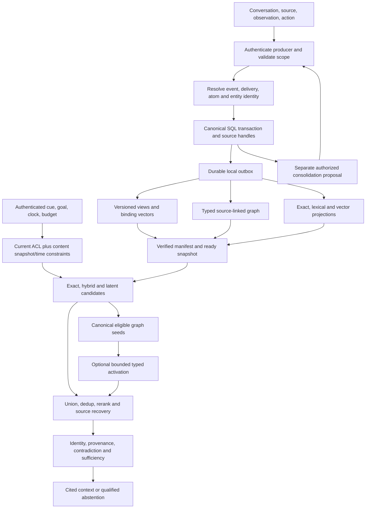

# Norn master development plan

Version 1.3, 21 October 2026 (Asia/Bangkok). Scope anchor: [Subcortical Memory Blueprint v1.0](../vision/subcortical_memory_blueprint.md). Baseline: clean `main` at `81badbd`, one checkout, only the vision tracked before this suite. **P01 canonical runtime/schema/tests are implemented and verified (E-P01-003).** P02 synthetic evaluator/harness is implemented and verified (E-P02-003). P03 conventional retrieval/models are verified locally (E-P03-003); external datasets and sealed efficacy results remain absent. The pre-runtime baseline is historical, not the current source state.

The user requested an extensive engineering MDP, not merely a phase list. This document therefore owns the proposed algorithms, data contracts, logical schema, read/write/recovery flows, module responsibilities, experimental decomposition, and atomic implementation cards. Supporting records own goals, decisions, proof, traceability, and current state. Do not split these technical contracts into competing subsystem specifications.

## Contents

- [Authority, execution, and proof](#execution-contract)
- [Scientific and engineering scope](#scope)
- [Reference reuse](#reference-reuse)
- [Architecture and module ownership](#architecture)
- [Typed contracts](#contracts)
- [Canonical schema](#canonical-schema)
- [Derived schema and manifests](#derived-schema)
- [Identity, time, and state machines](#identity-time)
- [Write, correction, and deletion flows](#write-flow)
- [Retrieval, verification, and abstention](#read-flow)
- [Functional views and shared binding](#binding)
- [Losses and pattern separation](#learning)
- [Graph activation and bounded completion](#graph-algorithms)
- [CDZ, salience, and consolidation](#optional-mechanisms)
- [Projection, consistency, and recovery](#operations)
- [Evaluation and statistical contracts](#evaluation)
- [Security, privacy, budgets, and observability](#security)
- [Worked end-to-end scenarios](#worked-scenarios)
- [Phase plan and exits](#phase-plan)
- [Atomic execution register](#atomic-register)
- [Full blueprint coverage](REQUIREMENTS_TRACEABILITY.md)

<a id="execution-contract"></a>

## Authority, execution, and proof

### Authority order and scope

Current user instructions and applicable AGENTS govern work. The blueprint owns intended research scope; live source, actual migrations, executed tests, and measurements own implemented behavior. This MDP translates intent and remains subordinate to both. Resolve a conflict explicitly: identify the source, affected contract/consumer, options, recommendation, and owner direction. An MDP sentence cannot silently amend the vision or a shipped contract.

[ADR_LOG](ADR_LOG.md) owns decisions. PROPOSED means unresolved, even when a recommended implementation is written in detail here. P01/P02 Python paths and executables are accepted under ADR-0002/0012/0014; P03 models/schema/workers are approved in ADR-0017/0018 and verified by E-P03-003. P04+ paths remain planned. The proposed design is reviewable now; it is not permission to install libraries, call providers, change foreign projects, expose endpoints, or execute real-data writes. Current scope includes the documentation suite, owner setup/instruction amendment and explicitly authorized publication (ADR-0010/0011). P01 GO and foundation decisions are approved in ADR-0012. P01 is complete; explicit P02 GO and partition clarification are recorded in ADR-0014/0015. P02 closes with E-P02-003. P03 GO is accepted in ADR-0017 and closes with E-P03-003. P04 GO is explicit in the current thread goal; ADR-0020 records accepted training/comparison/interface choices. P05+ and another main push retain their own authority.

### Owner setup and generative LLM policy

The owner created `.venv/` using uv, supplied a repository-root `.env` with a Groq API key and created `.gitignore`. The existing environment is CPython3.14.7 (uv0.13.1 metadata); reuse it without recreation. `.env`, `venv/` and `.venv/` are ignored. No key contents/variable name or provider validity were read or verified in the documentation task. P01 now supplies pyproject.toml and uv.lock under ADR-0012; existing environment is reused.

For any future **authorized task requiring generative LLM inference**, use **Groq**, selecting explicitly from **Qwen 3.8 27B**, **GPT OSS 120B**, **GPT OSS 20B**. Record the actual API model ID/provider in run manifests; verify identifiers and account availability before first authorized call. The options do not imply a default or silent fallback. This does not select embedding/reranker/training backbones or hardware. Root `.env` loads only for the specific explicitly enabled bounded command; never expose or commit secrets. An implemented generative path needs actual Groq-to-consumer proof, not only injected unit responses.

Use existing `.venv/Scripts/python.exe` for docs-only validation. Use `uv run --no-env-file` for ordinary execution. `uv sync` does not accept that flag and does not load .env. Approved P01 tools/tzdata may be installed; live inference/training remain disabled. The owner subsequently gave P01 GO and approved foundation decisions (ADR-0012); earlier publication authority does not authorize another main push. See root [AGENTS](../../AGENTS.md), ADR-0010/0011 and PROGRESS.

### Task reading protocol

1. Confirm checkout, branch, worktree, current diff, and recent commits. Preserve unrelated work. Read the current user request and applicable instructions.
2. Read GOAL, PROGRESS, PROJECT_MEMORY and the relevant readiness row. First onboarding reads the complete blueprint; subsequent work rereads the named source headings and I1–I10.
3. Read the parent phase, exact atomic card, direct/transitive dependencies, relevant ADR owner answers, risks, gate obligations and traceability. A planned source path must be verified to exist before its consumer is built.
4. Inspect actual producer and reader bodies, schema/migrations, tests, configuration, and external state. Comments and signatures alone do not establish a contract.
5. State the unit, expected behavior and proof before editing. Record material choices immediately in ADR_LOG. Questions requiring owner direction block only dependent work; continue independent authorized work.
6. Implement one coherent slice, with positive and negative controls. Prove committed data reaches the real consumer after reopen/restart. Do not replace integration proof with helper-only checks.
7. Run stack checks, owning gates, and an actual entry-point smoke. Record exact command, environment, source/artifact versions, exit, observations and limitations. Failed/skipped checks are not PASS.
8. Resolve the sole end review; update task state, derived progress/readiness, evidence, memory/map/learning and affected documents. Stop only task-owned processes and verify their ports are free. Review staged scope/secrets before a Conventional Commit with a descriptive body. Main/shared/first-branch pushes, PRs, history changes and destructive operations retain explicit approval gates.

### Reviews and closure

Use one start adversary and one end reviewer for substantial phases, GPT 6 Luna Medium, per the standing user rules. The main agent owns exploration, implementation, tests, intermediate checks and integration. Give reviewers self-contained scope, full blueprint, changed contracts, source/proof paths, and read-only restrictions; no credentials, runtime resource access, writes, git mutations, or extra agents. Reuse the end reviewer for resolution. Review does not replace tests or measurements.

Task states: PLANNED, IN_PROGRESS, BLOCKED, DONE, DEFERRED. A checked atomic card means DONE with evidence; DEFERRED is unchecked with owner/reason/destination. Gate states: NOT_RUN, PARTIAL, PASS, FAIL, BLOCKED. Algorithm outcomes: NOT_EVALUATED, RETAIN, REJECT, INCONCLUSIVE, UNSUPPORTED. These are three independent axes. A valid negative experiment can complete a task while its efficacy remains REJECT or INCONCLUSIVE; it never becomes an efficacy PASS by renaming the metric.

Phase-local obligations may pass while a cross-phase gate remains PARTIAL. Close a phase only when its tasks, own exit checks, evidence, review and cleanup are satisfied, or explicitly record an authorized negative-result exit. Downstream mechanisms requiring demonstrated incremental benefit do not automatically unlock after a rejection. Continue with the simpler winner where its prerequisites suffice; an additional exploratory study needs a distinct recorded question and budget.

<a id="scope"></a>

## Scientific and engineering scope

### Research claims

P1: complementary functional views and possibly shared query–memory binding improve evidence retrieval under interference at matched resources. P2: evidence-grounded, bounded graph activation recovers missing links without false associations. P3: constrained episodic/semantic consolidation improves long-term updates and abstraction without rewriting history. P4: sparse separation, biological salience proxies, and reconstruction provide incremental value only if individually demonstrated.

Norn is proposed as an agent-consumable memory engine plus a separate evaluator. It is not a literal brain simulation. A hippocampal/contextual operator, semantic operator, action/outcome operator and salience operator are functions over one canonical event, not mutually exclusive semantic buckets or mandatory microservices. Brain-region/neuron counts do not dictate dimensions. HNSW is not an attractor, cross-attention is not alignment training, PPR is not novel by itself, and a decoder cannot regenerate canonical truth.

### Scope boundaries

Included: source-backed events/atoms/edges, contextual/semantic/action/salience views, deterministic eligibility, learned binding experiments, separation/completion controls, CDZ/salience/consolidation ablations, bitemporal recall, source-linked partial answers/abstention, synthetic hidden-world evaluation, external memory benchmark adaptation, compression, replayable projections, faults and privacy research.

Excluded from initial runtime: UI, payment-support policy engine, privileged agent actions, biological diagnosis, autonomous write-back from recalled text, model-selected expiry, default cloud calls, online training on private data, production SLAs or a distributed deployment mandate. Optional denoising/flow, recurrent completion, generated summaries and slow learned updates remain visible experiments, not silently dropped or default-on features.

### Scientific invariants

| ID | Contract | First enforcement / later consumer |
|---|---|---|
| I1 | Immutable evidence; corrections append explicit records | P01 canonical write / P03 recall and P08 consolidation |
| I2 | Similarity, salience and activation never create authority | P01 epistemic types / P03 gate and P06 paths |
| I3 | Stable event, atom, edge, projection and source-span identity | P01 IDs / every index and evaluator |
| I4 | Read/derive cannot silently revise assertions | P03 recall / P09 interaction and P11 replay |
| I5 | Every derived artifact rebuildable with lineage/manifests | P03 local projection / P11 external reconstruction |
| I6 | Tenant/ACL before ranking and traversal; current recheck | P01 policy / P03 search and P06 graph |
| I7 | Explicit content snapshot and truthful freshness | P03 snapshot reader / P11 multi-store watermark |
| I8 | Global work, graph, time, retry and token bounds | P01 budgets / P06 diffusion and P11 queues |
| I9 | Measure false answer and false abstention | P02 scorer / P03 gate and P13 locked study |
| I10 | Added complexity needs ablation and resource evidence | P02 manifests / each mechanism decision |

<a id="reference-reuse"></a>

## Reference reuse

Reference repositories are read-only research inputs. Inspect source commits, licenses, current callers, tests, dependencies and adaptation cost before porting; record original path, digest/commit, copied/adapted symbols, changed assumptions, license and Norn consumer proof. No external checkout import or hidden runtime dependency is allowed. A clean-room implementation may be simpler than extracting a tightly coupled module. ADR-0006 owns the decision.

| Candidate in Palladion | Useful mechanism | Norn adaptation / rejection boundary | Owner |
|---|---|---|---|
| `storage/originals.py`, `core/ids.py` | Hash-checked immutable bytes and scoped stable references | Delivery/event identity must distinguish identical text in different occurrences | P01 |
| `retrieval/evidence.py`, `security/access.py` | Canonical permission, time, hash and original-span rechecks | Document approval is not the same as origin/authenticity of a user report or observation | P01/P03 |
| `storage/catalog.py`, `ingest/pipeline.py` | Stage, exact readback, required-backend manifests, publish | Per-document generations do not implement global memory snapshots/outbox delivery | P03/P11 |
| `retrieval/hybrid.py` and benchmark adapters | BM25/dense/exact union, RRF, rerank controls | Normalize event/atom/source evidence units, pin actual budgets/models | P03 |
| `memory/packet.py` | Bounded context, gaps, prior attempts, rechecked handles | A packet is an agent-facing projection, not the canonical memory or learned representation | P09 |
| `memory/store.py`, `classification.py`, `promotion.py` | Scoped context and auditable promotion examples | Do not inherit session-only episodes, preference-only semantic promotion, or category classification as multi-view binding | P01/P08/P09 review only |
| Benchmark runner/manifests/scorers/statistics | Paired trials, evidence-set completeness, failure accounting | Existing fixtures/GoldRecord contain payment-domain assumptions; isolate evaluator package | P02/P13 |
| Main agent, critic, policy engine, mock payment gateway | Possible later consuming system | Not required inside Norn; integration uses an approved adapter and existing foreign contracts | P09 optional consumer |

Palladion's small graph pilot retained graph-disabled defaults after no incremental exception recovery. This is a scoped negative result, not a diffusion result or superiority claim. Arcana's old `docs/development/DEVELOPMENT_PLAN.md` is explicitly partly superseded: use its detailed architecture/contracts/flows/task style only. Its old sidecars, ports, Redis lifecycle, product claims and historical completion states have no Norn authority.

<a id="architecture"></a>

## Architecture and module ownership

The tree separates implemented P01–P03 owners and planned P04+ research owners. MDP card states and evidence establish the actual boundary under ADR-0002/0017. Do not scaffold empty files merely to match the map. Create a file only with its producer/consumer slice. Package imports flow toward contracts/canonical/governance, never from those owners into an agent, provider, or hidden evaluator.

```text
src/norn/
  contracts/      # typed identities, time, evidence, requests, budgets, manifests
  canonical/      # source bytes, registry, atomic event writes, outbox, snapshots
  governance/     # authentication context, ACL, authority, time, sufficiency, deletion
  extraction/     # constrained source-to-atom parsing and uncertainty
  features/       # contextual, semantic, action/outcome, salience views
  embedding/      # baseline adapters, binding encoders, losses, versioned checkpoints
  graph/          # typed adjacency, seeds, BFS/path/PPR/heat/recurrent experiments
  retrieval/      # exact/lexical/dense, fusion/rerank, eligibility and source recovery
  consolidation/  # duplicate grouping, aggregate proposals, review and invalidation
  projection/     # local replay then external delivery, leases, manifests, rebuilds
  integration/    # engine facade and bounded agent context adapters
  telemetry/      # redacted spans, counters, failure/cost accounting
  cli.py          # proposed local synthetic fixture/recall/replay entry points
benchmark/
  fixtures/       # hidden world and publication boundary; evaluator-only
  adapters/       # common-input/native comparison adapters
  metrics/        # normalized IDs, sets, retrieval/answer/association/abstention
  statistics/     # paired family-cluster estimates and calibration
  runs/           # sealed manifests, failures, replay validation; no committed bulk runs
  failure_injection/ # disposable isolated resources only
tests/            # unit, integration, security, recovery, installed consumer proof
docs/development/ # this suite, decision/evidence receipts and report navigation
```

### Proposed control/data flow



### Ownership contracts

| Owner | Inputs / output | Must not own | Failure and consumer proof |
|---|---|---|---|
| contracts | validated typed request/reference/value records | provider calls or mutable global policy | unknown schema/tag rejected at CLI/facade |
| canonical | authenticated writes → durable receipt and append-only objects | relevance ranking | reopen registry and exact source readback |
| governance | principal, snapshot, source, time → eligibility/status | model-invented approval or causal inference | positive and denied canaries, TOCTOU recheck |
| extraction | exact source bytes → attributed atoms/edges or unresolved candidates | setting authority/permission | offsets/hash/uncertainty survive registry read |
| features/binding | eligible immutable content → versioned derived views | factual text regeneration | model/facet fingerprints and source hashes match |
| graph | allowed typed adjacency + grounded seeds → candidates/path diagnostics | claim truth | each edge/node re-resolves; unauthorized nodes cannot be intermediates |
| retrieval | cue/constraints → bounded candidate union | source mutation or confidence fabrication | exact/hybrid/latent sources read through resolver |
| consolidation | compatible independent supports → proposed abstraction | automatic normative authority | raw exceptions still addressable; revoke invalidates aggregate |
| projection | committed log/outbox → idempotent manifests/readiness | canonical truth or ACL decisions | crash/replay/partial-ready/rebuild tests |
| integration | host principal/request → context/result | external auth impersonation | next authorized agent turn consumes exact result |
| benchmark | published inputs + hidden evaluator truth → scores | writing labels into arm-visible storage | leakage barriers, perfect/empty/shuffled controls |

<a id="contracts"></a>

## Typed contracts

These are the complete **logical design contracts**. P01 implements the local canonical subset described below; later retrieval/research contracts remain proposals. Actual physical column types and migrations live in src/norn/canonical and preserve accepted P01 semantics. Never equate UNKNOWN, empty, missing, denied, expired, unindexed and nonexistent. All public IDs are opaque within an authenticated namespace. All strings, arrays, blobs and recursive structures have configurable validated bounds before work begins.

### Implemented P01 physical profile

The accepted synthetic pilot uses `src/norn/`, standard-library runtime owners plus tzdata, Hatchling1.32.4 and uv.lock. Namespace is a validated tenant/workspace/partition triple serialized without separators inside components; every object FK includes its exact namespace key. Schema1 contains normalized evidence, identity, access, correction, journal and denial tables; additive schema2 introduces derivation lineage. Both are authored initial profiles, not a claim of a previously deployed legacy release. Opening an older populated profile takes and verifies a uniquely named backup first; a dirty migration is refused until operator recovery. Canonical UPDATE/DELETE and replacement are guarded; schema catalog, versions and migration digests are checked on open.

The trusted embedding host constructs HostIdentity. The CLI is a local OS/filesystem-trusted operator, not a remote authenticator; principal options are host configuration, never accepted from write JSON. Namespace-wide READ/WRITE/ADMIN grants are current and epoch-versioned. Explicit targeted corrections bind to the target entity after access/alias checks; SUPERSEDES requires ADMIN; contradiction/additional evidence cannot silently choose a winner. Purpose-specific authority tables reserve the normalized contract; P01 never promotes a fixture/source to normative approval. That gate belongs to P03.

Sources are UTF-8 content-addressed bytes published before the SQL write. Every atom references a governed entity via a real namespace FK. Provisional entity identity additionally includes the occurrence's atom ID, so shared identical bytes do not prove identical people. Fixture annotations carry exact spans, typed values and uncertainty; they are not arbitrary-language semantic extraction. Canonical read SUPPORT means eligible anchored fixture evidence, not established real-world truth or measured entailment. Inference/hypothesis/aggregate alone cannot produce that outcome. Seven external epistemic values survive export, including unknown-origin retractions quarantined as UNRESOLVED.

All source/event/atom/support/delivery/relationship/journal writes for ingestion/correction share one transaction. Journal pages have explicit cursors, digests and read-only replay; INDEX_PENDING remains unsearchable. Source bytes may be orphaned after a failed transaction, but never acknowledged without a canonical reference; automatic physical garbage collection is not implemented. Current denial closes source/entity/contained-event/atom/edge/derived dependencies, with actual blob digest purge selectors; shared bytes remain pending reference/retention reconciliation; purge selectors remain PENDING for SQL/blobs/representations/traces/backups. P01 does not claim full erasure, old-backup reconciliation, external publication, ANN/graph/search or power-loss proof; P03/P11/P12 own those consumers.

Finite pilot limits are safety bounds, not performance targets: source1MiB, request2MiB, atoms64, qualifiers16, per-atom controls/relations256, supports64, total returned citation bytes1MiB, journal page1000, lineage10,000 unique objects/100,000 pending transitions, SQLite busy timeout5s and backup progress deadline5s. Exceeding a bound is an explicit error. The P01/default asset-free path loads no provider/model/backbone. P03 explicit model paths are separate. Full validation and installed scenario commands are in the README and evidence log.

### Primitive and temporal types

| Type | Proposed representation | Validation / semantics |
|---|---|---|
| NamespaceKey | tenant_id + workspace_id + partition_id | supplied by authenticated host; no inferred tenant from text |
| ObjectId | opaque stable ID + object kind + namespace | unique composite identity, not display-name equality |
| Digest | algorithm + lowercase digest | hash exact canonical bytes, explicit serialization version |
| Instant | UTC-aware timestamp plus source_timezone and precision | preserve original offset/zone; reject naive time as exact |
| TimeValue | EXACT instant / INTERVAL start,end / UNKNOWN reason | open bounds explicit; no fabricated noon/date ordering |
| SourceLocator | source_version_id + start_byte,end_byte + span_digest | UTF-8 half-open span or authenticated structured observation locator |
| TaggedValue | TEXT/INTEGER/DECIMAL/BOOLEAN/TIME/ENTITY_REF/JSON_NULL | no float coercion for exact amounts; qualifiers use a declared schema |
| EpistemicOrigin | DIRECT_OBSERVATION/USER_REPORTED/DOCUMENT_ASSERTION/MODEL_INFERENCE/HYPOTHESIS/DERIVED_AGGREGATE | preserve source of assertion; RETRACTED compatibility handled in ADR-0003 |
| AssertionStatus | ACTIVE/RETRACTED/UNRESOLVED with reason event | independent from origin, lifecycle and applicability; pending ADR-0003 |
| SnapshotRef | namespace + commit_seq + manifest digest + required projection versions | commit_seq ordered only within declared partition; cross-partition vector explicit |
| AuthorizationContext | authenticated principal_id + tenant + current grants + security_epoch | server constructed; never accepted from recalled text |

### Public operation records

| Contract | Required fields | Output/behavior |
|---|---|---|
| WriteRequest | request_id, namespace, producer identity, delivery_id, occurrence_key or unresolved occurrence, source descriptor, content digest/bytes handle, event_time, observed_at, schema_version | authenticated producer; idempotency compares payload digest; same delivery/different bytes is conflict |
| WriteReceipt | event_id, atom_ids, relation_ids, commit_seq, source handles, projection states, durable_at | COMMITTED does not mean searchable; no false READY acknowledgment |
| RecallRequest | query_id, cue_text, trusted principal/namespace, evaluation_time, query_timezone, temporal_basis, event/valid/knowledge bounds, task_goal, requested/minimum_snapshot, required capabilities, budget | exact time/entity filters parsed with ambiguity; server narrows requested edge types |
| RecallBudget | max_candidates, max_evidence_tokens, max_graph_seeds/nodes/edges/hops/iterations, deadline, max_encoder_calls, max_retries | global per-query accounting; invalid/negative/nonfinite/unbounded values rejected |
| EvidenceCandidate | event_id, atom_ids, source locators, channel, raw ranking feature, model/index revision, snapshot, optional path edge IDs | score is a ranking signal; no truth probability; source recovery required |
| EvidenceResult | query_id, effective snapshot, current security epoch, evidence status, cited atoms/spans, ambiguity/conflicts, missing prerequisites, coverage/degradation, budget usage | current authorization recheck before serialization; no denied-source existence leak |
| CorrectionRequest | target atom/event reference, new source-backed assertion, scope, correction class, authorized actor/reason | append new assertion and explicit SUPERSEDES/CONTRADICTS relation; new occurrence is separate |
| DeletionRequest | authorized subject/scope, object/source selector, policy/version, reason, request_id | immediate serving denial then per-artifact purge workflow; complete only with declared acknowledgments |
| ConsolidationProposal | candidate_id, support atom IDs, independence groups, aggregation window, method/checkpoint, proposed text/typed aggregate, exceptions, approval state | derived hypothesis until reviewed/gated; no automatic source/authority rewrite |
| FeedbackEvent | query_id, accessed record IDs, usage/cost, attributed feedback, recording time | separate analytics permission and retention; cannot update source fields |

### Error and capability envelope

Every operation returns an explicit typed error/status envelope with correlation ID, safe reason code, retryability, stage, consumed budget and partial-result validity. Validation/permission errors are not transient infrastructure faults. Source corruption is integrity failure, not a no-result. Disabled/unsupported optional algorithms return FEATURE_NOT_SUPPORTED; outages return UNAVAILABLE/DEGRADED according to the question's required capabilities. Deadline/cancellation never returns an unmarked complete result. Do not leak raw source bodies, private identifiers, provider messages containing credentials, or hidden labels in error text.

Recall result statuses are answer-level SUPPORTED, PARTIALLY_SUPPORTED, CONFLICT, NOT_ESTABLISHED, VERIFICATION_UNAVAILABLE. Infrastructure coverage is separate: CONSISTENT_READY, CANONICAL_FALLBACK, DEGRADED, UNAVAILABLE. A degraded search can still support a narrow exact fact; it cannot establish exhaustive absence when a required channel is missing.

<a id="canonical-schema"></a>

## Canonical schema

### Canonical relations and field-level obligations

Logical obligations govern the design; approved P01 persistence mechanics are recorded in ADR-0012 and implemented in the canonical SQL migrations. Later projection/operational fields retain their later owning tasks. All foreign keys include namespace. Creation/recording actors come from the authenticated host. Canonical assertion content is immutable except physical purge under an approved erasure policy; changes to authority, permissions, status and lifecycle are auditable separate control records. No on-disk store is authoritative merely because it contains a JSON `approved=true` field.

| Table | Key and required fields | Constraints / reader |
|---|---|---|
| namespaces | tenant_id, workspace_id, partition_id, schema_version | partition ordering contract; canonical authorization scope |
| principals | principal_id, tenant_id, external_auth_subject, status | trusted identity provisioning, not model text |
| scope_grants | grant_id, principal_id, scope_id, operation, valid interval, revoked_at, security_epoch | current security read; content snapshots cannot revive revoked grants |
| sources | source_id, namespace, source_kind, producer_id, authority_class, retention_policy_id | origin and purpose-specific trust, not global truth |
| source_versions | version_id, source_id, raw_digest, byte_length, media_type, content_uri, created_by, recorded_at, schema_version | write-once content address; blob and SQL publish protocol prevents dangling acknowledged source |
| source_spans | span_id, version_id, start_byte, end_byte, span_digest, encoding, observation_locator | source-local bounds/hash, exact bytes or typed observation readback |
| authority_events | authority_event_id, source/version selector, purpose/scope, status, actor_id, effective interval, recorded_seq, reason | external approval/authentication; cannot be manufactured by extraction |
| entities | entity_id, namespace, kind, verified_external_key or provisional_span_id | unique governed identity; same-name entities remain separate |
| entity_aliases | alias_id, entity_id, label, language, source_span_id, valid interval | display/search only; no equality proof |
| identity_events | identity_event_id, left/right entity IDs, decision, supporting spans, reviewer, recorded_seq | reviewed SAME_AS/non-equivalence with reversible projection; preserve original IDs |
| events | event_id, namespace, producer_id, occurrence_key, source_version_id, event_time kind/value, observed_at, recorded_at, commit_seq, schema_version | distinct occurrence identity even equal content; no similarity dedup |
| deliveries | namespace, producer_id, delivery_id, payload_digest, event_id, received_at | unique delivery key; digest mismatch rejects retry, same digest returns same event |
| atoms | atom_id, event_id, subject_ref, predicate, object_type/object_value, qualifier_schema/version, epistemic_origin, source_span_id, extraction_revision, commit_seq | schema-valid tagged object; no missing source or invented entity; historical assertions retained |
| atom_support | support_id, atom_id, source_span_id, support_kind, independence_group, producer_revision | many sources per assertion; copied reports share dependence lineage |
| assertion_events | assertion_event_id, atom_id, status, valid interval, recorded_seq, actor_id, reason/source | origin/status separation subject to ADR-0003; no read-time overwrite |
| relationships | edge_id, namespace, from_kind/id, to_kind/id, relation_type, epistemic/status, valid interval, producer_revision, commit_seq | typed endpoints; no HYPOTHESIZES_CAUSE→VERIFIED_CAUSE coercion |
| edge_support | edge_id, atom_id/source_span_id, support_kind, derivation_revision | every path edge is auditable, including inferred transformations |
| corrections | correction_id, prior_atom_id, new_atom_id, correction_class, applicability_scope, valid interval, recorded_seq, actor_id | acyclic scoped supersession; repeated delivery distinct from correction/new episode |
| derivations | derivation_id, output_kind/id, algorithm/model_revision, config_digest, created_at, validation_state | lineage for projections, aggregates and model-produced claims |
| derivation_inputs | derivation_id, input_kind/id, source_digest, independence_group | dependency index supports invalidation and audit; no provenance flattening |
| outbox | outbox_id, namespace, commit_seq, object IDs, operation, payload_digest, schema_version | inserted atomically with source/event/atom state; no acknowledged commit without durable journal |
| deletion_requests | request_id, subject/scope selector, policy_id/version, requested_by, requested_at, serving_denied_seq | request audit and eligibility control; policy may require audit metadata minimization |
| tombstones | object_kind/id, namespace, deletion_request_id, effective_seq, reason | deny reads/traversal immediately; not physical-erasure proof |
| retention_policies | policy_id/version, data classes, eligibility/expiry rules, trace/backup/parameter obligations | owner-defined; model cannot invent expiry |
| schema_migrations | migration_id, version, digest, applied_at, backup_ref | additive upgrade with populated-store proof and restore path |

### Transaction design sketch

```sql
-- Illustrative relational constraints, not a runnable migration.
UNIQUE(deliveries.tenant_id, deliveries.workspace_id, deliveries.producer_id, deliveries.delivery_id)
UNIQUE(events.tenant_id, events.workspace_id, events.producer_id, events.occurrence_key)
CHECK(source_spans.start_byte >= 0 AND source_spans.end_byte > source_spans.start_byte)
CHECK(atoms.object_type IN ('TEXT','INTEGER','DECIMAL','BOOLEAN','TIME','ENTITY_REF','JSON_NULL'))
FOREIGN KEY(atom_support.namespace, atom_support.atom_id) REFERENCES atoms(namespace, atom_id)
FOREIGN KEY(edge_support.namespace, edge_support.edge_id) REFERENCES relationships(namespace, edge_id)
UNIQUE(outbox.namespace, outbox.commit_seq, outbox.object_id, outbox.operation)
```

SQLite cannot directly execute the pseudo-qualified constraints above; P01 writes actual migrations and tests fresh/populated stores. Multiple atoms may share a transaction sequence; one transaction is the unit of ordered publication. Allocate sequence within that transaction; define rollback behavior and gaps explicitly. IDs must not depend on a sequence that changes on idempotent replay. Time interval checks use normalized aware instants and known precision, not lexical timestamp comparison.

Source bytes are published write-once and verified before SQL acknowledges their handle. A crash may leave an unreferenced blob, never an acknowledged source whose bytes cannot be read. Garbage collection requires a reference/retention audit and authorization; it is not an implicit ingestion cleanup. Hashes identify bytes, not occurrence, truth, authenticity or permission.

### Approval and epistemic origin

An authenticated tool observation can support DIRECT_OBSERVATION only for the tool's declared fields, target, time, and identity. A user statement remains attributed USER_REPORTED. An approved document proves its attributable contents under the approval's purpose, not arbitrary real-world truth. Model extraction and aggregation retain derivation identity; generated text cannot authorize itself. Retraction is orthogonal to the original provenance, pending ADR-0003's explicit resolution.

<a id="derived-schema"></a>

## Derived schema and manifests

Derived storage can mutate/rebuild operational rows, but every output points to the canonical source and transformation version. An index is a representation, replication is another copy of a logical dataset, and sharding partitions that dataset. A SQL row, graph edge and vector are not interchangeable replicas.

| Relation / artifact | Required fields | Readiness / invalidation |
|---|---|---|
| feature_views | view_id, event_id, facet_type, values/vector_ref, applicability, source_digest, algorithm_revision, config_digest | NOT_APPLICABLE for missing action/salience input; no fabricated zero-feature truth |
| embedding_models | model_revision, checkpoint_digest, tokenizer_digest, dimensions, normalization, query/document method, license | immutable fingerprints; mixed spaces rejected |
| projections | projection_id, event/atom IDs, kind, source_digest, model_revision, projection_version, state | PENDING/READY/DEGRADED/REVOKED independent per representation |
| graph_nodes/edges | typed canonical refs, allowed edge types, weight policy/version, provenance refs, snapshot | eligibility before subgraph construction and normalization |
| index_manifests | index_id, version, namespace, source_commit_watermark, expected IDs/count/digest, actual readback digest, model/config revision | exact reconciliation before acknowledgment; no count-only parity |
| serving_snapshots | snapshot_id, namespace, commit_seq/vector, required capability set, per-index manifest digests, state, published_at | atomic pointer switch only after every required representation acknowledges compatible content |
| projection_delivery | outbox_id, target projection/version, state, attempts, next_attempt_at, lease_owner/expiry, fence, last_error | external workers P11; idempotency and fencing prevent stale acknowledgments |
| cache_entries | key digest, principal/scope digest, content snapshot, security_epoch, projection/model version, expires_at | cache cannot authorize; canonical recheck and tombstone invalidation |
| consolidation_candidates | proposal_id, support refs, dependence groups, method/version, exceptions, validation/review state | no serving as validated abstraction before gate; support revoke invalidates |
| purge_receipts | deletion_request_id, artifact/backend generation, object selector, action, verification digest, completed_at | separate logical denial and physical purge, including backups/restore |
| run_manifests | run_id, code/config/model/data/gold hashes, arm, seed, hardware, budgets, clock, split, execution/price snapshot | hidden gold digests evaluator-only; arm receives published subset only |
| query_traces | query_id, pseudonymous scope, snapshot, stages, counts/cost, truncation/degradation, status | private content omitted by default; trace retention/deletion lineage |
| training_lineage | checkpoint_id, permitted data manifest, support-source IDs/dependence groups, consent/policy version | no unsupported claim of parameter erasure after source purge |

### Integrity reader obligations

Verify expected **IDs and digests**, model/tokenizer/normalization, source state, scope, and required projection versions. Count equality does not prove representation equality. The canonical resolver checks source hash and locator bytes rather than accepting vector/graph payload text. Rebuild from canonical evidence and recorded transformations; restore must replay tombstones before serving. A graph can be unavailable without preventing an exact eligible source read, but the result declares omitted association coverage.

<a id="identity-time"></a>

## Identity, time, and state machines

### Identity decision table

| Input | Decision | Durable effect / counterexample |
|---|---|---|
| Same producer/delivery key and payload digest | duplicate delivery | return prior receipt; no new event/atom/outbox multiplicity |
| Same delivery key, different digest | idempotency conflict | reject and audit; never silently overwrite |
| Same words, different occurrence/time/location | new occurrence | new event; high cosine does not suppress it |
| Additional source for the same established occurrence | additional evidence | link support; retain each source/dependence lineage |
| Correction of a prior assertion | correction | new assertion plus scoped supersession; original still historically addressable where authorized |
| Incompatible statements without deciding authority | contradiction | preserve both; return conflict when material and unresolved |
| Same-name entities without external key proof | unresolved identity | separate provisional IDs and possible-link candidate |
| Reviewed equivalent external keys | identity decision | append SAME_AS decision and rebuild projection; do not rewrite original source IDs |

### Temporal interpretation

Temporal basis is explicit: EVENT_TIME asks what happened; KNOWLEDGE_AT asks what was recorded by the cutoff; VALID_TIME asks which assertion applies; policy-specific basis belongs to an externally declared domain rule. A late-arriving correction can change today's account of Tuesday while remaining unknown in a knowledge-at-Tuesday replay. Query timezone resolves relative words using evaluation_time, never ingestion time or machine wall time. Ambiguous date, incomplete offset, DST fold, interval overlap and unknown time produce typed ambiguity, not a guessed single episode.

Store original precision/zone plus normalized comparable bounds. valid_to is exclusive in the proposal; ADR-0005 confirms this for P01. Unknown is distinct from unbounded. No blanket latest-wins rule: a supersession must match assertion, authority, scope, and applicable period. Historical content reads always enforce current security/erasure restrictions.

### Independent state axes

```text
Infrastructure: RECEIVED -> VALIDATED -> COMMITTED -> INDEX_PENDING -> READY
Exceptions: VALIDATION_REJECTED, INDEX_DEGRADED, REINDEX_PENDING, REVOKED, TOMBSTONED
Epistemic origin: observation / user report / document assertion / inference / hypothesis / aggregate
Assertion status: active / unresolved / retracted (ADR-0003; preserve RETRACTED external value)
Query applicability: CURRENT / HISTORICAL / SUPERSEDED / FUTURE / EXPIRED / UNKNOWN / CONFLICT
Answer outcome: SUPPORTED / PARTIALLY_SUPPORTED / CONFLICT / NOT_ESTABLISHED / VERIFICATION_UNAVAILABLE
```

READY does not imply verified, current, approved or permitted. Lifecycle changes and access counters do not mutate factual content. Corrections and retractions are new records; read results may compute effective applicability at the chosen clock without storing it as universal truth.

<a id="write-flow"></a>

## Write, correction, and deletion flows

### Ingestion algorithm

```text
ingest(request, host_auth):
  validate_schema_sizes_and_producer(host_auth, request)
  resolve_namespace_from_host_and_authorize_write()
  verify_source_bytes_or_authenticated_observation()
  decide_delivery_occurrence_correction_and_uncertainty()
  derive_source_anchored_atom_and_edge_candidates_without_authority_promotion()
  transaction:
    recheck_write_permission_and_idempotency_key()
    allocate_partition_commit_sequence()
    persist_event_atoms_support_controls_and_outbox()
  return_durable_receipt_with_pending_projection_states()
  local_or_later_external_projector_consumes_committed_outbox()
  publish_ready_snapshot_only_after_required_exact_readbacks()
```

Duplicate checking must occur again inside the transaction to handle concurrent retries. Do not hold a write transaction across provider calls or long embedding computation. If extraction is unavailable, preserve original source/event and unresolved extraction state; do not invent definitive atoms or falsely advertise an atom-dependent capability READY. An outbox entry identifies exactly which canonical version the projector may read. Source/ACL revocation is checked before and after derivation and before serving.

### Correction and contradiction flow

Authenticated correction → exact target/source lookup → classify correction vs new occurrence → append new source/assertion/control edge atomically → invalidate dependent projections/aggregates by lineage → idempotent reproject → new ready snapshot → query reads applicable version under chosen event/valid/knowledge clock. Historical originals remain permitted only according to current retention/access. A correction to Zone A is not an event in Zone B the next day. Competing authorities remain conflict until an explicit applicable resolution exists.

### Deletion and revocation flow

Authorize request and retention policy → append serving-denial/tombstone + invalidation journal atomically → current ACL/tombstone gate blocks exact, lexical, latent, graph intermediate, cache and context reads → enumerate downstream lineage → purge representations, summaries, permitted traces and affected backups under policy → verify per-backend acknowledgments → declare only the achieved erasure scope. An unavailable graph/index leaves purge incomplete while serving denial stays effective. A backup restore must reapply deletion state before accepting reads. Learned parameter deletion remains an explicit limitation unless approved retraining/unlearning proof exists. ADR-0004 owns irreversible retention choices.

### Replay and write proof

Minimum consumer proof: write Monday and Tuesday near-identical events; repeat Tuesday delivery; reopen registry; recall Tuesday through source locator; apply a correction; read current and knowledge-at-earlier snapshots; revoke source during a query; observe immediate denial and no forbidden path/counter leak. Inject crash between durable commit and projection, replay once and repeatedly, and prove stable IDs plus exact manifests. No provider is needed for these deterministic fixtures.

<a id="read-flow"></a>

## Retrieval, verification, and abstention

### Proposed recall algorithm

```text
recall(request, host_auth):
  authorize_host_principal_namespace_and_budget()
  resolve_content_snapshot_and_current_security_epoch()
  interpret_explicit_entity_time_goal_constraints_or_report_ambiguity()
  eligible = canonical_scope_time_source_and_erasure_policy()
  candidates = union(exact, lexical, dense, optional_shared_binding)
  seeds = recover_and_verify_source_anchors(candidates, eligible)
  if enabled_and_ready: candidates += bounded_graph_completion(seeds, eligible)
  candidates = dedup_by_canonical_identity_and_rerank_under_global_budget()
  evidence = reload_exact_source_spans_and_provenance(candidates)
  evidence = check_identity_time_contradiction_and_required_support(evidence)
  status = evidence_sufficiency_and_capability_gate(evidence)
  reauthorize_current_scope_sources_and_tombstones_before_return()
  append_separate_redacted_usage_event_if_allowed()
  return_cited_context_with_snapshot_status_coverage_and_missing_inputs()
```

Hard eligibility applies before search/rank windows and before graph construction; a denied candidate must neither starve allowed results nor become an intermediary. Push supported filters into the index and validate the eligible corpus for indexes that cannot enforce them; a post-filter-only design needs an explicit safe alternative, not an ACL exception. Final canonical rechecks address concurrent changes. Do not search a global private embedding corpus then expose ranks/counts before filtering.

### Conventional baseline details

R0 exact-key/lexical uses original identifiers and BM25/FTS semantics declared in the manifest. R1 dense uses pinned document and query methods, dimension, normalization and metric. Exact exhaustive nearest neighbors on a tractable subset diagnose representation quality; ANN recall is a separate measurement. R2 RRF computes `sum_channel 1/(k + rank)` with one vote per canonical candidate per channel, explicit tie handling and development-fixed k. R3 applies the same fixed reranker to a declared candidate depth and final evidence budget; do not give the candidate arm a stronger generator or extra hidden context.

Union includes exact identity/time matches without treating their presence as proof of semantic support. Dedup merges repeated representations of one atom/event without collapsing distinct occurrences or removing independent support sources. Candidate K, final K, distinct events/atoms, and evidence token budget are separate. Preserve required exceptions rather than filling the packet with redundant passages. Score each stage if observed; never label a final four-item packet as retrieval@20.

### Baseline scoring and token-bound assembly contracts

For a declared BM25 variant, a conventional term contribution is `IDF(t) * f(t,d)*(k1+1)/(f(t,d)+k1*(1-b+b*len(d)/avg_len))`. IDF convention, document unit, stopword/stemming/tokenization, k1/b, language handling and index snapshot must be pinned rather than assuming two libraries implement the same lexical score. Exact-key lookup is separate from BM25 ranking. Cosine uses compatible finite nonzero normalized vectors; exhaustive dot products on the same eligible set are the dense oracle.

Assembly first canonicalizes IDs and support alternatives, then selects evidence under the **actual** tokenizer and a declared deterministic ordering/slot reservation policy. Count headers, locators and status context if they enter the generator budget, not text alone. An oversized source unit is either returned through a validated smaller exact span with preserved locator or explicitly omitted; do not silently truncate a quotation and keep its old hash. Record candidates before/after dedup/rerank/assembly and omitted-required-support reason. The evaluator scores source-normalized final exposure separately from upstream retrieval so a packing error does not look like an encoder error.

### Sufficiency and uncertainty

The runtime may receive a user question's explicit requested fields and a declared domain schema. **Evaluator gold required slots are never a runtime input.** Runtime slot inference is either deterministic schema interpretation or a separately evaluated model proposal. Gate verifies source eligibility, attribution, applicability, contradictions, supported fields and missing prerequisites. It is not a universal natural-language entailment theorem prover. Unsupported semantic adjudication remains unknown or explicitly labeled in the study.

SUPPORTED: every material scoped claim supported. PARTIALLY_SUPPORTED: supported fields plus explicit unknowns. CONFLICT: unresolved material contradictory applicable sources. NOT_ESTABLISHED: insufficient support in the supplied eligible snapshot with adequate required capability coverage. VERIFICATION_UNAVAILABLE: required verification cannot finish because of stale/missing/unavailable capability, observation or access. Externally disclose only permitted missing-reason detail; an internal UNAUTHORIZED_SOURCE classification must not reveal forbidden existence.

An ambiguous cue matching two legitimate events returns candidates/clarification, not forced certainty. An empty result is scoped absence, not proof that no fact ever existed. Calibration, if introduced, predicts correctness/support of all material claims on a separate split; cosine/RRF/PPR and LLM self-confidence are not calibrated probabilities. Include Brier/log loss/ECE/risk–coverage and false-abstention controls.

<a id="binding"></a>

## Functional views and shared binding

### View operators

| Facet | Source inputs | Output / missing behavior | Experiment and proof |
|---|---|---|---|
| Context | event/entity IDs, time intervals, location, source scope | explicit keys/time features; unknown preserved | identity/temporal ablation; no inferred UUID equality |
| Semantic | exact canonical text and language | pinned normalized representation plus lexical tokens | single-view vs multi-view at equal bytes/backbone |
| Action/outcome | authenticated action sequence, attempted tool, observed result and time | ordered typed chain; NOT_APPLICABLE without observed sequence | tool execution success is not verified real-world task reward |
| Salience | declared S0/S1/S2 inputs | bounded priority features with derivation version | never changes eligibility, factual authority or retention without policy |

Each event owns any number of applicable derived views, not one exclusive memory category. Conditional fan-out avoids expensive/hallucinated views; full fan-out remains a measured control. Universal normalization is deterministic and cheap. Heavy independent 50–100M formula-generating hypernetworks are excluded from the core, as in blueprint “Deterministic functional operators.” A small learned gate is optional only after fixed controls.

### Binding family

| ID | Mechanism | Exact comparison obligation |
|---|---|---|
| B0 | One pretrained event embedding plus explicit metadata filters | same content/clock/ACL and encoder budget |
| B1 | Independent facet candidate lists with weighted rank fusion | separate weights/depths; missing facet behavior declared |
| B2 | Per-facet normalized weighted concatenation | correct scaling by facet/dimension; fixed metric and total bytes |
| B3 | Shared backbone, small typed heads, pooled linear/MLP attention projection | query encoder and memory encoder trained into comparable normalized geometry |
| B4 | Typed facet tokens with joint/cross-attention and pooled z | train retrieval alignment; attention alone is not supervision |
| B5 | Corrupted/masked cue to latent-code denoising | optional one-shot vs iterative, extra compute/uncertainty separately measured |

For memory m and cue q: `z_m = normalize(E_m(m))`, `z_q = normalize(E_q(q, context))`. Shared target geometry is required, identical weights are not. Freeze d/model/tokenizer/facet presence/normalization/checkpoint IDs. Mask absence explicitly so all-missing inputs cannot produce confident normal vectors. Query exact entity, permission and time constraints remain deterministic filters rather than responsibilities of latent geometry.

Cue-corruption augmentation masks/truncates/paraphrases query details and can use ordinary contrastive learning. Diffusion/flow matching trains reversal of an explicit latent noise process and is a different optional B5 experiment. It needs schedule, conditioning, target code, step budget, seed, uncertainty and canonical-ID mapping contracts. A sampled latent cannot become source evidence. Distinguish diffusion in representation generation from graph diffusion in G3/G4.

### Training-data construction

Positive query-memory pairs come from permitted published source evidence and evaluator-supervised training labels in the training partition only. Multi-positive queries preserve all acceptable events/support sets. Hard negatives vary one distinguishing field: actor/date/location/quantity, tenant, epistemic origin, version or source. A same-event paraphrase is positive. A truly underspecified query must not force an arbitrary sole positive. Split by scenario family/entity cluster before paraphrases; test held-out identities, domains and languages. Training negatives require checks for false negatives and shared evidence alternatives.

<a id="learning"></a>

## Losses and pattern separation

### Objectives and T0–T7

Retrieval loss: `L_ret = -log(exp(s(q,m+)/tau) / sum_eligible_candidates exp(s(q,m)/tau))`, extended to multiple positives without labeling other valid support as negative. Reconstruction loss: `L_rec = sum_r lambda_r ||D_r(z_m)-stopgrad(h_r)||^2` with per-facet scales/masks. Separation loss: `L_sep = max(0, margin + s(m,m_wrong_episode)-s(m,m_same_episode))`. Context-hard negatives are identity-labeled, not all semantically close events. Optional L1/top-k/covariance/whitening regularizers need non-collapse controls.

| ID | Retrieval | Reconstruction | Separation | Interpretation |
|---|---|---|---|---|
| T0 | off | off | off | frozen encoder control |
| T1 | on | off | off | alignment only |
| T2 | off | on | off | information retention; query alignment may fail |
| T3 | off | off | on | discrimination only; generalized cue recall may fail |
| T4 | on | on | off | alignment plus retention |
| T5 | on | off | on | alignment plus discrimination |
| T6 | off | on | on | retention plus discrimination |
| T7 | on | on | on | full combination; not presumed winner |

Do not compare raw numerical sums across different objectives as model quality. Normalize loss scales; tune weights, temperature, margins and sequential/contrastive-warm-start schedules only on development. Record data exposure, capacity, updates, seeds, FLOP/time proxy and inference bytes. Log pairwise gradient cosines, per-objective gradient norms, effective code rank and norm distributions to diagnose conflict/collapse. Reconstruction may preserve irrelevant detail; separation may destroy incomplete-cue recall. Selection uses held-out task utility and cost, not minimum training loss.

### Separation experiments

Maintain semantic/contextual discovery signal alongside discriminating episodic fields; compare score or rank fusion rather than forcing all related events orthogonal. Sweep dimensions {256,512,1024,2048}, sparsity {1%,2%,5%,10%,100%}, random/learned/identity projection, margin and semantic-vs-identity weight as illustrative development choices, not accepted optima. Include equal total storage and exhaustive-search controls.

Blueprint toy support calculation for independent d-dimensional binary top-k supports: expected intersection k²/d; fraction k/d. Correlated coordinates require joint-tail probability `P(X>u,Y>u)/p`; independence does not follow from a common projection. Do not equate support overlap, weighted cosine and retrieval recall or claim an automatic `c -> c^k` transformation. JL scaling depends on corpus size/distortion/construction, not a universal 40 dimensions.

Reproduce the two toy studies separately: seed20261019, d2048, 1200 pairs, k41/205, correlations0/.3/.7/.9; seed73319, 3000 target/competitor trials with competitor correlation.9 and cue correlations.20/.35/.60, ties not credited. Preserve exact iteration/generator order and compare reported outputs before claiming reproduction. Then run multiple seeds and real embeddings; toy geometry is not end-to-end memory evidence.

Measure same-episode paraphrase recall, wrong-episode confusion, nearest-neighbor margin/collisions, ambiguous-cue detection, unseen identity transfer and partial-cue degradation. Separate storage quantization and ANN approximation error from representation learning. Retain sparse separation only if its preregistered identity gain avoids unacceptable cue-recall/coverage/cost regression.

### Compression algorithms after geometry stabilizes

Freeze float32 vectors and exact neighbors before changing storage. Float16 is a cast with explicit finite-range/rounding and measured direction/ranking error. Scalar int8 uses a documented per-vector/per-dimension/global scale and zero point, for example `q=clip(round(x/scale)+zero_point,qmin,qmax)` and `x_hat=scale*(q-zero_point)`. Fit any data-derived scale on permitted training/development inputs only; declare how out-of-range updates and version changes are handled. Actual backend encodings may differ and need version-pinned readback rather than assuming this illustrative formula describes them.

Binary representation declares threshold/centering, bit order, byte padding and distance (for example Hamming); its geometric meaning depends on the embedding distribution. It is not the top-k sparse-support experiment and not neural-network ternary weights. Product quantization partitions dimensions into declared subspaces, fits codebooks on permitted data, stores nearest-centroid indices, and evaluates a declared asymmetric query-to-centroid distance or reconstruction/rescore path. Residual variants quantize the residual after a coarse or earlier reconstruction; retain the full codec chain, codebooks and source/model compatibility in the projection manifest.

For every codec measure actual index/RAM/disk footprint including codebooks, full vectors retained for rescoring, metadata and duplicated generations; measure fit/build, encode/decode, query/rescore, update and rebuild costs. Cross exact/ANN with float/compressed and hold candidate budgets fixed. Corrected/deleted sources keep the same canonical identity and current denial regardless of the stored codec. A codebook upgrade is a new projection requiring shadow/readback/version compatibility, not an in-place claim that old codes still mean the same geometry.

<a id="graph-algorithms"></a>

## Graph activation and bounded completion

### Graph and seed construction

Typed nodes: Event, Atom, Entity, Source and optional EpisodeCluster/DerivedSchema. Typed relations include MENTIONS, PART_OF_EVENT, OBSERVED_IN, OCCURRED_BEFORE/AFTER, RELATED_TO, REQUIRES, CONTRADICTS, SUPERSEDES, DERIVED_FROM, HYPOTHESIZES_CAUSE, VERIFIED_CAUSE and reviewed identity links. Not all relations are symmetric or causally traversable. Every edge has its own ID, evidence/derivation refs, scope, validity, epistemic status and producer version.

Build the eligible subgraph using current permissions/tombstones and requested content/time snapshot before transition normalization. Relation allowlists/directions are server policy narrowed by the question, not arbitrary query strings. Gold-graph diagnostic and source-derived graph realistic tracks are separate. Validate entity identity and relation extraction quality before attributing gains to traversal. No oracle edges for Norn while baselines see only imperfect extraction unless explicitly labeled an unequal diagnostic.

Seed union: exact scoped IDs/dates, BM25 source links, dense/shared-latent candidates, optional authorized task/recent context. Recover eligible source anchors before normalizing nonnegative weights to sum1. Preserve channel/model/version and test wrong same-name seeds, no-anchor cues, valid multiple seeds and null seeds. Seed scores propose relevance, not truth probabilities. Empty eligible seeds return explicit no-support/unavailable context, never activation invented elsewhere.

### Algorithm family

| ID | Mechanism | Purpose |
|---|---|---|
| G0 | exact/BM25+dense | fixed conventional candidate control |
| G1 | G0 + bounded BFS | topology/neighborhood benefit without diffusion |
| G2 | G0 + damped path scoring | transparent per-hop attenuation control |
| G3 | G0 + seeded PPR | aggregate multiple eligible walks |
| G4 | G0 + heat-kernel propagation | diffusion-scale/locality alternative |
| G5 | shared-latent cue seeds + PPR | interaction of improved seeds and completion |
| G6 | graph/exact seeds only | diagnose dependence on semantic search |
| G7 | optional learned recurrent associative model | distinct energy/state-update hypothesis, not implicit PPR |

BFS uses a FIFO frontier, typed direction policy, visited canonical identities and global depth/node/edge/deadline budgets. G2 path contribution `s(v0)*gamma^h*product(p_edge)` is explanatory ranking, not causality or identical to full PPR. Keep multiple-path bookkeeping bounded and provenance exact; explanation paths are selected diagnostics rather than a claim to enumerate every walk contributing to activation.

### PPR mathematical contract

With nonnegative allowed weights W and row-stochastic P, column-vector activation satisfies `a_next = (1-alpha)s + alpha P^T a`, alpha in[0,1). Alpha is forward propagation; restart is1-alpha. Resolve dangling mass by declared restart-to-seeds or redistribution policy. Use the same policy in dense oracle and sparse implementation. At convergence `a*=(1-alpha)(I-alpha P^T)^-1 s` on the fixed eligible graph. A dynamic capped subgraph changes the mathematical problem and must be labeled.

```text
bounded_ppr(seed, snapshot, policy, shared_budget):
  validate_finite_nonnegative_seed_and_damping()
  construct_or_incrementally_admit_only_eligible_typed_adjacency()
  reserve_global_unique_node_and_edge_budgets_across_all_iterations()
  normalize_seed_and_rows_with_declared_dangling_policy()
  a = seed
  for iteration within configured_limit:
    check_cancellation_deadline_and_current_security_change()
    next = restart_mass(seed)
    for eligible_source in active_nodes:
      for allowed_target in bounded_adjacency(source):
        reserve_work_even_for_revisited_edges()
        next[target] += alpha * a[source] * transition(source,target)
      redistribute_dangling_mass_to_seed_if_needed()
    validate_finiteness_mass_and_delta()
    if residual <= tolerance: return activation_with_converged_flag
    a = next
  return activation_with_nonconverged_flag
```

Important: unique-node/edge admission bounds do not cap repeated per-iteration edge work; also bound processed transitions, iterations, fanout and wall time. Check deadline inside expensive loops and backend calls. If admission truncates the graph, return explicit bounded approximation/degraded status and omitted coverage. Do not silently normalize away excluded mass and call it the exact full-graph stationary distribution. Numerical mass tolerance and convergence tolerance are separate. Revalidate paths/sources before answering; a security change may require abort/rebuild rather than reuse old transitions.

Starting sweeps alpha{.5,.7,.85}, explicit path hops2–4, visited nodes1k/5k/20k, iterations20–40 are blueprint illustrative settings only. Pin actual envelopes from pilot workload. Hub dominance controls include type normalization, degree correction, edge-class caps and personalized push; each is a distinct recorded treatment. Never multiply high graph scores into epistemic authority.

### Heat and recurrent alternatives

Heat: `a(t)=exp(t(P^T-I))s`; t is mathematical diffusion scale, not seconds/neural frequency. For a small fixed graph, use an exact matrix-exponential oracle. A sparse Poisson-series approximation uses `exp(-t) sum_k t^k/k! (P^T)^k s`; define truncation tail bound, mass error, overflow/underflow controls and same dangling/eligibility policy. Match seeds, graph, visited/work/time budgets to PPR. Do not compare an unlimited exponential to a budgeted BFS.

G7 must specify state variables, update/energy rule, stored patterns, cue mapping, convergence, spurious attractor detection, cancellation, training and fixed-source-ID recovery. It is optional pending benefit/budget; report FEATURE_NOT_SUPPORTED if unavailable. No ANN/HNSW or ordinary neighbor traversal may be relabeled a learned attractor.

### Graph proof

Hand-computed line/diamond/cycle/dangling/hub graphs validate direction, mass, restart and residual. Equal-seed paired BFS/path/PPR/heat comparisons test complete evidence not neighbor count. Unauthorized bridge, revoked support, hypothesis-vs-cause, wrong identity and time-incompatible paths are negative controls. Report false association, provenance validity, useful extra evidence per visited1000 nodes, extraction cost and p95 latency where sample size permits. A high-scoring rollback path only supports causation if the source does.

<a id="optional-mechanisms"></a>

## CDZ, salience, and consolidation

### CDZ-A/B/C

CDZ-A retrieves identity then reads exact stored facets; it is the preferred control. CDZ-B decodes compressed code to facets; output is a derived prediction, not source text. CDZ-C uses predicted facets for candidate ranking/completion followed by canonical verification. Explicit shapes matter: a decoder trained on dense512 cannot consume sparse2048 without a declared decoder/inverse or dense-code lookup. Store code type/dimension/version with checkpoints and enforce at load.

Fix candidate IDs when comparing exact facets to decoder fidelity, then separately measure downstream recall benefit. Track per-facet MSE/cosine **and** categorical identity/time/quantity/source distortion, OOD calibration, compression and actual latency. Start with continuous facet decoding, not generative factual prose. Preserve hallucinated reconstructions as errors even if canonical fallback corrects the final answer. If B/C add no downstream value at acceptable fidelity/cost, retain A.

### Salience S0/S1/S2

S0 disables salience. S1 preserves the hypothetical monoamine-inspired text proxy `(NE_hat,DA_hat,5HT_hat)` and gain `1 + alpha*NE_hat + beta*abs(DA_hat) + gamma*(1-5HT_hat)`. Historical weights(.5,.3,.2) are one illustrative arm, not biological measurements or calibrated probabilities. Bound/validate inputs and outputs, declare extractor/version and unavailable-feature behavior. No mental-health diagnosis or inference of hidden chemical state.

S2 uses auditable urgency, task relevance, novelty, verified consequence, explicit user priority and actionability. Distinguish observed consequence from predicted reward. Same candidate sets/budgets across S0–S2; measure ranking separately from retention so extra storage does not masquerade as relevance benefit. Test dramatic distractors versus mundane necessary evidence, neutral engineering tasks and language/group strata. Salience cannot alter authority, ACL, temporal validity, correction or deletion eligibility.

### Consolidation C0–C3

C0 retains episodic-only recall. C1 publishes deterministic aggregates. C2 proposes source-linked generated summaries with review. C3 slowly updates learned representations in a separately authorized exploratory track. Fast lane commits precise episodes immediately; slow lane never replaces the sole event copy. Repetition of copied reports is not independent corroboration.

```text
consolidate(window, approved_policy):
  select_eligible_compatible_episodes_and_recover_source_support()
  group_duplicate_or_derivative_reports_by_origin_not_wording()
  collect_conflicts_rare_exceptions_and_sampling_limits()
  compute_typed_aggregate_or_untrusted_summary_proposal()
  attach_all_support_refs_dependence_groups_and_method_revision()
  validate_scope_claim_strength_and_authorized_publication()
  append_new_derived_assertion_and_lineage_if_approved()
  index_as_aggregate_with_drilldown_to_original_episodes()
```

Correlation across deployments does not become causal law. Validate generalization strength and explicit denominator, selection window, unknown outcomes and exception counts. A review rejection preserves proposal history without serving it as fact. Support revocation/correction invalidates affected aggregates immediately by lineage and rederives them; no stale aggregate bypass. Measure growth, exception retention, false generalization, long-run correction propagation and rare-event retrievability. C3 training lineage and source deletion/unlearning limitations require ADR-0004/0007 acceptance.

<a id="operations"></a>

## Projection, consistency, and recovery

### Pilot versus later infrastructure

Pilot proposal: one local SQL registry/WAL, immutable blob directory, local exact/lexical/vector representations and typed adjacency. Canonical transaction+outbox semantics exist early; external Redis/Qdrant/Neo4j and distributed worker operations are later P11 treatments. Neither vendor count nor replicas create cross-store ACID. SQLite WAL has one writer and local-filesystem constraints; many concurrent writers/multi-region needs require a separate measured server-database design.

### Outbox delivery contract

Canonical transaction inserts journal row. Projector reads a committed row at its pinned source sequence, derives under a versioned profile and idempotency key `(namespace, canonical_id, projection_version, source_digest)`, writes/reads target, records acknowledgment, and advances capability watermark only across complete required work. Later worker leases use monotonic fencing so an expired worker cannot publish a newer owner's acknowledgment. Delivery is at-least-once with idempotent effects, not a promised magical exactly-once transport.

Retries have a single owner, bounded attempts/deadline, exponential backoff/jitter and dead-letter reason. Malformed records quarantine individually while sources survive. Queue capacity, per-tenant fairness and backlog visibility are explicit. Do not retry validation, permission or corruption failures as network faults. A crash after backend write but before acknowledgment must replay without duplicate graph multiplicity or changed identity.

### Snapshot publication

Each required projection reports high watermark, source-manifest digest, transformation/model version and exact readback. Publish a snapshot pointer atomically only after all required versions cover the agreed content set; per-index progress is not global READY. Optional projection failure declares reduced capabilities. A missing index cannot convert a known canonical event into a factual absence claim. Cache keys include content and security/version context, but cache hits still require current authoritative permission/revocation checks.

Across shards use a declared snapshot vector; do not pretend independent local sequence numbers form one global clock. Partition by tenant/workspace only after measuring locality, graph cross-shard edges, hot entities, skew and recall impact. Replication serves availability with explicit lag; sharding changes partition placement. Redis asynchronous replication/cache loss does not satisfy canonical durability. No RPO/RTO/SLO is claimed until recovery/load drills measure it.

### Rebuild, upgrade, backup, and shutdown

Verify current restorable backup before destructive migrations/tests. Fresh schema and populated additive upgrades have separate tests, with interrupted-upgrade rollback/recovery and version refusal. Rebuild a shadow index from a declared canonical snapshot, verify digests/model revisions, catch up deltas and atomically switch pointer. Mixed embedding geometry is rejected. Purge old generations only under approved retention/cleanup, not as incidental rebuild work.

Restore verifies source/SQL hashes, schema version, event sequence, retained tombstones/security state and lineage before opening reads. Reproject into clean derived stores; compare exact manifests and consumer recall. Record actual committed-event survival, residual windows, RPO/RTO and unrecovered artifacts. Do not regenerate missing data silently. Shutdown stops new work, drains or cancels within bounds, persists lease/delivery state, closes handles and terminates only owned child processes; verify owned ports free.

<a id="evaluation"></a>

## Evaluation and statistical contracts

Full scientific procedure is maintained in [RESEARCH_PROTOCOL](RESEARCH_PROTOCOL.md). The contracts here define what implementation must expose to that procedure. The benchmark never reads runtime internals as privileged truth; an adapter maps published source/event/atom locators to evaluator-held IDs. The evaluator, not the candidate memory store, owns labels and required evidence sets.

### Comparator and axis register

R0 BM25/exact; R1 dense ANN; R2 hybrid RRF; R3 hybrid plus fixed reranker (principal practical challenger); R4 ColBERT-style multi-vector where feasible; R5 official HippoRAG2; R6 graph system in matched/native-ingestion tracks; R7 naive functional-view late fusion; R8 shared binding without graph; R9 fixed hybrid seeds plus graph; R10 shared binding plus controlled graph plus evidence gate. R4/R5/R6 availability, exact versions, native costs and license are verified before claims, not presumed from a registry label. Optional GraphRAG Local/LightRAG/native memory products get separate capability and source-visibility disclosures.

Do not conflate comparator R IDs with binding B, loss T, graph G, salience S, consolidation C or development P IDs. Do not run the full Cartesian product. Baseline first, isolate individual axes, select on development, freeze conditional downstream studies, then confirm. R10-vs-R3 is composite-system evidence, G3-vs-G0/G1 isolates graph contribution, and binding on/off isolates seed quality.

### Hidden world and source publication

Construct typed world facts, events, temporal validity, identities, epistemic origin and true causal relations on the evaluator side. Render published documents/messages/authenticated observations separately; the retriever sees only authorized rendered sources and public metadata. Hidden labels/required slots, exact expected answer, case strata, outcome codes and oracle edges must not leak via text, filenames, IDs, prompts, graph, embeddings or traces. Code-first labels are audited rather than self-certified.

Split by scenario family/entity cluster before paraphrases, with distinct development, calibration and locked-test custody. Blueprint illustrative10/30/10/50 smoke/dev/calibration/test and5000events/15k–30katoms/40k–100kedges are planning values, not mandatory targets or measured scale. Pilot determines enough clusters/strata for power. Hold-out identities and languages matter. Human stratified review and double annotation of disputed cases have explicit provenance; model/coordinator labels are not independent human truth.

E1–E14 task families cover near duplicates, partial cues, multi-hop chains, false hubs, corrections, conflicting authorities, temporal late arrivals, salience distractors, unanswerable twins, ACL neighbors, poisoning, storage faults, longitudinal consolidation and cross-language cues. Each gets a matched positive/negative or counterfactual and a named scorer/test task in traceability. Gold-graph and source-derived graph results remain separate.

### Metrics and estimands

Retrieval: Recall/Precision/MRR/nDCG/Success@K on normalized eligible source/atom identities, SlotCoverage@K and CompleteSet@K with multiple valid minimal sets, episode accuracy, ambiguity detection, partial-cue curve, wrong-episode confusion, same-episode paraphrase recall, ANN-vs-exact recall. Graph: edge precision, path provenance, false association, wrong entity, hub exposure, useful complete evidence per visited work. Decoder: continuous fidelity plus identity/time/value distortion. Longitudinal: exception retention, correction/deletion propagation, false generalization and memory growth.

Answer/reliability: five-status accuracy, false answer, false abstention, selective risk/coverage/AURC, missing-reason accuracy, partial-answer usefulness, citation/span validity, wrong vintage, unauthorized exposure and degradation honesty. Confidence adds separate calibrated proper scoring only when valid labels/split exist. Never infer semantic entailment from source-ID existence. Severe privacy/fabrication/unsupported-action events are reported individually as well as aggregates.

P02's implemented structured-capture scorer separates full acceptable sets from qualified
partial claim subsets. PARTIALLY_SUPPORTED requires cited subset evidence and explicit
missing fields matching gold; it cannot earn full CompleteSet for unavailable support.
Partial usefulness measures supported requested slots, with its own denominator; full
CompleteSet ITT uses fully supported cases. Calibration reads validated calibration-role
run observations and binds completion/manifest/arm lineage, not caller-labeled JSON.
The constant-probability control is a math diagnostic, never a learned model or held-out
quality result. P02 publication/import checks are structural controls around trusted
in-process arms, not an OS sandbox for arbitrary hostile plugin code.

Costs: offline parsing/extraction/training/index/graph/storage/rebuild plus online embedding/retrieval/transitions/rerank/verification/generation. Warm/cold conditions, hardware/concurrency, queue/backlog, RAM/disk/VRAM, raw attempts/tokens and unknown failed billing are recorded. Quantiles need adequate samples and confidence context; do not call a tiny sample production p99. Failure records remain in the paired analysis with declared estimand; unsupported arms and harness faults are distinguished from candidate errors.

### Selection, freezing, and statistical proof

Pilot estimates practical effect/power and regression margins; owner freezes numeric acceptance before locked evaluation. Primary proposed comparisons from blueprint: R10-vs-R3 on partial-cue CompleteSet@10 and G3-vs-G0/G1 on evidence-complete multi-hop at matched resources. Pair by query, bootstrap scenario-family clusters, account for model seeds/hierarchy, declare multiplicity family and correction, report per-stratum CIs and Pareto quality/cost/latency/footprint/risk. Too few clusters means descriptive/inconclusive estimates, not a fabricated narrow CI.

Promotion requires prespecified useful gain or clearly documented new capability at cost, no unacceptable false-association/coverage/privacy regression, passing defined integrity/deletion/time gates, transfer to external benchmark or explicitly narrow conclusion, and justified resource tradeoff. Freeze code/config/model/checkpoint/source/gold/hardware/price snapshot and run order for Stage6. Locked test runs once under the declared protocol; a bug/retest breaks the seal and is logged, with exploratory versus newly sealed evidence kept distinct.

<a id="security"></a>

## Security, privacy, budgets, and observability

Trust boundaries: authenticated host principal vs request text; trusted observation producer vs user report; canonical registry/bytes vs external source contents; source text vs instructions; hidden evaluator vs runtime; model output vs authority; local process vs external stores; snapshot content vs current ACL; retained model checkpoint vs source-erasure obligations. Threat actor may control cues, uploaded sources, aliases and low-trust producer output, not trusted approval metadata.

Validate schema, predicate/relation/tool allowlists, typed IDs/values, UTF-8 spans and total expansion sizes. Parameterize SQL/graph operations; no raw user SQL/Cypher or executable memory formulas. Retrieved “ignore instructions” remains quoted data. Repetition and consolidation cannot launder one poisoned source into independent proof. Current ACL applies to seed/rank/traverse/explain/count/serialize paths; denied nodes cannot influence exposed rank statistics. Rate limits and quotas need workload evidence, not arbitrary production claims.

Define one request budget owner coordinating candidate depth, tokens, model calls, graph admission and repeated transitions, rerank batches, deadlines, cancellation and retries. Set finite profiles in pilot configs, test boundary/off-by-one/exhaustion and reserve enough completion budget for verification. Expensive optional operations require explicit enablement, not a credential's existence. Failed calls consume attempts and cost uncertainty. No silent fallback model, unbounded recursive retrieval, retry storms or fabricated fully verified fallback.

Structured stages: ingest.validate, sql.commit, outbox.enqueue, projection.embed, projection.graph, snapshot.publish, query.seed, query.hybrid, query.latent, query.diffuse, candidate.verify, abstention.gate, answer.cite. Correlation/query IDs, versioned snapshots, counts, residuals, timings, queue lag, failures and resource estimates are safe diagnostics; raw bodies/prompts/private entity names are excluded unless separately authorized. Store redaction and retention policy/version; telemetry is not source truth or proof of semantic correctness.

Fault matrix must exercise vector/graph/cache outage, SQL contention, duplicate delivery, worker crash around each boundary, malformed record, mixed encoder version, wrong identity seed, graph hub, false causal edge, deletion during outage, TOCTOU revoke, retry burst, poisoned memory, partition, disk full/corruption, migration/reindex race and backup restore. Tests use disposable synthetic resources, with destructive-set inspection and backup before any live-state operation. Never connect broad test suites to ambient credentials. No real-data or paid-provider execution is authorized by this plan.

<a id="worked-scenarios"></a>

## Worked end-to-end scenarios

### Parking identity and historical knowledge

Monday report: actor17 parked ZoneA. Tuesday report: actor17 parked ZoneC. They are different events despite near-identical wording; both remain USER_REPORTED unless independently observed. A Wednesday query “yesterday” resolves using Wednesday's declared timezone/clock and retrieves Tuesday. A vague “where did I park?” keeps multiple plausible events unless the request supplies a time basis. A Thursday correction to Tuesday's zone appends a new assertion. Event-time-Tuesday/current-knowledge can use the correction; knowledge-at-Wednesday cannot pretend it was already recorded. A revoked source remains denied even in historical reads. P01/P03/P05/P09 and G-IDENTITY/G-TEMPORAL/G-ABSTENTION own proof.

### Deployment, timeout, and rollback

Authenticated incident atom with errorE503 seeds incident32. Typed supported links lead to deployment19 and rollback20. Graph traversal proposes a candidate; exact source recovery verifies same service/release, chronology, authority and current access. A HYPOTHESIZES_CAUSE link cannot become VERIFIED_CAUSE because of high activation. Answer can support chronology and decline causal certainty. Add a popular service hub and private same-name deployment as decoys. P06 compares G0/G1/G2/G3/G4 on identical seeds and graph, measures complete evidence and false paths, and verifies each returned edge/source.

### Ingestion crash and stale projection

Event+atoms+outbox commitseq42 succeeds; process dies after vector write but before graph/readback acknowledgment. Receipt says COMMITTED/INDEX_PENDING, never fully searchable. Replay uses pinned source/version idempotency; required manifests must converge before snapshot42 publishes. If query requires42 while graph lags, exact canonical support may satisfy a narrow fact with declared coverage; otherwise VERIFICATION_UNAVAILABLE. Deletion atseq43 blocks any old cache/snapshot from serving the event. Restore replays tombstones before opening reads. P11 G-SNAPSHOT/G-OPS/G-DELETION own this proof beyond local pilot checks.

### Consolidation with a rare exception

Five independent deployments show a parameter/latency correlation, one shows no regression. C1 reports the typed count/denominator/window; C2 summary must preserve the exception and noncausal language, with support drilldown. Copies of one report count as one origin. After one support is corrected/revoked, current aggregate invalidates before rederivation. The rare event remains addressable. P08/P09 compare C0–C3 at matched storage/serving policy; no average-score gain excuses lost exceptions.

### Deletion and model parameters

Authorized request tombstones a source while graph backend is offline. Retrieval, path explanations, cache hits and host context immediately deny it through canonical controls. Graph purge remains pending; erasure is not declared complete. A prior trained checkpoint may still contain source information; retraining/unlearning policy and actual proof are required before any complete-parameter-erasure claim. Synthetic-only pilot avoids silently adopting a personal-data training regime. P08/P11/P12 own lineage/purge/restore proofs and ADR-0004 owns policy direction.

<a id="phase-plan"></a>

## Phase plan and exits

The next section is the canonical execution register. Detailed phase rationale, prerequisites, explicit files, positive/negative controls and exits appear with each phase. Phases are implementation groups, not names of experimental arms. The broad sequence preserves blueprint Stage0–6; conditional experiments may be rejected without manufacturing success, but every skipped branch needs a recorded disposition. Safety/provenance/observability begin in P01, not at the final security phase.

P00 suite → P01 canonical foundation → P02 hidden world/harness → P03 strong conventional baseline → P04 binding/views → P05 losses/separation → P06 graph completion → P07 CDZ/salience → P08 consolidation → P09 longitudinal/external → P10 compression → P11 operational projections → P12 expanded security/fault program → P13 sealed confirmatory report.

P06 can use fixed hybrid seeds even if learned binding is rejected. P07 reconstruction needs a justified binding representation; otherwise its result is deferred/unsupported with CDZ-A retained, not a false executed experiment. P08 C1 can use canonical episodes even if graph/salience are rejected. P09 evaluates the retained simpler winner plus documented exploratory arms. P10 requires stable retrieval geometry, not a complex winning architecture. P11 changes deployment under fixed algorithm settings; it cannot retroactively explain algorithmic gains. P13 confirms only eligible supported configurations and discloses missing required comparator coverage.

P04's binding decision is preliminary within Stage1. P05's already specified loss-factorial/separation controls are part of that same Stage1 study and can investigate why alignment failed; they do not require inventing a larger architecture or claiming the P04 candidate won. Apply the final Stage1 advancement gate after P05. New costly B5/CDZ extensions still require their positive prerequisite or distinct exploratory authorization. Preserve both the preliminary and final outcomes with their differing exposure/checkpoints.

<a id="atomic-register"></a>

## Atomic execution register

Atomic IDs are stable `Pnn-Tnn`. Parent phase owns rationale/stage/dependencies/exit. Each task owns exact files, producer→consumer change, positive/negative proof, gate, source headings, evidence and status. File paths without Markdown links are planned until created; a dependency ID is an actual plan object, not proof that its runtime file exists. P01 UNIT and INTEGRATION profiles are bound below; MEASURE and later research paths remain planned.

Command profile DOC is runnable now: `python docs/development/check_docs.py` and `--self-test`. Python/uv is owner-selected and `.venv/` already exists. P01 GO and package decisions are accepted. UNIT/INTEGRATION are actual; MEASURE remains planned: `uv run --no-env-file python -m pytest <named owning test>`; `uv run --no-env-file python -m norn.cli <declared synthetic operation>`; `uv run --no-env-file python -m benchmark.runs.cli --config <frozen development manifest>`. P01 binds exact executable command/fixture/profile to each gate before use. P01 paths/pytest are implemented and installed as verified in E-P01-003; later test paths remain intended proof contracts. Installed-wheel smoke and per-phase cleanup remain mandatory where runnable output exists.

<a id="p00"></a>

## P00 — Development suite and proof instruments

- **Blueprint stage:** Documentation mandate.
- **Design:** [technical contract](#execution-contract).
- **Source headings:** All 27 blueprint sections; Experiment execution sequence.
- **Entry:** User documentation mandate.
- **Exit:** D01-D08 have structural and independent semantic review evidence; runtime gates stay NOT_RUN.
- **State:** DONE.

<a id="p00-t01"></a>

### P00-T01 — Record source baseline and references

- [x] **P00-T01**
- **State:** DONE.
- **Files:** `docs/development/EVIDENCE_LOG.md`, `docs/development/PROJECT_MEMORY.md`.
- **Depends:** NONE.
- **Source:** All 27 blueprint sections; Experiment execution sequence; [design](#execution-contract).
- **Change:** Record starting revision, clean checkout, one worktree, vision-only baseline, full blueprint read and format-only reference status.
- **Consumer:** Next session reads baseline and scope before choosing a task.
- **Positive proof:** Exact source pointers distinguish actual files from proposed runtime.
- **Negative proof:** Historical Arcana modules and Palladion results cannot be reported as Norn implementation.
- **Gate:** G-DOC. Cross-cutting I1–I10 apply; later consumers keep their own obligations.
- **Commands:** DOC. Run the actual documentation checker and self-tests, source-grounded full-suite review, syntax check and diff check as applicable; record exact commands in EVIDENCE_LOG.
- **Evidence:** E-DOC-001, E-DOC-002, E-DOC-003, E-DOC-004. Documentation CLI/controls, source audit and independent resolved end review apply; no runtime proof claimed. Record exact command, environment, source/model/config hashes, exit, observations, reader/readback, limitations and cleanup in EVIDENCE_LOG.
- **Completion:** Owning positive/negative controls, actual consumer smoke, stack validation, evidence and review resolved. A file or proposal alone is not proof. Optional work may produce an explicit eligibility/unsupported disposition; it cannot claim an unexecuted algorithm was built or tested.

<a id="p00-t02"></a>

### P00-T02 — Specify contracts schemas algorithms and flows

- [x] **P00-T02**
- **State:** DONE.
- **Files:** `docs/development/MASTER_DEV_PLAN.md`, `docs/development/ADR_LOG.md`.
- **Depends:** P00-T01.
- **Source:** All 27 blueprint sections; Experiment execution sequence; [design](#execution-contract).
- **Change:** Translate the blueprint into reviewable typed contracts, schema, flows, algorithms and unresolved owner decisions.
- **Consumer:** Implementer and reviewers follow one technical owner rather than competing specs.
- **Positive proof:** Each source mechanism has data ownership, producer/reader and falsifiable proof.
- **Negative proof:** Retraction, erasure and time ambiguities remain explicit ADRs rather than silent rule changes.
- **Gate:** G-DOC. Cross-cutting I1–I10 apply; later consumers keep their own obligations.
- **Commands:** DOC. Run the actual documentation checker and self-tests, source-grounded full-suite review, syntax check and diff check as applicable; record exact commands in EVIDENCE_LOG.
- **Evidence:** E-DOC-001, E-DOC-002, E-DOC-003, E-DOC-004. Documentation CLI/controls, source audit and independent resolved end review apply; no runtime proof claimed. Record exact command, environment, source/model/config hashes, exit, observations, reader/readback, limitations and cleanup in EVIDENCE_LOG.
- **Completion:** Owning positive/negative controls, actual consumer smoke, stack validation, evidence and review resolved. A file or proposal alone is not proof. Optional work may produce an explicit eligibility/unsupported disposition; it cannot claim an unexecuted algorithm was built or tested.

<a id="p00-t03"></a>

### P00-T03 — Decompose atomic tasks dependencies and traceability

- [x] **P00-T03**
- **State:** DONE.
- **Files:** `docs/development/MASTER_DEV_PLAN.md`, `docs/development/REQUIREMENTS_TRACEABILITY.md`.
- **Depends:** P00-T02.
- **Source:** All 27 blueprint sections; Experiment execution sequence; [design](#execution-contract).
- **Change:** Create stable exact-file cards, dependency closure, stage/phase mapping and full blueprint/arm coverage.
- **Consumer:** Task executor follows dependency DAG and named gate before writing a consumer.
- **Positive proof:** Every invariant, hypothesis, task family and arm maps to task and gate.
- **Negative proof:** Undefined/cyclic IDs and nonexistent planned path claimed shipped must fail review.
- **Gate:** G-DOC. Cross-cutting I1–I10 apply; later consumers keep their own obligations.
- **Commands:** DOC. Run the actual documentation checker and self-tests, source-grounded full-suite review, syntax check and diff check as applicable; record exact commands in EVIDENCE_LOG.
- **Evidence:** E-DOC-001, E-DOC-002, E-DOC-003, E-DOC-004. Documentation CLI/controls, source audit and independent resolved end review apply; no runtime proof claimed. Record exact command, environment, source/model/config hashes, exit, observations, reader/readback, limitations and cleanup in EVIDENCE_LOG.
- **Completion:** Owning positive/negative controls, actual consumer smoke, stack validation, evidence and review resolved. A file or proposal alone is not proof. Optional work may produce an explicit eligibility/unsupported disposition; it cannot claim an unexecuted algorithm was built or tested.

<a id="p00-t04"></a>

### P00-T04 — Create governance and recovery anchors

- [x] **P00-T04**
- **State:** DONE.
- **Files:** `docs/development/GOAL.md`, `docs/development/PROGRESS.md`, `docs/development/PROJECT_MEMORY.md`, `docs/development/PROJECT_MAP.md`, `docs/development/READINESS_MATRIX.md`, `docs/development/RESEARCH_PROTOCOL.md`, `docs/development/RISKS_AND_OPEN_QUESTIONS.md`, `docs/development/PROJECT_LEARNING.md`, `docs/development/README.md`, `docs/README.md`.
- **Depends:** P00-T03.
- **Source:** All 27 blueprint sections; Experiment execution sequence; [design](#execution-contract).
- **Change:** Assign one role per anchor, one canonical folder and explicit future implementation/measurement boundaries.
- **Consumer:** Fresh contributor recovers scope, next work, approvals and evidence without rediscovering vision.
- **Positive proof:** Navigation reaches detailed MDP and pending decisions; no duplicate memory/map.
- **Negative proof:** Docs completion cannot mark runtime or efficacy proven; no configuration/instruction files changed as side effect.
- **Gate:** G-DOC. Cross-cutting I1–I10 apply; later consumers keep their own obligations.
- **Commands:** DOC. Run the actual documentation checker and self-tests, source-grounded full-suite review, syntax check and diff check as applicable; record exact commands in EVIDENCE_LOG.
- **Evidence:** E-DOC-001, E-DOC-002, E-DOC-003, E-DOC-004. Documentation CLI/controls, source audit and independent resolved end review apply; no runtime proof claimed. Record exact command, environment, source/model/config hashes, exit, observations, reader/readback, limitations and cleanup in EVIDENCE_LOG.
- **Completion:** Owning positive/negative controls, actual consumer smoke, stack validation, evidence and review resolved. A file or proposal alone is not proof. Optional work may produce an explicit eligibility/unsupported disposition; it cannot claim an unexecuted algorithm was built or tested.

<a id="p00-t05"></a>

### P00-T05 — Implement structural checker and adversarial self-tests

- [x] **P00-T05**
- **State:** DONE.
- **Files:** `docs/development/check_docs.py`.
- **Depends:** P00-T04.
- **Source:** All 27 blueprint sections; Experiment execution sequence; [design](#execution-contract).
- **Change:** Validate actual Markdown links/anchors, IDs, task metadata, dependency DAG, traceability and derived counts with standard library only.
- **Consumer:** CLI reads the suite; self-test mutates independent temporary copies.
- **Positive proof:** Valid suite passes and malformed variants fail for intended reasons.
- **Negative proof:** Missing link, duplicate task, undefined gate, missing consumer/proof, cyclic dependency and false DONE state must fail.
- **Gate:** G-DOC. Cross-cutting I1–I10 apply; later consumers keep their own obligations.
- **Commands:** DOC. Run the actual documentation checker and self-tests, source-grounded full-suite review, syntax check and diff check as applicable; record exact commands in EVIDENCE_LOG.
- **Evidence:** E-DOC-001, E-DOC-002, E-DOC-003, E-DOC-004. Documentation CLI/controls, source audit and independent resolved end review apply; no runtime proof claimed. Record exact command, environment, source/model/config hashes, exit, observations, reader/readback, limitations and cleanup in EVIDENCE_LOG.
- **Completion:** Owning positive/negative controls, actual consumer smoke, stack validation, evidence and review resolved. A file or proposal alone is not proof. Optional work may produce an explicit eligibility/unsupported disposition; it cannot claim an unexecuted algorithm was built or tested.

<a id="p00-t06"></a>

### P00-T06 — Verify independently review and preserve suite

- [x] **P00-T06**
- **State:** DONE.
- **Files:** `docs/development/EVIDENCE_LOG.md`, `docs/development/PROGRESS.md`, `docs/development/GOAL.md`, `docs/development/PROJECT_MEMORY.md`, `docs/development/READINESS_MATRIX.md`, `docs/development/PROJECT_LEARNING.md`.
- **Depends:** P00-T05.
- **Source:** All 27 blueprint sections; Experiment execution sequence; [design](#execution-contract).
- **Change:** Run checker/self-tests/syntax/diff checks, full main and sole end review, resolve findings and preserve reviewed local checkpoint.
- **Consumer:** Next session consumes final evidence and starts only newly authorized implementation.
- **Positive proof:** Exact command receipts and source/requirement audit establish documentation outcomes.
- **Negative proof:** No runtime success, provider use, database proof or main push inferred; pending owner answers stay pending.
- **Gate:** G-DOC. Cross-cutting I1–I10 apply; later consumers keep their own obligations.
- **Commands:** DOC. Run the actual documentation checker and self-tests, source-grounded full-suite review, syntax check and diff check as applicable; record exact commands in EVIDENCE_LOG.
- **Evidence:** E-DOC-001, E-DOC-002, E-DOC-003, E-DOC-004. Documentation CLI/controls, source audit and independent resolved end review apply; no runtime proof claimed. Record exact command, environment, source/model/config hashes, exit, observations, reader/readback, limitations and cleanup in EVIDENCE_LOG.
- **Completion:** Owning positive/negative controls, actual consumer smoke, stack validation, evidence and review resolved. A file or proposal alone is not proof. Optional work may produce an explicit eligibility/unsupported disposition; it cannot claim an unexecuted algorithm was built or tested.

<a id="p01"></a>

## P01 — Canonical contracts and durable local foundation

- **Blueprint stage:** Stage 0.
- **Design:** [technical contract](#canonical-schema).
- **Source headings:** Memory ontology; Principles and non-negotiable invariants; Encoding and write pipeline; Temporal identity; Data contracts.
- **Entry:** P00-T06 plus affected ADR owner answers and implementation mandate.
- **Exit:** Installed local synthetic write/reopen/read/correction/revocation works with canonical provenance and atomic outbox; no external backends required.
- **State:** DONE.

<a id="p01-t01"></a>

### P01-T01 — Resolve runtime and executable profiles

- [x] **P01-T01**
- **State:** DONE.
- **Files:** `pyproject.toml`, `uv.lock`, `src/norn/cli.py`, `tests/test_package.py`, `docs/development/ADR_LOG.md`.
- **Depends:** P00-T06.
- **Source:** Memory ontology; Principles and non-negotiable invariants; Encoding and write pipeline; Temporal identity; Data contracts; [design](#canonical-schema).
- **Change:** Reuse the owner-created uv `.venv/`; verify compatibility without recreating it. After Phase 1 GO, resolve remaining package/layout direction and pin approved dependencies; bind planned command profiles to verified executables. Generative LLM provider/options follow ADR-0010, with actual API IDs verified at authorized integration.
- **Consumer:** Installed CLI and test runner consume the built package in a fresh isolated environment.
- **Positive proof:** Wheel/import/capability smoke works without optional model/backend assets.
- **Negative proof:** No pending owner answer becomes approval; absent optional component cannot trigger downloads or provider calls.
- **Gate:** G-CONTRACT. Cross-cutting I1–I10 apply; later consumers keep their own obligations.
- **Commands:** UNIT + INTEGRATION; MEASURE when changing a research result. Owning tests: `tests/test_package.py`. Actual P01 commands and isolated resource profile: E-P01-001/E-P01-002 and Local foundation in development README. No MEASURE claim.
- **Evidence:** E-P01-003 final closeout; 63 tests, stack/build/docs controls, matching installed wheel and full-blueprint Luna Medium end review/resolution PASS. Earlier failures/artifacts retained in E-P01-001/002. Scope is synthetic local canonical behavior; later gate obligations remain open.
- **Completion:** Owning positive/negative controls, actual consumer smoke, stack validation, evidence and review resolved. A file or proposal alone is not proof. Optional work may produce an explicit eligibility/unsupported disposition; it cannot claim an unexecuted algorithm was built or tested.

<a id="p01-t02"></a>

### P01-T02 — Freeze typed identities values and evidence contracts

- [x] **P01-T02**
- **State:** DONE.
- **Files:** `src/norn/contracts/identity.py`, `src/norn/contracts/evidence.py`, `tests/test_contracts.py`.
- **Depends:** P01-T01.
- **Source:** Memory ontology; Principles and non-negotiable invariants; Encoding and write pipeline; Temporal identity; Data contracts; [design](#canonical-schema).
- **Change:** Implement namespace-aware IDs, tagged values, source locators and accepted RETRACTED/origin resolution preserving all seven external values.
- **Consumer:** Canonical registry, graph and API validate the same versioned records.
- **Positive proof:** Observation/report/hypothesis/retraction round-trip preserve original source, scope and independent states.
- **Negative proof:** Malformed IDs, unknown tags/schema, nonfinite values and forged authority reject before writes.
- **Gate:** G-CONTRACT. Cross-cutting I1–I10 apply; later consumers keep their own obligations.
- **Commands:** UNIT + INTEGRATION; MEASURE when changing a research result. Owning tests: `tests/test_contracts.py`. Actual P01 commands and isolated resource profile: E-P01-001/E-P01-002 and Local foundation in development README. No MEASURE claim.
- **Evidence:** E-P01-003 final closeout; 63 tests, stack/build/docs controls, matching installed wheel and full-blueprint Luna Medium end review/resolution PASS. Earlier failures/artifacts retained in E-P01-001/002. Scope is synthetic local canonical behavior; later gate obligations remain open.
- **Completion:** Owning positive/negative controls, actual consumer smoke, stack validation, evidence and review resolved. A file or proposal alone is not proof. Optional work may produce an explicit eligibility/unsupported disposition; it cannot claim an unexecuted algorithm was built or tested.

<a id="p01-t03"></a>

### P01-T03 — Own query clock and independent state axes

- [x] **P01-T03**
- **State:** DONE.
- **Files:** `src/norn/contracts/time.py`, `src/norn/governance/temporal.py`, `tests/test_temporal.py`.
- **Depends:** P01-T02.
- **Source:** Memory ontology; Principles and non-negotiable invariants; Encoding and write pipeline; Temporal identity; Data contracts; [design](#canonical-schema).
- **Change:** Implement exact/interval/unknown time, timezone/precision, event/valid/knowledge bases and independent lifecycle/epistemic/applicability/outcome.
- **Consumer:** Canonical readers and query parser use explicit request clock.
- **Positive proof:** Late arrival/correction replays distinguish event time and knowledge time; yesterday uses query zone.
- **Negative proof:** READY hypothesis never becomes verified; ambiguous DST/date-only time is not silently precise.
- **Gate:** G-TEMPORAL. Cross-cutting I1–I10 apply; later consumers keep their own obligations.
- **Commands:** UNIT + INTEGRATION; MEASURE when changing a research result. Owning tests: `tests/test_temporal.py`. Actual P01 commands and isolated resource profile: E-P01-001/E-P01-002 and Local foundation in development README. No MEASURE claim.
- **Evidence:** E-P01-003 final closeout; 63 tests, stack/build/docs controls, matching installed wheel and full-blueprint Luna Medium end review/resolution PASS. Earlier failures/artifacts retained in E-P01-001/002. Scope is synthetic local canonical behavior; later gate obligations remain open.
- **Completion:** Owning positive/negative controls, actual consumer smoke, stack validation, evidence and review resolved. A file or proposal alone is not proof. Optional work may produce an explicit eligibility/unsupported disposition; it cannot claim an unexecuted algorithm was built or tested.

<a id="p01-t04"></a>

### P01-T04 — Persist immutable bytes and exact source spans

- [x] **P01-T04**
- **State:** DONE.
- **Files:** `src/norn/canonical/sources.py`, `tests/test_sources.py`.
- **Depends:** P01-T02.
- **Source:** Memory ontology; Principles and non-negotiable invariants; Encoding and write pipeline; Temporal identity; Data contracts; [design](#canonical-schema).
- **Change:** Publish write-once content with digest/length/encoding and validated half-open spans or authenticated observation locators.
- **Consumer:** Registry acknowledges only source handles that exact reader can reopen.
- **Positive proof:** Repeat bytes reuse content handle; full/range reads recover identical bytes after reopen.
- **Negative proof:** Corruption, missing blob, invalid span/UTF8 and path/symlink escape cannot yield usable evidence.
- **Gate:** G-SOURCE. Cross-cutting I1–I10 apply; later consumers keep their own obligations.
- **Commands:** UNIT + INTEGRATION; MEASURE when changing a research result. Owning tests: `tests/test_sources.py`. Actual P01 commands and isolated resource profile: E-P01-001/E-P01-002 and Local foundation in development README. No MEASURE claim.
- **Evidence:** E-P01-003 final closeout; 63 tests, stack/build/docs controls, matching installed wheel and full-blueprint Luna Medium end review/resolution PASS. Earlier failures/artifacts retained in E-P01-001/002. Scope is synthetic local canonical behavior; later gate obligations remain open.
- **Completion:** Owning positive/negative controls, actual consumer smoke, stack validation, evidence and review resolved. A file or proposal alone is not proof. Optional work may produce an explicit eligibility/unsupported disposition; it cannot claim an unexecuted algorithm was built or tested.

<a id="p01-t05"></a>

### P01-T05 — Separate delivery occurrence and entity identity

- [x] **P01-T05**
- **State:** DONE.
- **Files:** `src/norn/canonical/identity.py`, `tests/test_identity.py`.
- **Depends:** P01-T03.
- **Source:** Memory ontology; Principles and non-negotiable invariants; Encoding and write pipeline; Temporal identity; Data contracts; [design](#canonical-schema).
- **Change:** Use explicit occurrence identity and unique producer delivery key; retain provisional entities and reviewed identity links.
- **Consumer:** Registry idempotency and graph keys consume scoped identities.
- **Positive proof:** Same words at two times remain distinct; repeated delivery has one stable event/journal effect.
- **Negative proof:** Same key with changed payload rejects; same-name different-tenant entities cannot merge by similarity.
- **Gate:** G-IDENTITY. Cross-cutting I1–I10 apply; later consumers keep their own obligations.
- **Commands:** UNIT + INTEGRATION; MEASURE when changing a research result. Owning tests: `tests/test_identity.py`. Actual P01 commands and isolated resource profile: E-P01-001/E-P01-002 and Local foundation in development README. No MEASURE claim.
- **Evidence:** E-P01-003 final closeout; 63 tests, stack/build/docs controls, matching installed wheel and full-blueprint Luna Medium end review/resolution PASS. Earlier failures/artifacts retained in E-P01-001/002. Scope is synthetic local canonical behavior; later gate obligations remain open.
- **Completion:** Owning positive/negative controls, actual consumer smoke, stack validation, evidence and review resolved. A file or proposal alone is not proof. Optional work may produce an explicit eligibility/unsupported disposition; it cannot claim an unexecuted algorithm was built or tested.

<a id="p01-t06"></a>

### P01-T06 — Enforce trusted principal and current access controls

- [x] **P01-T06**
- **State:** DONE.
- **Files:** `src/norn/governance/access.py`, `tests/test_access.py`.
- **Depends:** P01-T02.
- **Source:** Memory ontology; Principles and non-negotiable invariants; Encoding and write pipeline; Temporal identity; Data contracts; [design](#canonical-schema).
- **Change:** Host builds authenticated principal/grants/security epoch independent of content snapshot or cue text.
- **Consumer:** Every write/direct read/query/graph path calls canonical policy.
- **Positive proof:** Allowed synthetic principal succeeds; revoked permission fails on reopened reader.
- **Negative proof:** Forged identity in memory, stale grant cache and private ID cannot leak text or existence.
- **Gate:** G-ACL. Cross-cutting I1–I10 apply; later consumers keep their own obligations.
- **Commands:** UNIT + INTEGRATION; MEASURE when changing a research result. Owning tests: `tests/test_access.py`. Actual P01 commands and isolated resource profile: E-P01-001/E-P01-002 and Local foundation in development README. No MEASURE claim.
- **Evidence:** E-P01-003 final closeout; 63 tests, stack/build/docs controls, matching installed wheel and full-blueprint Luna Medium end review/resolution PASS. Earlier failures/artifacts retained in E-P01-001/002. Scope is synthetic local canonical behavior; later gate obligations remain open.
- **Completion:** Owning positive/negative controls, actual consumer smoke, stack validation, evidence and review resolved. A file or proposal alone is not proof. Optional work may produce an explicit eligibility/unsupported disposition; it cannot claim an unexecuted algorithm was built or tested.

<a id="p01-t07"></a>

### P01-T07 — Create normalized schema and upgrade safeguards

- [x] **P01-T07**
- **State:** DONE.
- **Files:** `src/norn/canonical/schema.sql`, `src/norn/canonical/002_governance.sql`, `src/norn/canonical/database.py`, `tests/test_schema.py`, `tests/test_integrity.py`.
- **Depends:** P01-T03,P01-T04,P01-T05,P01-T06.
- **Source:** Memory ontology; Principles and non-negotiable invariants; Encoding and write pipeline; Temporal identity; Data contracts; [design](#canonical-schema).
- **Change:** Implement actual namespace FKs, event/atom/support/control/lineage/outbox constraints and migration versioning.
- **Consumer:** Registry and projection readers use one validated database owner.
- **Positive proof:** Fresh schema and populated upgrade/restore preserve history with verified backups.
- **Negative proof:** Unknown foreign store refuses mutation; interrupted upgrade cannot report READY; destructive tests use disposable state.
- **Gate:** G-CONTRACT. Cross-cutting I1–I10 apply; later consumers keep their own obligations.
- **Commands:** UNIT + INTEGRATION; MEASURE when changing a research result. Owning tests: `tests/test_schema.py`. Actual P01 commands and isolated resource profile: E-P01-001/E-P01-002 and Local foundation in development README. No MEASURE claim.
- **Evidence:** E-P01-003 final closeout; 63 tests, stack/build/docs controls, matching installed wheel and full-blueprint Luna Medium end review/resolution PASS. Earlier failures/artifacts retained in E-P01-001/002. Scope is synthetic local canonical behavior; later gate obligations remain open.
- **Completion:** Owning positive/negative controls, actual consumer smoke, stack validation, evidence and review resolved. A file or proposal alone is not proof. Optional work may produce an explicit eligibility/unsupported disposition; it cannot claim an unexecuted algorithm was built or tested.

<a id="p01-t08"></a>

### P01-T08 — Commit source-backed events and local outbox atomically

- [x] **P01-T08**
- **State:** DONE.
- **Files:** `src/norn/canonical/registry.py`, `src/norn/canonical/outbox.py`, `tests/test_ingest.py`.
- **Depends:** P01-T07.
- **Source:** Memory ontology; Principles and non-negotiable invariants; Encoding and write pipeline; Temporal identity; Data contracts; [design](#canonical-schema).
- **Change:** Allocate transaction sequence and check delivery uniqueness inside transaction; commit event/atoms/support/outbox with truthful receipt.
- **Consumer:** Local projector and reopened registry consume same committed versions.
- **Positive proof:** Racing identical deliveries create one effect; source/atoms/journal read back after reopen.
- **Negative proof:** Rollback/crash leaves no partial canonical set; pending projections never advertised searchable; no provider call under write lock.
- **Gate:** G-INGEST. Cross-cutting I1–I10 apply; later consumers keep their own obligations.
- **Commands:** UNIT + INTEGRATION; MEASURE when changing a research result. Owning tests: `tests/test_ingest.py`. Actual P01 commands and isolated resource profile: E-P01-001/E-P01-002 and Local foundation in development README. No MEASURE claim.
- **Evidence:** E-P01-003 final closeout; 63 tests, stack/build/docs controls, matching installed wheel and full-blueprint Luna Medium end review/resolution PASS. Earlier failures/artifacts retained in E-P01-001/002. Scope is synthetic local canonical behavior; later gate obligations remain open.
- **Completion:** Owning positive/negative controls, actual consumer smoke, stack validation, evidence and review resolved. A file or proposal alone is not proof. Optional work may produce an explicit eligibility/unsupported disposition; it cannot claim an unexecuted algorithm was built or tested.

<a id="p01-t09"></a>

### P01-T09 — Extract fixture atoms and typed uncertainty

- [x] **P01-T09**
- **State:** DONE.
- **Files:** `src/norn/extraction/atoms.py`, `tests/test_extraction.py`.
- **Depends:** P01-T08.
- **Source:** Memory ontology; Principles and non-negotiable invariants; Encoding and write pipeline; Temporal identity; Data contracts; [design](#canonical-schema).
- **Change:** Deterministic fixtures first; source-anchored predicates/qualifiers and unresolved extraction state; later model extraction explicit/versioned.
- **Consumer:** Registry receives candidate atoms without granting them new authority.
- **Positive proof:** Known exact spans produce typed atoms whose source hashes and offsets re-resolve.
- **Negative proof:** Absent action, ambiguous entity and causal speculation remain missing/unresolved/hypothesis; extraction cannot approve sources.
- **Gate:** G-SOURCE. Cross-cutting I1–I10 apply; later consumers keep their own obligations.
- **Commands:** UNIT + INTEGRATION; MEASURE when changing a research result. Owning tests: `tests/test_extraction.py`. Actual P01 commands and isolated resource profile: E-P01-001/E-P01-002 and Local foundation in development README. No MEASURE claim.
- **Evidence:** E-P01-003 final closeout; 63 tests, stack/build/docs controls, matching installed wheel and full-blueprint Luna Medium end review/resolution PASS. Earlier failures/artifacts retained in E-P01-001/002. Scope is synthetic local canonical behavior; later gate obligations remain open.
- **Completion:** Owning positive/negative controls, actual consumer smoke, stack validation, evidence and review resolved. A file or proposal alone is not proof. Optional work may produce an explicit eligibility/unsupported disposition; it cannot claim an unexecuted algorithm was built or tested.

<a id="p01-t10"></a>

### P01-T10 — Append scoped corrections and retractions

- [x] **P01-T10**
- **State:** DONE.
- **Files:** `src/norn/canonical/corrections.py`, `tests/test_corrections.py`.
- **Depends:** P01-T09.
- **Source:** Memory ontology; Principles and non-negotiable invariants; Encoding and write pipeline; Temporal identity; Data contracts; [design](#canonical-schema).
- **Change:** Distinguish occurrence, duplicate, additional evidence, correction and contradiction; append scoped acyclic links.
- **Consumer:** Historical/current resolver consumes control records without rewriting original assertions.
- **Positive proof:** Current corrected value and prior knowledge-at value are both recoverable under current access.
- **Negative proof:** Wrong scope, supersession cycle, blanket latest-wins and read-time factual mutation reject.
- **Gate:** G-TEMPORAL. Cross-cutting I1–I10 apply; later consumers keep their own obligations.
- **Commands:** UNIT + INTEGRATION; MEASURE when changing a research result. Owning tests: `tests/test_corrections.py`. Actual P01 commands and isolated resource profile: E-P01-001/E-P01-002 and Local foundation in development README. No MEASURE claim.
- **Evidence:** E-P01-003 final closeout; 63 tests, stack/build/docs controls, matching installed wheel and full-blueprint Luna Medium end review/resolution PASS. Earlier failures/artifacts retained in E-P01-001/002. Scope is synthetic local canonical behavior; later gate obligations remain open.
- **Completion:** Owning positive/negative controls, actual consumer smoke, stack validation, evidence and review resolved. A file or proposal alone is not proof. Optional work may produce an explicit eligibility/unsupported disposition; it cannot claim an unexecuted algorithm was built or tested.

<a id="p01-t11"></a>

### P01-T11 — Implement serving denial and lineage purge selectors

- [x] **P01-T11**
- **State:** DONE.
- **Files:** `src/norn/governance/deletion.py`, `tests/test_deletion.py`.
- **Depends:** P01-T10.
- **Source:** Memory ontology; Principles and non-negotiable invariants; Encoding and write pipeline; Temporal identity; Data contracts; [design](#canonical-schema).
- **Change:** Accepted retention policy drives atomic tombstone/invalidation, physical purge obligations and safe minimal audit metadata.
- **Consumer:** Canonical direct/query readers deny immediately; purge worker consumes lineage targets.
- **Positive proof:** Deleted source is denied even while derived purge stays pending.
- **Negative proof:** Old snapshot, unavailable graph/cache and missing parameter policy cannot justify serving or claiming complete erasure.
- **Gate:** G-DELETION. Cross-cutting I1–I10 apply; later consumers keep their own obligations.
- **Commands:** UNIT + INTEGRATION; MEASURE when changing a research result. Owning tests: `tests/test_deletion.py`. Actual P01 commands and isolated resource profile: E-P01-001/E-P01-002 and Local foundation in development README. No MEASURE claim.
- **Evidence:** E-P01-003 final closeout; 63 tests, stack/build/docs controls, matching installed wheel and full-blueprint Luna Medium end review/resolution PASS. Earlier failures/artifacts retained in E-P01-001/002. Scope is synthetic local canonical behavior; later gate obligations remain open.
- **Completion:** Owning positive/negative controls, actual consumer smoke, stack validation, evidence and review resolved. A file or proposal alone is not proof. Optional work may produce an explicit eligibility/unsupported disposition; it cannot claim an unexecuted algorithm was built or tested.

<a id="p01-t12"></a>

### P01-T12 — Prove installed write reopen read facade

- [x] **P01-T12**
- **State:** DONE.
- **Files:** `src/norn/integration/engine.py`, `src/norn/cli.py`, `tests/test_foundation_cli.py`.
- **Depends:** P01-T11.
- **Source:** Memory ontology; Principles and non-negotiable invariants; Encoding and write pipeline; Temporal identity; Data contracts; [design](#canonical-schema).
- **Change:** Wire minimal local synthetic operations through owning registry/governance; close all resource handles.
- **Consumer:** Actual installed client writes and next process reads precise source-backed memory.
- **Positive proof:** Two episodes, repeated delivery, correction and revoke work after restart with owning stack checks.
- **Negative proof:** Read cannot mutate facts or load credentials; typed failure and no dangling owned process/listener required.
- **Gate:** G-INGEST. Cross-cutting I1–I10 apply; later consumers keep their own obligations.
- **Commands:** UNIT + INTEGRATION; MEASURE when changing a research result. Owning tests: `tests/test_foundation_cli.py`. Actual P01 commands and isolated resource profile: E-P01-001/E-P01-002 and Local foundation in development README. No MEASURE claim.
- **Evidence:** E-P01-003 final closeout; 63 tests, stack/build/docs controls, matching installed wheel and full-blueprint Luna Medium end review/resolution PASS. Earlier failures/artifacts retained in E-P01-001/002. Scope is synthetic local canonical behavior; later gate obligations remain open.
- **Completion:** Owning positive/negative controls, actual consumer smoke, stack validation, evidence and review resolved. A file or proposal alone is not proof. Optional work may produce an explicit eligibility/unsupported disposition; it cannot claim an unexecuted algorithm was built or tested.

<a id="p02"></a>

## P02 — Hidden world evaluator and custody

- **Blueprint stage:** Stage 0.
- **Design:** [technical contract](#evaluation).
- **Source headings:** Datasets and benchmark alignment; Metrics statistical protocol and cost; Research hypotheses.
- **Entry:** P01-T12.
- **Exit:** Paired runner/scorers pass perfect empty shuffled and corrupt-manifest controls; published input never exposes hidden truth.
- **State:** DONE.

<a id="p02-t01"></a>

### P02-T01 — Construct deterministic typed hidden world

- [x] **P02-T01**
- **State:** DONE.
- **Files:** `benchmark/fixtures/world.py`, `benchmark/fixtures/entities.py`, `tests/test_world.py`.
- **Depends:** P01-T12.
- **Source:** Datasets and benchmark alignment; Metrics statistical protocol and cost; Research hypotheses; [design](#evaluation).
- **Change:** Model events, identities, temporal facts, source origin/dependence and causal truth in evaluator-only code.
- **Consumer:** Renderer and gold builder read hidden state; runtime does not.
- **Positive proof:** Same seed/config yields same digest and tier-specific seeds separate entity families.
- **Negative proof:** World/gold import into runtime or publishing generator metadata as evidence fails custody.
- **Gate:** G-CUSTODY. Cross-cutting I1–I10 apply; later consumers keep their own obligations.
- **Commands:** UNIT + INTEGRATION; MEASURE when changing a research result. Owning tests: `tests/test_world.py`. Actual commands and disposable synthetic resource names: E-P02-003 and Synthetic benchmark harness in development README. No efficacy measurement.
- **Evidence:** E-P02-003 final closeout;97 tests/stack/build,1,620 paired control observations,405 installed-wheel observations, calibration lineage/corruption controls and sole Luna Medium end-review resolution PASS. Human sample42 reviewed and source/gold bound;50 installed package files match source. No scientific efficacy or later integration is claimed.
- **Completion:** Owning positive/negative controls, actual consumer smoke, stack validation, evidence and review resolved. A file or proposal alone is not proof. Optional work may produce an explicit eligibility/unsupported disposition; it cannot claim an unexecuted algorithm was built or tested.

<a id="p02-t02"></a>

### P02-T02 — Render published sources and observations

- [x] **P02-T02**
- **State:** DONE.
- **Files:** `benchmark/fixtures/render.py`, `benchmark/fixtures/observations.py`, `tests/test_render.py`.
- **Depends:** P02-T01.
- **Source:** Datasets and benchmark alignment; Metrics statistical protocol and cost; Research hypotheses; [design](#evaluation).
- **Change:** Render faithful documents/messages/action logs and authenticated synthetic observations separately from labels.
- **Consumer:** Adapters ingest only published namespace with exact byte provenance.
- **Positive proof:** Parser roundtrip preserves time, identity and quantities under source digests.
- **Negative proof:** No hidden answer, slot, stratum or oracle edge can enter published names/text/metadata.
- **Gate:** G-CUSTODY. Cross-cutting I1–I10 apply; later consumers keep their own obligations.
- **Commands:** UNIT + INTEGRATION; MEASURE when changing a research result. Owning tests: `tests/test_render.py`. Actual commands and disposable synthetic resource names: E-P02-003 and Synthetic benchmark harness in development README. No efficacy measurement.
- **Evidence:** E-P02-003 final closeout;97 tests/stack/build,1,620 paired control observations,405 installed-wheel observations, calibration lineage/corruption controls and sole Luna Medium end-review resolution PASS. Human sample42 reviewed and source/gold bound;50 installed package files match source. No scientific efficacy or later integration is claimed.
- **Completion:** Owning positive/negative controls, actual consumer smoke, stack validation, evidence and review resolved. A file or proposal alone is not proof. Optional work may produce an explicit eligibility/unsupported disposition; it cannot claim an unexecuted algorithm was built or tested.

<a id="p02-t03"></a>

### P02-T03 — Build E1 to E14 counterfactual families

- [x] **P02-T03**
- **State:** DONE.
- **Files:** `benchmark/fixtures/scenarios.py`, `tests/test_scenarios.py`.
- **Depends:** P02-T02.
- **Source:** Datasets and benchmark alignment; Metrics statistical protocol and cost; Research hypotheses; [design](#evaluation).
- **Change:** Generate every blueprint family with answerable/ambiguous/missing-support twins and multiple acceptable evidence alternatives.
- **Consumer:** Gold builder and human audit consume typed paired cases.
- **Positive proof:** Each family has hand-checkable positive and near-twin negative including rare exceptions and EN/ID cues.
- **Negative proof:** No forced sole positive for underspecified cue; hypothesis twin cannot be gold verified cause.
- **Gate:** G-RESEARCH. Cross-cutting I1–I10 apply; later consumers keep their own obligations.
- **Commands:** UNIT + INTEGRATION; MEASURE when changing a research result. Owning tests: `tests/test_scenarios.py`. Actual commands and disposable synthetic resource names: E-P02-003 and Synthetic benchmark harness in development README. No efficacy measurement.
- **Evidence:** E-P02-003 final closeout;97 tests/stack/build,1,620 paired control observations,405 installed-wheel observations, calibration lineage/corruption controls and sole Luna Medium end-review resolution PASS. Human sample42 reviewed and source/gold bound;50 installed package files match source. No scientific efficacy or later integration is claimed.
- **Completion:** Owning positive/negative controls, actual consumer smoke, stack validation, evidence and review resolved. A file or proposal alone is not proof. Optional work may produce an explicit eligibility/unsupported disposition; it cannot claim an unexecuted algorithm was built or tested.

<a id="p02-t04"></a>

### P02-T04 — Partition families and entity clusters before paraphrases

- [x] **P02-T04**
- **State:** DONE.
- **Files:** `benchmark/fixtures/partitions.py`, `tests/test_partitions.py`.
- **Depends:** P02-T03.
- **Source:** Datasets and benchmark alignment; Metrics statistical protocol and cost; Research hypotheses; [design](#evaluation).
- **Change:** Freeze smoke/dev/calibration/locked custody and source/label manifests before query variation.
- **Consumer:** Trainer, tuner, calibrator and sealed runner receive only their permitted partition.
- **Positive proof:** No prohibited entity/scenario overlap; strata/cluster adequacy or limitations reported.
- **Negative proof:** Random paraphrase split or threshold tuning on locked labels invalidates study.
- **Gate:** G-CUSTODY. Cross-cutting I1–I10 apply; later consumers keep their own obligations.
- **Commands:** UNIT + INTEGRATION; MEASURE when changing a research result. Owning tests: `tests/test_partitions.py`. Actual commands and disposable synthetic resource names: E-P02-003 and Synthetic benchmark harness in development README. No efficacy measurement.
- **Evidence:** E-P02-003 final closeout;97 tests/stack/build,1,620 paired control observations,405 installed-wheel observations, calibration lineage/corruption controls and sole Luna Medium end-review resolution PASS. Human sample42 reviewed and source/gold bound;50 installed package files match source. No scientific efficacy or later integration is claimed.
- **Completion:** Owning positive/negative controls, actual consumer smoke, stack validation, evidence and review resolved. A file or proposal alone is not proof. Optional work may produce an explicit eligibility/unsupported disposition; it cannot claim an unexecuted algorithm was built or tested.

<a id="p02-t05"></a>

### P02-T05 — Create annotation and disputed-label audit

- [x] **P02-T05**
- **State:** DONE.
- **Files:** `benchmark/fixtures/audit.py`, `tests/test_label_audit.py`, `docs/development/evidence/label_audit.md`.
- **Depends:** P02-T04.
- **Source:** Datasets and benchmark alignment; Metrics statistical protocol and cost; Research hypotheses; [design](#evaluation).
- **Change:** Stratified review, independent annotator provenance, source/gold digest binding and dispute adjudication.
- **Consumer:** Scorer uses version-bound audited gold; reviewer sees disagreement history.
- **Positive proof:** Hand-check challenge cases and independent reviewers resolve disputed evidence sets.
- **Negative proof:** Coordinator/model agreement cannot be called independent human truth; changed source invalidates audit binding.
- **Gate:** G-RESEARCH. Cross-cutting I1–I10 apply; later consumers keep their own obligations.
- **Commands:** UNIT + INTEGRATION; MEASURE when changing a research result. Owning tests: `tests/test_label_audit.py`. Actual commands and disposable synthetic resource names: E-P02-003 and Synthetic benchmark harness in development README. No efficacy measurement.
- **Evidence:** E-P02-003 final closeout;97 tests/stack/build,1,620 paired control observations,405 installed-wheel observations, calibration lineage/corruption controls and sole Luna Medium end-review resolution PASS. Human sample42 reviewed and source/gold bound;50 installed package files match source. No scientific efficacy or later integration is claimed.
- **Completion:** Owning positive/negative controls, actual consumer smoke, stack validation, evidence and review resolved. A file or proposal alone is not proof. Optional work may produce an explicit eligibility/unsupported disposition; it cannot claim an unexecuted algorithm was built or tested.

<a id="p02-t06"></a>

### P02-T06 — Enforce arm-visible information barriers

- [x] **P02-T06**
- **State:** DONE.
- **Files:** `benchmark/fixtures/publication.py`, `tests/test_leakage.py`.
- **Depends:** P02-T05.
- **Source:** Datasets and benchmark alignment; Metrics statistical protocol and cost; Research hypotheses; [design](#evaluation).
- **Change:** Validate published texts, IDs, paths, prompts, graph/embedding inputs and import boundaries for hidden labels/answers.
- **Consumer:** Adapter creation refuses contaminated published artifacts.
- **Positive proof:** Evaluator-only canary labels are absent from exported corpus and candidate model input.
- **Negative proof:** Deliberately leaked required slot in metadata/file/graph/prompt must fail actual validation.
- **Gate:** G-CUSTODY. Cross-cutting I1–I10 apply; later consumers keep their own obligations.
- **Commands:** UNIT + INTEGRATION; MEASURE when changing a research result. Owning tests: `tests/test_leakage.py`. Actual commands and disposable synthetic resource names: E-P02-003 and Synthetic benchmark harness in development README. No efficacy measurement.
- **Evidence:** E-P02-003 final closeout;97 tests/stack/build,1,620 paired control observations,405 installed-wheel observations, calibration lineage/corruption controls and sole Luna Medium end-review resolution PASS. Human sample42 reviewed and source/gold bound;50 installed package files match source. No scientific efficacy or later integration is claimed.
- **Completion:** Owning positive/negative controls, actual consumer smoke, stack validation, evidence and review resolved. A file or proposal alone is not proof. Optional work may produce an explicit eligibility/unsupported disposition; it cannot claim an unexecuted algorithm was built or tested.

<a id="p02-t07"></a>

### P02-T07 — Define common-input and native adapters

- [x] **P02-T07**
- **State:** DONE.
- **Files:** `benchmark/adapters/contracts.py`, `benchmark/adapters/common.py`, `tests/test_adapter_contracts.py`.
- **Depends:** P02-T06.
- **Source:** Datasets and benchmark alignment; Metrics statistical protocol and cost; Research hypotheses; [design](#evaluation).
- **Change:** Specify normalized candidates, principal/clock/budget, capability and explicit failure/unsupported envelopes without foreign internals.
- **Consumer:** Runner calls arms through independent published interface.
- **Positive proof:** Perfect/extractive controls obey same scope and evidence budget; native input differences disclosed.
- **Negative proof:** Unsupported feature not replaced silently; no hidden-world or foreign checkout imports.
- **Gate:** G-REUSE. Cross-cutting I1–I10 apply; later consumers keep their own obligations.
- **Commands:** UNIT + INTEGRATION; MEASURE when changing a research result. Owning tests: `tests/test_adapter_contracts.py`. Actual commands and disposable synthetic resource names: E-P02-003 and Synthetic benchmark harness in development README. No efficacy measurement.
- **Evidence:** E-P02-003 final closeout;97 tests/stack/build,1,620 paired control observations,405 installed-wheel observations, calibration lineage/corruption controls and sole Luna Medium end-review resolution PASS. Human sample42 reviewed and source/gold bound;50 installed package files match source. No scientific efficacy or later integration is claimed.
- **Completion:** Owning positive/negative controls, actual consumer smoke, stack validation, evidence and review resolved. A file or proposal alone is not proof. Optional work may produce an explicit eligibility/unsupported disposition; it cannot claim an unexecuted algorithm was built or tested.

<a id="p02-t08"></a>

### P02-T08 — Persist immutable run manifests and paired ledger

- [x] **P02-T08**
- **State:** DONE.
- **Files:** `benchmark/runs/manifest.py`, `benchmark/runs/runner.py`, `tests/test_runner.py`.
- **Depends:** P02-T07.
- **Source:** Datasets and benchmark alignment; Metrics statistical protocol and cost; Research hypotheses; [design](#evaluation).
- **Change:** Bind code/model/config/source/gold hashes, hardware/clock/seeds/cache/prices and every attempt/result.
- **Consumer:** Reopened validator/scorer reads exact planned arm-query outcomes.
- **Positive proof:** Paired replay includes failed/timeout/unsupported observations and complete planned pair accounting.
- **Negative proof:** Dropped row, changed hash, hidden model fallback and best-of-N selection invalidate run.
- **Gate:** G-RESEARCH. Cross-cutting I1–I10 apply; later consumers keep their own obligations.
- **Commands:** UNIT + INTEGRATION; MEASURE when changing a research result. Owning tests: `tests/test_runner.py`. Actual commands and disposable synthetic resource names: E-P02-003 and Synthetic benchmark harness in development README. No efficacy measurement.
- **Evidence:** E-P02-003 final closeout;97 tests/stack/build,1,620 paired control observations,405 installed-wheel observations, calibration lineage/corruption controls and sole Luna Medium end-review resolution PASS. Human sample42 reviewed and source/gold bound;50 installed package files match source. No scientific efficacy or later integration is claimed.
- **Completion:** Owning positive/negative controls, actual consumer smoke, stack validation, evidence and review resolved. A file or proposal alone is not proof. Optional work may produce an explicit eligibility/unsupported disposition; it cannot claim an unexecuted algorithm was built or tested.

<a id="p02-t09"></a>

### P02-T09 — Implement identity evidence-set and abstention metrics

- [x] **P02-T09**
- **State:** DONE.
- **Files:** `benchmark/metrics/normalize.py`, `benchmark/metrics/retrieval.py`, `benchmark/metrics/evidence_sets.py`, `benchmark/metrics/abstention.py`, `tests/test_metrics.py`.
- **Depends:** P02-T08.
- **Source:** Datasets and benchmark alignment; Metrics statistical protocol and cost; Research hypotheses; [design](#evaluation).
- **Change:** Score source/atom identity, alternate minimal sets, completeness, wrong episodes and two-sided abstention with explicit applicability denominators.
- **Consumer:** Report consumes normalized scores and unavailable metric reasons.
- **Positive proof:** Hand-calculated complete/partial/redundant evidence and answerable/unanswerable twins match expected.
- **Negative proof:** Text similarity alone cannot earn identity credit; no citable denominator yields unavailable not fake perfect/zero.
- **Gate:** G-RESEARCH. Cross-cutting I1–I10 apply; later consumers keep their own obligations.
- **Commands:** UNIT + INTEGRATION; MEASURE when changing a research result. Owning tests: `tests/test_metrics.py`. Actual commands and disposable synthetic resource names: E-P02-003 and Synthetic benchmark harness in development README. No efficacy measurement.
- **Evidence:** E-P02-003 final closeout;97 tests/stack/build,1,620 paired control observations,405 installed-wheel observations, calibration lineage/corruption controls and sole Luna Medium end-review resolution PASS. Human sample42 reviewed and source/gold bound;50 installed package files match source. No scientific efficacy or later integration is claimed.
- **Completion:** Owning positive/negative controls, actual consumer smoke, stack validation, evidence and review resolved. A file or proposal alone is not proof. Optional work may produce an explicit eligibility/unsupported disposition; it cannot claim an unexecuted algorithm was built or tested.

<a id="p02-t10"></a>

### P02-T10 — Implement paired statistics and calibration

- [x] **P02-T10**
- **State:** DONE.
- **Files:** `benchmark/statistics/paired.py`, `benchmark/statistics/calibration.py`, `tests/test_statistics.py`.
- **Depends:** P02-T09.
- **Source:** Datasets and benchmark alignment; Metrics statistical protocol and cost; Research hypotheses; [design](#evaluation).
- **Change:** Family-cluster paired differences, seed/hierarchy handling, multiplicity correction, proper scores and small-sample descriptive state.
- **Consumer:** Research report consumes reproducible intervals and calibration lineage.
- **Positive proof:** Seeded clustered examples reproduce estimates/denominators and known calibration controls.
- **Negative proof:** Unpaired cases, insufficient clusters and zero observed leaks cannot produce universal guarantee or fabricated CI.
- **Gate:** G-RESEARCH. Cross-cutting I1–I10 apply; later consumers keep their own obligations.
- **Commands:** UNIT + INTEGRATION; MEASURE when changing a research result. Owning tests: `tests/test_statistics.py`. Actual commands and disposable synthetic resource names: E-P02-003 and Synthetic benchmark harness in development README. No efficacy measurement.
- **Evidence:** E-P02-003 final closeout;97 tests/stack/build,1,620 paired control observations,405 installed-wheel observations, calibration lineage/corruption controls and sole Luna Medium end-review resolution PASS. Human sample42 reviewed and source/gold bound;50 installed package files match source. No scientific efficacy or later integration is claimed.
- **Completion:** Owning positive/negative controls, actual consumer smoke, stack validation, evidence and review resolved. A file or proposal alone is not proof. Optional work may produce an explicit eligibility/unsupported disposition; it cannot claim an unexecuted algorithm was built or tested.

<a id="p02-t11"></a>

### P02-T11 — Prove actual harness CLI and control scorecards

- [x] **P02-T11**
- **State:** DONE.
- **Files:** `benchmark/runs/cli.py`, `benchmark/runs/validate.py`, `tests/test_benchmark_cli.py`.
- **Depends:** P02-T10.
- **Source:** Datasets and benchmark alignment; Metrics statistical protocol and cost; Research hypotheses; [design](#evaluation).
- **Change:** Run perfect/empty/shuffled/adversarial controls through adapter/runner/scorer and reopen artifacts without providers.
- **Consumer:** Command-line validator and report read actual output rather than test-only helpers.
- **Positive proof:** Perfect covers support, empty abstains as applicable, shuffled loses identity score.
- **Negative proof:** Corrupt manifest, missing ledger and stage-mislabeled score fail CLI; failures remain visible.
- **Gate:** G-RESEARCH. Cross-cutting I1–I10 apply; later consumers keep their own obligations.
- **Commands:** UNIT + INTEGRATION; MEASURE when changing a research result. Owning tests: `tests/test_benchmark_cli.py`. Actual commands and disposable synthetic resource names: E-P02-003 and Synthetic benchmark harness in development README. No efficacy measurement.
- **Evidence:** E-P02-003 final closeout;97 tests/stack/build,1,620 paired control observations,405 installed-wheel observations, calibration lineage/corruption controls and sole Luna Medium end-review resolution PASS. Human sample42 reviewed and source/gold bound;50 installed package files match source. No scientific efficacy or later integration is claimed.
- **Completion:** Owning positive/negative controls, actual consumer smoke, stack validation, evidence and review resolved. A file or proposal alone is not proof. Optional work may produce an explicit eligibility/unsupported disposition; it cannot claim an unexecuted algorithm was built or tested.

<a id="p03"></a>

## P03 — Conventional retrieval evidence and strong baseline

- **Blueprint stage:** Stage 0.
- **Design:** [technical contract](#read-flow).
- **Source headings:** Read pipeline evidence verification and abstention; Storage design; Retrieval comparator families.
- **Entry:** P02-T11.
- **Exit:** Real R0-R3 paths measured under equal published inputs; local source/ACL/time/snapshot/budget gates and installed consumer smoke pass.
- **State:** DONE.
- **Exit proof:** E-P03-003; all12 cards, real R0–R3 equal-input measurement, phase-local source/ACL/time/snapshot/budget controls and fresh installed consumer verified. Scientific superiority remains INCONCLUSIVE; P04+ not authorized.

<a id="p03-t01"></a>

### P03-T01 — Index exact IDs aliases and time fields

- [x] **P03-T01**
- **State:** DONE.
- **Files:** `src/norn/retrieval/exact.py`, `src/norn/retrieval/contracts.py`, `tests/test_exact.py`.
- **Depends:** P02-T11.
- **Source:** Read pipeline evidence verification and abstention; Storage design; Retrieval comparator families; [design](#read-flow).
- **Change:** Use canonical equality/time constraints with scope and tombstone filtering before bounded result windows.
- **Consumer:** Retrieval union receives exact eligible event/atom candidates.
- **Positive proof:** Actor/date and exact event read recover correct episode after reopen.
- **Negative proof:** Unknown structured ID cannot substitute similar ID; private flood cannot starve allowed results.
- **Gate:** G-RETRIEVAL. Cross-cutting I1–I10 apply; later consumers keep their own obligations.
- **Commands:** UNIT + INTEGRATION; MEASURE when changing a research result. Owning tests: `tests/test_exact.py`. Actual commands, source/model/artifact identities and limits: E-P03-003 and evidence/baselines.md.
- **Evidence:** E-P03-003;131 tests,540 paired development observations,444 ANN measurements,80-file installed parity, actual all-arm/model/cancel source consumers and sole end-review resolution PASS. Scientific outcome INCONCLUSIVE; synthetic field-support scope only.
- **Completion:** Owning positive/negative controls, actual consumer smoke, stack validation, evidence and review resolved. A file or proposal alone is not proof. Optional work may produce an explicit eligibility/unsupported disposition; it cannot claim an unexecuted algorithm was built or tested.

<a id="p03-t02"></a>

### P03-T02 — Implement lexical R0 and declared tokenization

- [x] **P03-T02**
- **State:** DONE.
- **Files:** `src/norn/retrieval/lexical.py`, `benchmark/adapters/r0.py`, `tests/test_lexical.py`.
- **Depends:** P03-T01.
- **Source:** Read pipeline evidence verification and abstention; Storage design; Retrieval comparator families; [design](#read-flow).
- **Change:** Build versioned BM25/FTS over published eligible text with fixed fields/language/tie rules.
- **Consumer:** Real arm adapter returns source-backed canonical candidates.
- **Positive proof:** Rare code and lexical cue read correct original evidence.
- **Negative proof:** Empty punctuation, unindexed source and language limits give honest coverage not exhaustive absence.
- **Gate:** G-RETRIEVAL. Cross-cutting I1–I10 apply; later consumers keep their own obligations.
- **Commands:** UNIT + INTEGRATION; MEASURE when changing a research result. Owning tests: `tests/test_lexical.py`. Actual commands, source/model/artifact identities and limits: E-P03-003 and evidence/baselines.md.
- **Evidence:** E-P03-003;131 tests,540 paired development observations,444 ANN measurements,80-file installed parity, actual all-arm/model/cancel source consumers and sole end-review resolution PASS. Scientific outcome INCONCLUSIVE; synthetic field-support scope only.
- **Completion:** Owning positive/negative controls, actual consumer smoke, stack validation, evidence and review resolved. A file or proposal alone is not proof. Optional work may produce an explicit eligibility/unsupported disposition; it cannot claim an unexecuted algorithm was built or tested.

<a id="p03-t03"></a>

### P03-T03 — Add pinned dense encoder and exhaustive R1

- [x] **P03-T03**
- **State:** DONE.
- **Files:** `src/norn/embedding/baseline.py`, `src/norn/embedding/assets.py`, `src/norn/retrieval/dense.py`, `benchmark/adapters/r1.py`, `tests/test_dense.py`.
- **Depends:** P03-T02.
- **Source:** Read pipeline evidence verification and abstention; Storage design; Retrieval comparator families; [design](#read-flow).
- **Change:** After approval pin query/document methods, tokenizer, dimension, metric and normalization; retain exhaustive control.
- **Consumer:** Query and stored event readers use identical compatible geometry.
- **Positive proof:** Reloaded pinned local vectors reproduce exact source-ID nearest neighbors.
- **Negative proof:** Missing assets/disabled provider, wrong dimension/revision, zero/nonfinite vectors cannot produce fake embedding.
- **Gate:** G-RETRIEVAL. Cross-cutting I1–I10 apply; later consumers keep their own obligations.
- **Commands:** UNIT + INTEGRATION; MEASURE when changing a research result. Owning tests: `tests/test_dense.py`. Actual commands, source/model/artifact identities and limits: E-P03-003 and evidence/baselines.md.
- **Evidence:** E-P03-003;131 tests,540 paired development observations,444 ANN measurements,80-file installed parity, actual all-arm/model/cancel source consumers and sole end-review resolution PASS. Scientific outcome INCONCLUSIVE; synthetic field-support scope only.
- **Completion:** Owning positive/negative controls, actual consumer smoke, stack validation, evidence and review resolved. A file or proposal alone is not proof. Optional work may produce an explicit eligibility/unsupported disposition; it cannot claim an unexecuted algorithm was built or tested.

<a id="p03-t04"></a>

### P03-T04 — Measure ANN approximation separately

- [x] **P03-T04**
- **State:** DONE.
- **Files:** `src/norn/retrieval/ann.py`, `benchmark/runs/ann_recall.py`, `tests/test_ann.py`.
- **Depends:** P03-T03.
- **Source:** Read pipeline evidence verification and abstention; Storage design; Retrieval comparator families; [design](#read-flow).
- **Change:** Approved optional ANN adapter measured against exhaustive same-vector same-eligibility subset.
- **Consumer:** Report separates approximation failure from representation failure.
- **Positive proof:** ANN recall/latency/memory curve records actual configuration and readback.
- **Negative proof:** Changed encoder/corpus invalidates comparison; HNSW graph is not associative completion.
- **Gate:** G-RETRIEVAL. Cross-cutting I1–I10 apply; later consumers keep their own obligations.
- **Commands:** UNIT + INTEGRATION; MEASURE when changing a research result. Owning tests: `tests/test_ann.py`. Actual commands, source/model/artifact identities and limits: E-P03-003 and evidence/baselines.md.
- **Evidence:** E-P03-003;131 tests,540 paired development observations,444 ANN measurements,80-file installed parity, actual all-arm/model/cancel source consumers and sole end-review resolution PASS. Scientific outcome INCONCLUSIVE; synthetic field-support scope only.
- **Completion:** Owning positive/negative controls, actual consumer smoke, stack validation, evidence and review resolved. A file or proposal alone is not proof. Optional work may produce an explicit eligibility/unsupported disposition; it cannot claim an unexecuted algorithm was built or tested.

<a id="p03-t05"></a>

### P03-T05 — Fuse exact lexical and dense as R2

- [x] **P03-T05**
- **State:** DONE.
- **Files:** `src/norn/retrieval/fusion.py`, `benchmark/adapters/r2.py`, `tests/test_fusion.py`.
- **Depends:** P03-T04.
- **Source:** Read pipeline evidence verification and abstention; Storage design; Retrieval comparator families; [design](#read-flow).
- **Change:** Implement versioned RRF, exact union, canonical dedup and fixed ties without collapsing occurrences.
- **Consumer:** Reranker and source resolver consume one bounded candidate list.
- **Positive proof:** Hand-ranked RRF and actual union match expected IDs and scores.
- **Negative proof:** Duplicate channel votes and same-text distinct-event collapse are rejected.
- **Gate:** G-RETRIEVAL. Cross-cutting I1–I10 apply; later consumers keep their own obligations.
- **Commands:** UNIT + INTEGRATION; MEASURE when changing a research result. Owning tests: `tests/test_fusion.py`. Actual commands, source/model/artifact identities and limits: E-P03-003 and evidence/baselines.md.
- **Evidence:** E-P03-003;131 tests,540 paired development observations,444 ANN measurements,80-file installed parity, actual all-arm/model/cancel source consumers and sole end-review resolution PASS. Scientific outcome INCONCLUSIVE; synthetic field-support scope only.
- **Completion:** Owning positive/negative controls, actual consumer smoke, stack validation, evidence and review resolved. A file or proposal alone is not proof. Optional work may produce an explicit eligibility/unsupported disposition; it cannot claim an unexecuted algorithm was built or tested.

<a id="p03-t06"></a>

### P03-T06 — Add fixed reranker and actual evidence token budget R3

- [x] **P03-T06**
- **State:** DONE.
- **Files:** `src/norn/retrieval/rerank.py`, `benchmark/adapters/r3.py`, `tests/test_rerank.py`.
- **Depends:** P03-T05.
- **Source:** Read pipeline evidence verification and abstention; Storage design; Retrieval comparator families; [design](#read-flow).
- **Change:** Pin approved model/language/revision/candidate depth and tokenizer; preserve unchanged baseline.
- **Consumer:** Assembly receives fixed-depth ranked candidates under declared context budget.
- **Positive proof:** Actual local model reranks frozen pool and tokenizer checks final budget.
- **Negative proof:** Extra hidden candidates/context/generator strength cannot be attributed to architecture; language limitations disclosed.
- **Gate:** G-RETRIEVAL. Cross-cutting I1–I10 apply; later consumers keep their own obligations.
- **Commands:** UNIT + INTEGRATION; MEASURE when changing a research result. Owning tests: `tests/test_rerank.py`. Actual commands, source/model/artifact identities and limits: E-P03-003 and evidence/baselines.md.
- **Evidence:** E-P03-003;131 tests,540 paired development observations,444 ANN measurements,80-file installed parity, actual all-arm/model/cancel source consumers and sole end-review resolution PASS. Scientific outcome INCONCLUSIVE; synthetic field-support scope only.
- **Completion:** Owning positive/negative controls, actual consumer smoke, stack validation, evidence and review resolved. A file or proposal alone is not proof. Optional work may produce an explicit eligibility/unsupported disposition; it cannot claim an unexecuted algorithm was built or tested.

<a id="p03-t07"></a>

### P03-T07 — Resolve exact canonical evidence after ranking

- [x] **P03-T07**
- **State:** DONE.
- **Files:** `src/norn/retrieval/resolve.py`, `tests/test_resolve.py`.
- **Depends:** P03-T06.
- **Source:** Read pipeline evidence verification and abstention; Storage design; Retrieval comparator families; [design](#read-flow).
- **Change:** Recheck atom/event/source identity, byte hash, time, ACL and projection/model snapshot.
- **Consumer:** Assembly and host citation reader receive exact source-backed contents.
- **Positive proof:** Ranked candidate resolves original bytes and attributed origin after reopen.
- **Negative proof:** Index payload poisoning, revoked source, corrupt locator and wrong geometry never enter evidence.
- **Gate:** G-SOURCE. Cross-cutting I1–I10 apply; later consumers keep their own obligations.
- **Commands:** UNIT + INTEGRATION; MEASURE when changing a research result. Owning tests: `tests/test_resolve.py`. Actual commands, source/model/artifact identities and limits: E-P03-003 and evidence/baselines.md.
- **Evidence:** E-P03-003;131 tests,540 paired development observations,444 ANN measurements,80-file installed parity, actual all-arm/model/cancel source consumers and sole end-review resolution PASS. Scientific outcome INCONCLUSIVE; synthetic field-support scope only.
- **Completion:** Owning positive/negative controls, actual consumer smoke, stack validation, evidence and review resolved. A file or proposal alone is not proof. Optional work may produce an explicit eligibility/unsupported disposition; it cannot claim an unexecuted algorithm was built or tested.

<a id="p03-t08"></a>

### P03-T08 — Assemble sufficient support and five answer statuses

- [x] **P03-T08**
- **State:** DONE.
- **Files:** `src/norn/governance/sufficiency.py`, `src/norn/retrieval/assembly.py`, `tests/test_sufficiency.py`.
- **Depends:** P03-T07.
- **Source:** Read pipeline evidence verification and abstention; Storage design; Retrieval comparator families; [design](#read-flow).
- **Change:** Use runtime question/schema-derived prerequisites independently of hidden gold, material contradiction and capability coverage.
- **Consumer:** Engine returns cited support, qualified unknowns and permitted missing reasons.
- **Positive proof:** Complete/partial/conflict/insufficient/outage controls yield distinct expected outputs.
- **Negative proof:** Citation existence not entailment; denied-source existence not leaked; always-refuse loses answerable coverage.
- **Gate:** G-ABSTENTION. Cross-cutting I1–I10 apply; later consumers keep their own obligations.
- **Commands:** UNIT + INTEGRATION; MEASURE when changing a research result. Owning tests: `tests/test_sufficiency.py`. Actual commands, source/model/artifact identities and limits: E-P03-003 and evidence/baselines.md.
- **Evidence:** E-P03-003;131 tests,540 paired development observations,444 ANN measurements,80-file installed parity, actual all-arm/model/cancel source consumers and sole end-review resolution PASS. Scientific outcome INCONCLUSIVE; synthetic field-support scope only.
- **Completion:** Owning positive/negative controls, actual consumer smoke, stack validation, evidence and review resolved. A file or proposal alone is not proof. Optional work may produce an explicit eligibility/unsupported disposition; it cannot claim an unexecuted algorithm was built or tested.

<a id="p03-t09"></a>

### P03-T09 — Publish local exact-readback manifests and snapshots

- [x] **P03-T09**
- **State:** DONE.
- **Files:** `src/norn/projection/local.py`, `src/norn/canonical/snapshots.py`, `src/norn/canonical/003_projection.sql`, `src/norn/canonical/database.py`, `src/norn/governance/deletion.py`, `tests/test_schema.py`, `tests/test_snapshots.py`.
- **Depends:** P03-T08.
- **Source:** Read pipeline evidence verification and abstention; Storage design; Retrieval comparator families; [design](#read-flow).
- **Change:** Idempotent local outbox consumers verify exact IDs/digests/versions before required-capability snapshot publication.
- **Consumer:** Recall resolves declared content snapshot and current security controls.
- **Positive proof:** Crash/replay converges stable projection identity and honest pending/ready coverage.
- **Negative proof:** Counts alone, mixed model, missing required index and stale tombstone cannot publish false READY.
- **Gate:** G-SNAPSHOT. Cross-cutting I1–I10 apply; later consumers keep their own obligations.
- **Commands:** UNIT + INTEGRATION; MEASURE when changing a research result. Owning tests: `tests/test_snapshots.py`. Actual commands, source/model/artifact identities and limits: E-P03-003 and evidence/baselines.md.
- **Evidence:** E-P03-003;131 tests,540 paired development observations,444 ANN measurements,80-file installed parity, actual all-arm/model/cancel source consumers and sole end-review resolution PASS. Scientific outcome INCONCLUSIVE; synthetic field-support scope only.
- **Completion:** Owning positive/negative controls, actual consumer smoke, stack validation, evidence and review resolved. A file or proposal alone is not proof. Optional work may produce an explicit eligibility/unsupported disposition; it cannot claim an unexecuted algorithm was built or tested.

<a id="p03-t10"></a>

### P03-T10 — Coordinate query budgets cancellation and redacted traces

- [x] **P03-T10**
- **State:** DONE.
- **Files:** `src/norn/contracts/budgets.py`, `src/norn/retrieval/service.py`, `src/norn/integration/engine.py`, `src/norn/telemetry/resources.py`, `src/norn/telemetry/query.py`, `tests/test_query_budgets.py`.
- **Depends:** P03-T09.
- **Source:** Read pipeline evidence verification and abstention; Storage design; Retrieval comparator families; [design](#read-flow).
- **Change:** One owner bounds candidates/models/rerank/tokens/deadline/retries and cleans canceled work.
- **Consumer:** Engine/runner consume actual budget usage and degradation status.
- **Positive proof:** Normal/exhausted/canceled recalls return truthful envelopes and close handles.
- **Negative proof:** Timeout cannot claim full absence; private/credential canaries absent in trace and error outputs.
- **Gate:** G-BUDGET. Cross-cutting I1–I10 apply; later consumers keep their own obligations.
- **Commands:** UNIT + INTEGRATION; MEASURE when changing a research result. Owning tests: `tests/test_query_budgets.py`. Actual commands, source/model/artifact identities and limits: E-P03-003 and evidence/baselines.md.
- **Evidence:** E-P03-003;131 tests,540 paired development observations,444 ANN measurements,80-file installed parity, actual all-arm/model/cancel source consumers and sole end-review resolution PASS. Scientific outcome INCONCLUSIVE; synthetic field-support scope only.
- **Completion:** Owning positive/negative controls, actual consumer smoke, stack validation, evidence and review resolved. A file or proposal alone is not proof. Optional work may produce an explicit eligibility/unsupported disposition; it cannot claim an unexecuted algorithm was built or tested.

<a id="p03-t11"></a>

### P03-T11 — Measure baseline quality costs and security strata

- [x] **P03-T11**
- **State:** DONE.
- **Files:** `benchmark/runs/baselines.py`, `benchmark/adapters/baseline.py`, `benchmark/adapters/contracts.py`, `benchmark/adapters/common.py`, `benchmark/runs/runner.py`, `benchmark/runs/validate.py`, `benchmark/metrics/normalize.py`, `benchmark/metrics/retrieval.py`, `tests/test_baseline_report.py`, `docs/development/evidence/baselines.md`.
- **Depends:** P03-T10.
- **Source:** Read pipeline evidence verification and abstention; Storage design; Retrieval comparator families; [design](#read-flow).
- **Change:** Pair R0-R3 development results with observed stage counts, raw failures, evidence completeness and warm/cold resources.
- **Consumer:** Selection and pilot power analysis read reopened ledger/report.
- **Positive proof:** Full per-family report reproduces normalized scores and separates retrieval from generation error.
- **Negative proof:** Final packet cannot be called unobserved retrieval@20; unequal clock/principal/hash/token budgets invalidate pairing.
- **Gate:** G-RESEARCH. Cross-cutting I1–I10 apply; later consumers keep their own obligations.
- **Commands:** UNIT + INTEGRATION; MEASURE when changing a research result. Owning tests: `tests/test_baseline_report.py`. Actual commands, source/model/artifact identities and limits: E-P03-003 and evidence/baselines.md.
- **Evidence:** E-P03-003;131 tests,540 paired development observations,444 ANN measurements,80-file installed parity, actual all-arm/model/cancel source consumers and sole end-review resolution PASS. Scientific outcome INCONCLUSIVE; synthetic field-support scope only.
- **Completion:** Owning positive/negative controls, actual consumer smoke, stack validation, evidence and review resolved. A file or proposal alone is not proof. Optional work may produce an explicit eligibility/unsupported disposition; it cannot claim an unexecuted algorithm was built or tested.

<a id="p03-t12"></a>

### P03-T12 — Close baseline installed entry-point proof

- [x] **P03-T12**
- **State:** DONE.
- **Files:** `src/norn/cli.py`, `tests/test_recall_cli.py`, `docs/development/EVIDENCE_LOG.md`.
- **Depends:** P03-T11.
- **Source:** Read pipeline evidence verification and abstention; Storage design; Retrieval comparator families; [design](#read-flow).
- **Change:** Exercise installed synthetic ingest/reopen/query/cite plus correction/revoke and owning checks/review.
- **Consumer:** Actual external process reads produced memory and citations.
- **Positive proof:** Fresh installed client returns exact source, historical scope and honest missing-capability statuses.
- **Negative proof:** Mock/helper score cannot replace actual model/index proof; task-owned ports/processes must be clean.
- **Gate:** G-RETRIEVAL. Cross-cutting I1–I10 apply; later consumers keep their own obligations.
- **Commands:** UNIT + INTEGRATION; MEASURE when changing a research result. Owning tests: `tests/test_recall_cli.py`. Actual commands, source/model/artifact identities and limits: E-P03-003 and evidence/baselines.md.
- **Evidence:** E-P03-003;131 tests,540 paired development observations,444 ANN measurements,80-file installed parity, actual all-arm/model/cancel source consumers and sole end-review resolution PASS. Scientific outcome INCONCLUSIVE; synthetic field-support scope only.
- **Completion:** Owning positive/negative controls, actual consumer smoke, stack validation, evidence and review resolved. A file or proposal alone is not proof. Optional work may produce an explicit eligibility/unsupported disposition; it cannot claim an unexecuted algorithm was built or tested.

<a id="p04"></a>

## P04 — Functional views and shared binding

- **Blueprint stage:** Stage 1.
- **Design:** [technical contract](#binding).
- **Source headings:** Functional operators; Shared latent binding; Train/test split and alignment challenges.
- **Entry:** P03-T12.
- **Exit:** B0-B4 matched comparison and B5 eligibility documented; simpler fusion retained when learned binding lacks benefit.
- **State:** IN_PROGRESS.

<a id="p04-t01"></a>

### P04-T01 — Derive context and action-outcome views

- [ ] **P04-T01**
- **State:** IN_PROGRESS.
- **Files:** `src/norn/features/context.py`, `src/norn/features/actions.py`, `src/norn/features/views.py`, `tests/test_features.py`, `tests/test_feature_masks.py`.
- **Depends:** P03-T12.
- **Source:** Functional operators; Shared latent binding; Train/test split and alignment challenges; [design](#binding).
- **Change:** Compute source-backed keys/time context and ordered observed action/outcome chains with applicability masks.
- **Consumer:** Binding and explicit query filters read multiple complementary views of one event.
- **Positive proof:** Event/time/action views re-resolve to source/version and stable occurrence.
- **Negative proof:** Missing action is NOT_APPLICABLE; tool success not invented real-world reward.
- **Gate:** G-BINDING. Cross-cutting I1–I10 apply; later consumers keep their own obligations.
- **Commands:** UNIT + INTEGRATION; MEASURE when changing a research result. Owning planned tests: `tests/test_features.py`. Bind exact CLI/config/resource names in the evidence receipt before execution; planned paths are not runnable yet.
- **Evidence:** NOT_RUN. Record exact command, environment, source/model/config hashes, exit, observations, reader/readback, limitations and cleanup in EVIDENCE_LOG.
- **Completion:** Owning positive/negative controls, actual consumer smoke, stack validation, evidence and review resolved. A file or proposal alone is not proof. Optional work may produce an explicit eligibility/unsupported disposition; it cannot claim an unexecuted algorithm was built or tested.

<a id="p04-t02"></a>

### P04-T02 — Bind semantic neutral-salience and fan-out contracts

- [ ] **P04-T02**
- **State:** IN_PROGRESS.
- **Files:** `src/norn/features/semantic.py`, `src/norn/features/salience.py`, `src/norn/features/views.py`, `src/norn/embedding/feature_encoder.py`, `tests/test_feature_masks.py`.
- **Depends:** P04-T01.
- **Source:** Functional operators; Shared latent binding; Train/test split and alignment challenges; [design](#binding).
- **Change:** Reuse approved semantic backbone and S0 mask; record model/facet/source versions and selective versus full fan-out cost.
- **Consumer:** Fusion consumes explicit present/missing typed facets.
- **Positive proof:** Missing facets stay masked and all view references match source hashes.
- **Negative proof:** Filled zero cannot masquerade as observed emotion; salience cannot set ACL/expiry.
- **Gate:** G-BINDING. Cross-cutting I1–I10 apply; later consumers keep their own obligations.
- **Commands:** UNIT + INTEGRATION; MEASURE when changing a research result. Owning planned tests: `tests/test_feature_masks.py`. Bind exact CLI/config/resource names in the evidence receipt before execution; planned paths are not runnable yet.
- **Evidence:** E-P04-005; implementation/158-test/105-file installed/public all-arm controls and sole source review complete. Version0024140-pair study is preserved; final003/standalone/corruption/artifact review pending. This card remains unchecked until final owning proof closes.
- **Completion:** Owning positive/negative controls, actual consumer smoke, stack validation, evidence and review resolved. A file or proposal alone is not proof. Optional work may produce an explicit eligibility/unsupported disposition; it cannot claim an unexecuted algorithm was built or tested.

<a id="p04-t03"></a>

### P04-T03 — Implement B1 independent facet retrieval and late fusion

- [ ] **P04-T03**
- **State:** IN_PROGRESS.
- **Files:** `src/norn/embedding/late_fusion.py`, `benchmark/adapters/r7.py`, `benchmark/adapters/r8.py`, `src/norn/canonical/004_binding.sql`, `src/norn/canonical/database.py`, `src/norn/projection/binding.py`, `src/norn/projection/local.py`, `src/norn/retrieval/binding.py`, `src/norn/retrieval/service.py`, `src/norn/integration/engine.py`, `src/norn/governance/deletion.py`, `src/norn/cli.py`, `tests/test_late_fusion.py`, `tests/test_binding_projection.py`, `tests/test_binding_cli.py`.
- **Depends:** P04-T02.
- **Source:** Functional operators; Shared latent binding; Train/test split and alignment challenges; [design](#binding).
- **Change:** Fuse independent facet ranks at fixed weights under matched total bytes/training/model budgets.
- **Consumer:** Actual R7 adapter retrieves canonical candidates through each view.
- **Positive proof:** Partial time/action cue gains are measured with same evidence budget.
- **Negative proof:** Extra backbone capacity/candidate pool cannot be hidden as decomposition benefit.
- **Gate:** G-BINDING. Cross-cutting I1–I10 apply; later consumers keep their own obligations.
- **Commands:** UNIT + INTEGRATION; MEASURE when changing a research result. Owning planned tests: `tests/test_late_fusion.py`. Bind exact CLI/config/resource names in the evidence receipt before execution; planned paths are not runnable yet.
- **Evidence:** E-P04-005; implementation/158-test/105-file installed/public all-arm controls and sole source review complete. Version0024140-pair study is preserved; final003/standalone/corruption/artifact review pending. This card remains unchecked until final owning proof closes.
- **Completion:** Owning positive/negative controls, actual consumer smoke, stack validation, evidence and review resolved. A file or proposal alone is not proof. Optional work may produce an explicit eligibility/unsupported disposition; it cannot claim an unexecuted algorithm was built or tested.

<a id="p04-t04"></a>

### P04-T04 — Implement B2 normalized concatenation

- [ ] **P04-T04**
- **State:** IN_PROGRESS.
- **Files:** `src/norn/embedding/concatenate.py`, `tests/test_concatenate.py`.
- **Depends:** P04-T03.
- **Source:** Functional operators; Shared latent binding; Train/test split and alignment challenges; [design](#binding).
- **Change:** Normalize/scale present facets and concatenate under declared dimension/order/metric.
- **Consumer:** Query and memory control reader use compatible vectors.
- **Positive proof:** Hand-computed weighted similarity and serialization stable.
- **Negative proof:** Dimension/scale domination, reordered facets and wrong revision fail.
- **Gate:** G-BINDING. Cross-cutting I1–I10 apply; later consumers keep their own obligations.
- **Commands:** UNIT + INTEGRATION; MEASURE when changing a research result. Owning planned tests: `tests/test_concatenate.py`. Bind exact CLI/config/resource names in the evidence receipt before execution; planned paths are not runnable yet.
- **Evidence:** E-P04-005; implementation/158-test/105-file installed/public all-arm controls and sole source review complete. Version0024140-pair study is preserved; final003/standalone/corruption/artifact review pending. This card remains unchecked until final owning proof closes.
- **Completion:** Owning positive/negative controls, actual consumer smoke, stack validation, evidence and review resolved. A file or proposal alone is not proof. Optional work may produce an explicit eligibility/unsupported disposition; it cannot claim an unexecuted algorithm was built or tested.

<a id="p04-t05"></a>

### P04-T05 — Implement B3 shared heads and aligned cue encoder

- [ ] **P04-T05**
- **State:** IN_PROGRESS.
- **Files:** `src/norn/embedding/binding.py`, `src/norn/embedding/query.py`, `src/norn/embedding/numerics.py`, `src/norn/embedding/training.py`, `src/norn/embedding/checkpoint.py`, `tests/test_binding.py`, `tests/test_binding_checkpoint.py`.
- **Depends:** P04-T04.
- **Source:** Functional operators; Shared latent binding; Train/test split and alignment challenges; [design](#binding).
- **Change:** Shared backbone small heads and typed pooling create normalized memory z and comparable incomplete-cue z.
- **Consumer:** Retriever queries code written by actual memory encoder.
- **Positive proof:** Verified small-pair training plus held-out cue lookup exercises both encoders.
- **Negative proof:** Untrained fusion cannot claim alignment; latent similarity never replaces UUID/time/permission filtering.
- **Gate:** G-BINDING. Cross-cutting I1–I10 apply; later consumers keep their own obligations.
- **Commands:** UNIT + INTEGRATION; MEASURE when changing a research result. Owning planned tests: `tests/test_binding.py`. Bind exact CLI/config/resource names in the evidence receipt before execution; planned paths are not runnable yet.
- **Evidence:** E-P04-005; implementation/158-test/105-file installed/public all-arm controls and sole source review complete. Version0024140-pair study is preserved; final003/standalone/corruption/artifact review pending. This card remains unchecked until final owning proof closes.
- **Completion:** Owning positive/negative controls, actual consumer smoke, stack validation, evidence and review resolved. A file or proposal alone is not proof. Optional work may produce an explicit eligibility/unsupported disposition; it cannot claim an unexecuted algorithm was built or tested.

<a id="p04-t06"></a>

### P04-T06 — Implement B4 typed-token attention candidate

- [ ] **P04-T06**
- **State:** IN_PROGRESS.
- **Files:** `src/norn/embedding/attention.py`, `tests/test_attention.py`.
- **Depends:** P04-T05.
- **Source:** Functional operators; Shared latent binding; Train/test split and alignment challenges; [design](#binding).
- **Change:** Type IDs/masks and pooled joint attention use declared retrieval supervision and parameter/compute exposure.
- **Consumer:** Same retrieval adapter consumes B4 code without extra privileged context.
- **Positive proof:** Missing-facet and partial-cue fixtures produce finite aligned shapes.
- **Negative proof:** Attention alone not supervision; no denied text or hidden gold enters representation.
- **Gate:** G-BINDING. Cross-cutting I1–I10 apply; later consumers keep their own obligations.
- **Commands:** UNIT + INTEGRATION; MEASURE when changing a research result. Owning planned tests: `tests/test_attention.py`. Bind exact CLI/config/resource names in the evidence receipt before execution; planned paths are not runnable yet.
- **Evidence:** E-P04-005; implementation/158-test/105-file installed/public all-arm controls and sole source review complete. Version0024140-pair study is preserved; final003/standalone/corruption/artifact review pending. This card remains unchecked until final owning proof closes.
- **Completion:** Owning positive/negative controls, actual consumer smoke, stack validation, evidence and review resolved. A file or proposal alone is not proof. Optional work may produce an explicit eligibility/unsupported disposition; it cannot claim an unexecuted algorithm was built or tested.

<a id="p04-t07"></a>

### P04-T07 — Specify B5 corruption and generative denoising eligibility

- [ ] **P04-T07**
- **State:** IN_PROGRESS.
- **Files:** `src/norn/embedding/denoising.py`, `benchmark/adapters/binding_arms.py`, `tests/test_denoising_contract.py`.
- **Depends:** P04-T06.
- **Source:** Functional operators; Shared latent binding; Train/test split and alignment challenges; [design](#binding).
- **Change:** Declare optional capability, cue-corruption control and approved noise/flow schedule only if separate compute hypothesis enabled.
- **Consumer:** Arm registry returns honest supported/unsupported contract to runner.
- **Positive proof:** Disabled B5 FEATURE_NOT_SUPPORTED; enabled branch maps samples to canonical IDs and logs steps/uncertainty.
- **Negative proof:** Ordinary masking is not generative diffusion; sampled latent cannot become source fact.
- **Gate:** G-BINDING. Cross-cutting I1–I10 apply; later consumers keep their own obligations.
- **Commands:** UNIT + INTEGRATION; MEASURE when changing a research result. Owning planned tests: `tests/test_denoising_contract.py`. Bind exact CLI/config/resource names in the evidence receipt before execution; planned paths are not runnable yet.
- **Evidence:** E-P04-005; implementation/158-test/105-file installed/public all-arm controls and sole source review complete. Version0024140-pair study is preserved; final003/standalone/corruption/artifact review pending. This card remains unchecked until final owning proof closes.
- **Completion:** Owning positive/negative controls, actual consumer smoke, stack validation, evidence and review resolved. A file or proposal alone is not proof. Optional work may produce an explicit eligibility/unsupported disposition; it cannot claim an unexecuted algorithm was built or tested.

<a id="p04-t08"></a>

### P04-T08 — Measure complementary signal and query alignment

- [ ] **P04-T08**
- **State:** IN_PROGRESS.
- **Files:** `benchmark/fixtures/binding_cases.py`, `benchmark/runs/binding.py`, `benchmark/runs/binding_report.py`, `benchmark/runs/cli.py`, `tests/test_binding_report.py`, `docs/development/evidence/binding.md`.
- **Depends:** P04-T07.
- **Source:** Functional operators; Shared latent binding; Train/test split and alignment challenges; [design](#binding).
- **Change:** Compare B0-B4 and same-capacity larger single encoder with partial/ambiguous cues and held-out identities.
- **Consumer:** Research decision consumes per-facet conditional gain and resource frontier.
- **Positive proof:** Report target margins, right/wrong episode, cue degradation, failures and total bytes/compute.
- **Negative proof:** Identical facet signal cannot claim novelty by naming; development result not locked efficacy.
- **Gate:** G-RESEARCH. Cross-cutting I1–I10 apply; later consumers keep their own obligations.
- **Commands:** UNIT + INTEGRATION; MEASURE when changing a research result. Owning planned tests: `tests/test_binding_report.py`. Bind exact CLI/config/resource names in the evidence receipt before execution; planned paths are not runnable yet.
- **Evidence:** E-P04-005; implementation/158-test/105-file installed/public all-arm controls and sole source review complete. Version0024140-pair study is preserved; final003/standalone/corruption/artifact review pending. This card remains unchecked until final owning proof closes.
- **Completion:** Owning positive/negative controls, actual consumer smoke, stack validation, evidence and review resolved. A file or proposal alone is not proof. Optional work may produce an explicit eligibility/unsupported disposition; it cannot claim an unexecuted algorithm was built or tested.

<a id="p04-t09"></a>

### P04-T09 — Record retain reject or inconclusive binding decision

- [ ] **P04-T09**
- **State:** PLANNED.
- **Files:** `docs/development/ADR_LOG.md`, `docs/development/READINESS_MATRIX.md`, `docs/development/EVIDENCE_LOG.md`.
- **Depends:** P04-T08.
- **Source:** Functional operators; Shared latent binding; Train/test split and alignment challenges; [design](#binding).
- **Change:** Record a preliminary within-Stage1 binding result, simplest current winner and B5 disposition. The already specified P05 T0-T7/separation study remains eligible after a negative P04 result; its dependency is sequencing and evidence handoff, not a positive-binding prerequisite. Only new costly extensions such as B5/CDZ need their separate benefit/authorization gate.
- **Consumer:** P05 reads the actual candidate/control checkpoints, limitations and preliminary outcome; P05-T09 owns the final Stage1 advancement decision.
- **Positive proof:** Decision links frozen dev data, regression limits and raw evidence, and demonstrates that a negative P04 outcome still permits the predeclared P05 controls without claiming an alignment win.
- **Negative proof:** Negative study closes investigation without marking learned binding proven.
- **Gate:** G-BINDING. Cross-cutting I1–I10 apply; later consumers keep their own obligations.
- **Commands:** UNIT + INTEGRATION; MEASURE when changing a research result. Owning planned tests: documentation CLI and source-grounded review. Bind exact CLI/config/resource names in the evidence receipt before execution; planned paths are not runnable yet.
- **Evidence:** NOT_RUN. Record exact command, environment, source/model/config hashes, exit, observations, reader/readback, limitations and cleanup in EVIDENCE_LOG.
- **Completion:** Owning positive/negative controls, actual consumer smoke, stack validation, evidence and review resolved. A file or proposal alone is not proof. Optional work may produce an explicit eligibility/unsupported disposition; it cannot claim an unexecuted algorithm was built or tested.

<a id="p05"></a>

## P05 — Loss factorial and separation-generalization frontier

- **Blueprint stage:** Stage 1.
- **Design:** [technical contract](#learning).
- **Source headings:** Training objectives; Pattern separation theory and experiments; Primary selection criterion.
- **Entry:** P04-T09 as sequencing/decision-record handoff only; T0-T7 and sparse controls are predeclared Stage1 research and remain eligible after a negative preliminary binding result.
- **Exit:** T0-T7 and sparse controls fairly evaluated; toy reproduction separate from real recall; outcome and regression limits explicit.
- **State:** PLANNED.

<a id="p05-t01"></a>

### P05-T01 — Build multi-positive pairs and screened negatives

- [ ] **P05-T01**
- **State:** PLANNED.
- **Files:** `benchmark/fixtures/training_pairs.py`, `tests/test_training_pairs.py`.
- **Depends:** P04-T09.
- **Source:** Training objectives; Pattern separation theory and experiments; Primary selection criterion; [design](#learning).
- **Change:** Generate supervised positives and one-field hard negatives from allowed training data; retain alternative valid evidence.
- **Consumer:** Trainer reads versioned pairs without test/cali custody.
- **Positive proof:** Same-event paraphrases and ambiguous multiple events keep correct positive sets.
- **Negative proof:** Valid alternative cannot be false negative; held-out labels cannot enter training.
- **Gate:** G-LEARNING. Cross-cutting I1–I10 apply; later consumers keep their own obligations.
- **Commands:** UNIT + INTEGRATION; MEASURE when changing a research result. Owning planned tests: `tests/test_training_pairs.py`. Bind exact CLI/config/resource names in the evidence receipt before execution; planned paths are not runnable yet.
- **Evidence:** NOT_RUN. Record exact command, environment, source/model/config hashes, exit, observations, reader/readback, limitations and cleanup in EVIDENCE_LOG.
- **Completion:** Owning positive/negative controls, actual consumer smoke, stack validation, evidence and review resolved. A file or proposal alone is not proof. Optional work may produce an explicit eligibility/unsupported disposition; it cannot claim an unexecuted algorithm was built or tested.

<a id="p05-t02"></a>

### P05-T02 — Implement retrieval reconstruction separation objectives

- [ ] **P05-T02**
- **State:** PLANNED.
- **Files:** `src/norn/embedding/losses.py`, `tests/test_losses.py`.
- **Depends:** P05-T01.
- **Source:** Training objectives; Pattern separation theory and experiments; Primary selection criterion; [design](#learning).
- **Change:** Multi-positive contrastive, masked scaled reconstruction and identity-margin separation with finite checked params.
- **Consumer:** Trainer and diagnostics consume separate objective values/gradients.
- **Positive proof:** Small hand tensors verify objective values and perturbation direction.
- **Negative proof:** Invalid temperature, zero/missing target and collapse-only regularization fail.
- **Gate:** G-LEARNING. Cross-cutting I1–I10 apply; later consumers keep their own obligations.
- **Commands:** UNIT + INTEGRATION; MEASURE when changing a research result. Owning planned tests: `tests/test_losses.py`. Bind exact CLI/config/resource names in the evidence receipt before execution; planned paths are not runnable yet.
- **Evidence:** NOT_RUN. Record exact command, environment, source/model/config hashes, exit, observations, reader/readback, limitations and cleanup in EVIDENCE_LOG.
- **Completion:** Owning positive/negative controls, actual consumer smoke, stack validation, evidence and review resolved. A file or proposal alone is not proof. Optional work may produce an explicit eligibility/unsupported disposition; it cannot claim an unexecuted algorithm was built or tested.

<a id="p05-t03"></a>

### P05-T03 — Train controlled T0 to T7 and checkpoint lineage

- [ ] **P05-T03**
- **State:** PLANNED.
- **Files:** `src/norn/embedding/train.py`, `benchmark/runs/loss_factorial.py`, `tests/test_training_manifest.py`.
- **Depends:** P05-T02.
- **Source:** Training objectives; Pattern separation theory and experiments; Primary selection criterion; [design](#learning).
- **Change:** Run each combination with matched backbone/data/updates/budget and multiple seeds; bind checkpoint/data/config hashes.
- **Consumer:** Actual query-memory reader loads each checkpoint for held-out dev retrieval.
- **Positive proof:** Reload reproduces code and downstream scores; all failures retained.
- **Negative proof:** T2/T3/T6 query alignment failures not excluded; lowest incomparable loss sum cannot select winner.
- **Gate:** G-LEARNING. Cross-cutting I1–I10 apply; later consumers keep their own obligations.
- **Commands:** UNIT + INTEGRATION; MEASURE when changing a research result. Owning planned tests: `tests/test_training_manifest.py`. Bind exact CLI/config/resource names in the evidence receipt before execution; planned paths are not runnable yet.
- **Evidence:** NOT_RUN. Record exact command, environment, source/model/config hashes, exit, observations, reader/readback, limitations and cleanup in EVIDENCE_LOG.
- **Completion:** Owning positive/negative controls, actual consumer smoke, stack validation, evidence and review resolved. A file or proposal alone is not proof. Optional work may produce an explicit eligibility/unsupported disposition; it cannot claim an unexecuted algorithm was built or tested.

<a id="p05-t04"></a>

### P05-T04 — Measure gradient conflicts collapse and schedules

- [ ] **P05-T04**
- **State:** PLANNED.
- **Files:** `src/norn/embedding/diagnostics.py`, `tests/test_diagnostics.py`.
- **Depends:** P05-T03.
- **Source:** Training objectives; Pattern separation theory and experiments; Primary selection criterion; [design](#learning).
- **Change:** Record objective norms/cosines, effective rank/norm distribution and optional warm-start schedule as distinct treatment.
- **Consumer:** Training report diagnoses retention/alignment/discrimination tradeoffs.
- **Positive proof:** Antagonistic gradient and collapsed-code controls produce expected diagnostic signs.
- **Negative proof:** Missing metric not proof of no conflict; different exposure/schedule must not be hidden.
- **Gate:** G-LEARNING. Cross-cutting I1–I10 apply; later consumers keep their own obligations.
- **Commands:** UNIT + INTEGRATION; MEASURE when changing a research result. Owning planned tests: `tests/test_diagnostics.py`. Bind exact CLI/config/resource names in the evidence receipt before execution; planned paths are not runnable yet.
- **Evidence:** NOT_RUN. Record exact command, environment, source/model/config hashes, exit, observations, reader/readback, limitations and cleanup in EVIDENCE_LOG.
- **Completion:** Owning positive/negative controls, actual consumer smoke, stack validation, evidence and review resolved. A file or proposal alone is not proof. Optional work may produce an explicit eligibility/unsupported disposition; it cannot claim an unexecuted algorithm was built or tested.

<a id="p05-t05"></a>

### P05-T05 — Reproduce sparse-support toy study

- [ ] **P05-T05**
- **State:** PLANNED.
- **Files:** `benchmark/runs/toy_support.py`, `tests/test_toy_support.py`.
- **Depends:** P05-T04.
- **Source:** Training objectives; Pattern separation theory and experiments; Primary selection criterion; [design](#learning).
- **Change:** Reproduce seed20261019/order/d2048/k41,205/rho0,.3,.7,.9 and declared output before multi-seed extension.
- **Consumer:** Report consumes exact saved simulation output and scope warning.
- **Positive proof:** Independent supports approximate k/d and correlated supports follow joint-tail expectation.
- **Negative proof:** Support overlap not cosine/Recall@K; failed reproduction remains visible.
- **Gate:** G-SEPARATION. Cross-cutting I1–I10 apply; later consumers keep their own obligations.
- **Commands:** UNIT + INTEGRATION; MEASURE when changing a research result. Owning planned tests: `tests/test_toy_support.py`. Bind exact CLI/config/resource names in the evidence receipt before execution; planned paths are not runnable yet.
- **Evidence:** NOT_RUN. Record exact command, environment, source/model/config hashes, exit, observations, reader/readback, limitations and cleanup in EVIDENCE_LOG.
- **Completion:** Owning positive/negative controls, actual consumer smoke, stack validation, evidence and review resolved. A file or proposal alone is not proof. Optional work may produce an explicit eligibility/unsupported disposition; it cannot claim an unexecuted algorithm was built or tested.

<a id="p05-t06"></a>

### P05-T06 — Reproduce weak-cue correlated-competitor study

- [ ] **P05-T06**
- **State:** PLANNED.
- **Files:** `benchmark/runs/toy_cues.py`, `tests/test_toy_cues.py`.
- **Depends:** P05-T05.
- **Source:** Training objectives; Pattern separation theory and experiments; Primary selection criterion; [design](#learning).
- **Change:** Reproduce seed73319/3000trials/competitorrho.9/cuerho.20,.35,.60 with strict tie rule.
- **Consumer:** Separation report reads dense/sparse correct/tie/error counts.
- **Positive proof:** Saved output separates ties and declares information-retention mismatch.
- **Negative proof:** Ties not credited; toy cannot establish real trained-language benefit.
- **Gate:** G-SEPARATION. Cross-cutting I1–I10 apply; later consumers keep their own obligations.
- **Commands:** UNIT + INTEGRATION; MEASURE when changing a research result. Owning planned tests: `tests/test_toy_cues.py`. Bind exact CLI/config/resource names in the evidence receipt before execution; planned paths are not runnable yet.
- **Evidence:** NOT_RUN. Record exact command, environment, source/model/config hashes, exit, observations, reader/readback, limitations and cleanup in EVIDENCE_LOG.
- **Completion:** Owning positive/negative controls, actual consumer smoke, stack validation, evidence and review resolved. A file or proposal alone is not proof. Optional work may produce an explicit eligibility/unsupported disposition; it cannot claim an unexecuted algorithm was built or tested.

<a id="p05-t07"></a>

### P05-T07 — Sweep real dense sparse random learned codes

- [ ] **P05-T07**
- **State:** PLANNED.
- **Files:** `src/norn/embedding/separation.py`, `benchmark/runs/separation.py`, `tests/test_separation.py`.
- **Depends:** P05-T06.
- **Source:** Training objectives; Pattern separation theory and experiments; Primary selection criterion; [design](#learning).
- **Change:** Development dimension/sparsity/margin/projection and semantic/episode fusion sweep at matched bytes and exhaustive control.
- **Consumer:** Actual source-ID retrieval measures geometry versus approximation.
- **Positive proof:** Record collisions, margins, partial-cue frontier and index cost on real embeddings.
- **Negative proof:** No universal orthogonalization, c-to-c^k or JL40dim claim; ANN/model changes disclosed.
- **Gate:** G-SEPARATION. Cross-cutting I1–I10 apply; later consumers keep their own obligations.
- **Commands:** UNIT + INTEGRATION; MEASURE when changing a research result. Owning planned tests: `tests/test_separation.py`. Bind exact CLI/config/resource names in the evidence receipt before execution; planned paths are not runnable yet.
- **Evidence:** NOT_RUN. Record exact command, environment, source/model/config hashes, exit, observations, reader/readback, limitations and cleanup in EVIDENCE_LOG.
- **Completion:** Owning positive/negative controls, actual consumer smoke, stack validation, evidence and review resolved. A file or proposal alone is not proof. Optional work may produce an explicit eligibility/unsupported disposition; it cannot claim an unexecuted algorithm was built or tested.

<a id="p05-t08"></a>

### P05-T08 — Test ambiguity same-event and held-out transfer

- [ ] **P05-T08**
- **State:** PLANNED.
- **Files:** `benchmark/metrics/identity.py`, `tests/test_partial_cues.py`.
- **Depends:** P05-T07.
- **Source:** Training objectives; Pattern separation theory and experiments; Primary selection criterion; [design](#learning).
- **Change:** Score discrimination only with sufficient cue and safe ambiguity otherwise; include paraphrase and unseen identity/language.
- **Consumer:** Evaluator reports both separation benefit and generalization harm.
- **Positive proof:** Specific cue picks right episode; vague cue keeps plausible set or correct clarification.
- **Negative proof:** Arbitrary sole-positive gold and over-separation recall loss are defects/regressions not wins.
- **Gate:** G-SEPARATION. Cross-cutting I1–I10 apply; later consumers keep their own obligations.
- **Commands:** UNIT + INTEGRATION; MEASURE when changing a research result. Owning planned tests: `tests/test_partial_cues.py`. Bind exact CLI/config/resource names in the evidence receipt before execution; planned paths are not runnable yet.
- **Evidence:** NOT_RUN. Record exact command, environment, source/model/config hashes, exit, observations, reader/readback, limitations and cleanup in EVIDENCE_LOG.
- **Completion:** Owning positive/negative controls, actual consumer smoke, stack validation, evidence and review resolved. A file or proposal alone is not proof. Optional work may produce an explicit eligibility/unsupported disposition; it cannot claim an unexecuted algorithm was built or tested.

<a id="p05-t09"></a>

### P05-T09 — Publish loss separation and retained-code decision

- [ ] **P05-T09**
- **State:** PLANNED.
- **Files:** `docs/development/evidence/losses_and_separation.md`, `docs/development/ADR_LOG.md`, `tests/test_loss_report.py`.
- **Depends:** P05-T08.
- **Source:** Training objectives; Pattern separation theory and experiments; Primary selection criterion; [design](#learning).
- **Change:** Select downstream completeness, confusion, abstention and cost frontier, preserving raw failures and seeds.
- **Consumer:** Graph study reads retained code or simpler winner and known limitations.
- **Positive proof:** T0-T7 scorecard binds code/data and practical regression margins.
- **Negative proof:** Calibration/test tuning or post-result margin revision invalidates promotion.
- **Gate:** G-RESEARCH. Cross-cutting I1–I10 apply; later consumers keep their own obligations.
- **Commands:** UNIT + INTEGRATION; MEASURE when changing a research result. Owning planned tests: `tests/test_loss_report.py`. Bind exact CLI/config/resource names in the evidence receipt before execution; planned paths are not runnable yet.
- **Evidence:** NOT_RUN. Record exact command, environment, source/model/config hashes, exit, observations, reader/readback, limitations and cleanup in EVIDENCE_LOG.
- **Completion:** Owning positive/negative controls, actual consumer smoke, stack validation, evidence and review resolved. A file or proposal alone is not proof. Optional work may produce an explicit eligibility/unsupported disposition; it cannot claim an unexecuted algorithm was built or tested.

<a id="p06"></a>

## P06 — Typed graph and activation completion

- **Blueprint stage:** Stage 2.
- **Design:** [technical contract](#graph-algorithms).
- **Source headings:** Pattern completion via graph activation diffusion; Damped graph propagation pseudocode.
- **Entry:** P05-T09.
- **Exit:** Gold/derived topology and fixed/shared seeds distinguished; bounded BFS/PPR/heat oracle and security controls pass; incremental evidence measured.
- **State:** PLANNED.

<a id="p06-t01"></a>

### P06-T01 — Define typed graph and canonical adjacency

- [ ] **P06-T01**
- **State:** PLANNED.
- **Files:** `src/norn/graph/contracts.py`, `src/norn/graph/adjacency.py`, `tests/test_graph_contracts.py`.
- **Depends:** P05-T09.
- **Source:** Pattern completion via graph activation diffusion; Damped graph propagation pseudocode; [design](#graph-algorithms).
- **Change:** Typed nodes/endpoints/relations carry independent source support, identity, time, scope, origin and revision.
- **Consumer:** Seed and traversal readers rebuild graph from registry.
- **Positive proof:** Exact event/atom/entity/source graph reloads deterministically.
- **Negative proof:** Name similarity cannot merge; missing provenance or unsupported direction cannot enter eligible graph.
- **Gate:** G-GRAPH. Cross-cutting I1–I10 apply; later consumers keep their own obligations.
- **Commands:** UNIT + INTEGRATION; MEASURE when changing a research result. Owning planned tests: `tests/test_graph_contracts.py`. Bind exact CLI/config/resource names in the evidence receipt before execution; planned paths are not runnable yet.
- **Evidence:** NOT_RUN. Record exact command, environment, source/model/config hashes, exit, observations, reader/readback, limitations and cleanup in EVIDENCE_LOG.
- **Completion:** Owning positive/negative controls, actual consumer smoke, stack validation, evidence and review resolved. A file or proposal alone is not proof. Optional work may produce an explicit eligibility/unsupported disposition; it cannot claim an unexecuted algorithm was built or tested.

<a id="p06-t02"></a>

### P06-T02 — Extract realistic graph and audit gold diagnostic

- [ ] **P06-T02**
- **State:** PLANNED.
- **Files:** `src/norn/extraction/relations.py`, `benchmark/metrics/graph_quality.py`, `tests/test_relation_extraction.py`.
- **Depends:** P06-T01.
- **Source:** Pattern completion via graph activation diffusion; Damped graph propagation pseudocode; [design](#graph-algorithms).
- **Change:** Separate hidden oracle diagnostic from source-derived graph and measure identity/relation extraction precision.
- **Consumer:** Traversal report attributes construction errors separately.
- **Positive proof:** Same published sources reproduce supported graph with known extraction limits.
- **Negative proof:** Candidate-only oracle edges not matched comparison; speculation stays HYPOTHESIZES_CAUSE.
- **Gate:** G-GRAPH. Cross-cutting I1–I10 apply; later consumers keep their own obligations.
- **Commands:** UNIT + INTEGRATION; MEASURE when changing a research result. Owning planned tests: `tests/test_relation_extraction.py`. Bind exact CLI/config/resource names in the evidence receipt before execution; planned paths are not runnable yet.
- **Evidence:** NOT_RUN. Record exact command, environment, source/model/config hashes, exit, observations, reader/readback, limitations and cleanup in EVIDENCE_LOG.
- **Completion:** Owning positive/negative controls, actual consumer smoke, stack validation, evidence and review resolved. A file or proposal alone is not proof. Optional work may produce an explicit eligibility/unsupported disposition; it cannot claim an unexecuted algorithm was built or tested.

<a id="p06-t03"></a>

### P06-T03 — Construct eligible source-grounded seeds

- [ ] **P06-T03**
- **State:** PLANNED.
- **Files:** `src/norn/graph/seeds.py`, `tests/test_graph_seeds.py`.
- **Depends:** P06-T02.
- **Source:** Pattern completion via graph activation diffusion; Damped graph propagation pseudocode; [design](#graph-algorithms).
- **Change:** Map exact/BM25/dense/binding candidates after ACL/time/erasure then normalize and preserve channel version.
- **Consumer:** Every graph algorithm receives same declared seed control.
- **Positive proof:** Known code/partial cue gives expected positive seed mass; empty anchors explicit.
- **Negative proof:** Wrong tenant/name, zero/nonfinite mass, denied or stale anchors cannot seed.
- **Gate:** G-ACL. Cross-cutting I1–I10 apply; later consumers keep their own obligations.
- **Commands:** UNIT + INTEGRATION; MEASURE when changing a research result. Owning planned tests: `tests/test_graph_seeds.py`. Bind exact CLI/config/resource names in the evidence receipt before execution; planned paths are not runnable yet.
- **Evidence:** NOT_RUN. Record exact command, environment, source/model/config hashes, exit, observations, reader/readback, limitations and cleanup in EVIDENCE_LOG.
- **Completion:** Owning positive/negative controls, actual consumer smoke, stack validation, evidence and review resolved. A file or proposal alone is not proof. Optional work may produce an explicit eligibility/unsupported disposition; it cannot claim an unexecuted algorithm was built or tested.

<a id="p06-t04"></a>

### P06-T04 — Implement G1 BFS and G2 damped paths

- [ ] **P06-T04**
- **State:** PLANNED.
- **Files:** `src/norn/graph/bfs.py`, `src/norn/graph/paths.py`, `tests/test_graph_paths.py`.
- **Depends:** P06-T03.
- **Source:** Pattern completion via graph activation diffusion; Damped graph propagation pseudocode; [design](#graph-algorithms).
- **Change:** Typed directions and global unique/repeated-work/hop/fanout/time limits with diagnostic path attenuation.
- **Consumer:** Source recovery reads path-backed candidates.
- **Positive proof:** Hand line/diamond and bounded hub fixtures recover target and expose truncation.
- **Negative proof:** Path score is neither full PPR nor causation; cycles/denied intermediaries cannot leak.
- **Gate:** G-GRAPH. Cross-cutting I1–I10 apply; later consumers keep their own obligations.
- **Commands:** UNIT + INTEGRATION; MEASURE when changing a research result. Owning planned tests: `tests/test_graph_paths.py`. Bind exact CLI/config/resource names in the evidence receipt before execution; planned paths are not runnable yet.
- **Evidence:** NOT_RUN. Record exact command, environment, source/model/config hashes, exit, observations, reader/readback, limitations and cleanup in EVIDENCE_LOG.
- **Completion:** Owning positive/negative controls, actual consumer smoke, stack validation, evidence and review resolved. A file or proposal alone is not proof. Optional work may produce an explicit eligibility/unsupported disposition; it cannot claim an unexecuted algorithm was built or tested.

<a id="p06-t05"></a>

### P06-T05 — Implement G3 PPR and dangling policy

- [ ] **P06-T05**
- **State:** PLANNED.
- **Files:** `src/norn/graph/ppr.py`, `tests/test_ppr.py`.
- **Depends:** P06-T04.
- **Source:** Pattern completion via graph activation diffusion; Damped graph propagation pseudocode; [design](#graph-algorithms).
- **Change:** Row-stochastic forward-alpha PPR with restart, declared dangling rule, global budget, residual and mass metadata.
- **Consumer:** Retriever uses activation only to propose IDs.
- **Positive proof:** Sparse iteration matches dense line/cycle/diamond/dangling oracle within tolerance.
- **Negative proof:** Wrong transpose/restart, leaked mass, negative weight and per-iteration-only node cap fail.
- **Gate:** G-DIFFUSION. Cross-cutting I1–I10 apply; later consumers keep their own obligations.
- **Commands:** UNIT + INTEGRATION; MEASURE when changing a research result. Owning planned tests: `tests/test_ppr.py`. Bind exact CLI/config/resource names in the evidence receipt before execution; planned paths are not runnable yet.
- **Evidence:** NOT_RUN. Record exact command, environment, source/model/config hashes, exit, observations, reader/readback, limitations and cleanup in EVIDENCE_LOG.
- **Completion:** Owning positive/negative controls, actual consumer smoke, stack validation, evidence and review resolved. A file or proposal alone is not proof. Optional work may produce an explicit eligibility/unsupported disposition; it cannot claim an unexecuted algorithm was built or tested.

<a id="p06-t06"></a>

### P06-T06 — Implement G4 heat kernel with numerical oracle

- [ ] **P06-T06**
- **State:** PLANNED.
- **Files:** `src/norn/graph/heat.py`, `tests/test_heat.py`.
- **Depends:** P06-T05.
- **Source:** Pattern completion via graph activation diffusion; Damped graph propagation pseudocode; [design](#graph-algorithms).
- **Change:** Exact small-graph exponential and sparse Poisson-series approximation with tail/work/time error bounds and same seed/graph.
- **Consumer:** Paired runner compares true approximation/locality costs.
- **Positive proof:** Mass/locality and tail tolerance match oracle on hand graphs.
- **Negative proof:** Underflow/overflow/truncation cannot claim converged full result; diffusion scale not physical seconds.
- **Gate:** G-DIFFUSION. Cross-cutting I1–I10 apply; later consumers keep their own obligations.
- **Commands:** UNIT + INTEGRATION; MEASURE when changing a research result. Owning planned tests: `tests/test_heat.py`. Bind exact CLI/config/resource names in the evidence receipt before execution; planned paths are not runnable yet.
- **Evidence:** NOT_RUN. Record exact command, environment, source/model/config hashes, exit, observations, reader/readback, limitations and cleanup in EVIDENCE_LOG.
- **Completion:** Owning positive/negative controls, actual consumer smoke, stack validation, evidence and review resolved. A file or proposal alone is not proof. Optional work may produce an explicit eligibility/unsupported disposition; it cannot claim an unexecuted algorithm was built or tested.

<a id="p06-t07"></a>

### P06-T07 — Declare G5 G6 G7 capability and eligibility

- [ ] **P06-T07**
- **State:** PLANNED.
- **Files:** `benchmark/adapters/graph_arms.py`, `src/norn/graph/recurrent.py`, `tests/test_graph_arm_contracts.py`.
- **Depends:** P06-T06.
- **Source:** Pattern completion via graph activation diffusion; Damped graph propagation pseudocode; [design](#graph-algorithms).
- **Change:** Wire retained-binding+PPR, graph-only diagnostic and optional approved recurrent energy/state experiment; unsupported remains explicit.
- **Consumer:** Runner and next phase consume genuine supported arm matrix.
- **Positive proof:** G5/G6 use real intended channels; G7 disabled returns FEATURE_NOT_SUPPORTED.
- **Negative proof:** Missing binding cannot silently substitute G5; HNSW/BFS cannot masquerade as learned attractor.
- **Gate:** G-DIFFUSION. Cross-cutting I1–I10 apply; later consumers keep their own obligations.
- **Commands:** UNIT + INTEGRATION; MEASURE when changing a research result. Owning planned tests: `tests/test_graph_arm_contracts.py`. Bind exact CLI/config/resource names in the evidence receipt before execution; planned paths are not runnable yet.
- **Evidence:** NOT_RUN. Record exact command, environment, source/model/config hashes, exit, observations, reader/readback, limitations and cleanup in EVIDENCE_LOG.
- **Completion:** Owning positive/negative controls, actual consumer smoke, stack validation, evidence and review resolved. A file or proposal alone is not proof. Optional work may produce an explicit eligibility/unsupported disposition; it cannot claim an unexecuted algorithm was built or tested.

<a id="p06-t08"></a>

### P06-T08 — Recover path provenance and final source spans

- [ ] **P06-T08**
- **State:** PLANNED.
- **Files:** `src/norn/graph/explain.py`, `src/norn/retrieval/service.py`, `tests/test_graph_evidence.py`.
- **Depends:** P06-T07.
- **Source:** Pattern completion via graph activation diffusion; Damped graph propagation pseudocode; [design](#graph-algorithms).
- **Change:** Union candidates and re-resolve every edge support, identity and source/time before release.
- **Consumer:** Host receives only independently checked cited evidence and diagnostic path.
- **Positive proof:** Rollback chronology resolves exact authorized logs and correct release/service.
- **Negative proof:** Activation cannot upgrade hypothesis to cause; counts/path text cannot leak revoked or denied nodes.
- **Gate:** G-SOURCE. Cross-cutting I1–I10 apply; later consumers keep their own obligations.
- **Commands:** UNIT + INTEGRATION; MEASURE when changing a research result. Owning planned tests: `tests/test_graph_evidence.py`. Bind exact CLI/config/resource names in the evidence receipt before execution; planned paths are not runnable yet.
- **Evidence:** NOT_RUN. Record exact command, environment, source/model/config hashes, exit, observations, reader/readback, limitations and cleanup in EVIDENCE_LOG.
- **Completion:** Owning positive/negative controls, actual consumer smoke, stack validation, evidence and review resolved. A file or proposal alone is not proof. Optional work may produce an explicit eligibility/unsupported disposition; it cannot claim an unexecuted algorithm was built or tested.

<a id="p06-t09"></a>

### P06-T09 — Stress hubs wrong seeds ACL bridges and cancellation

- [ ] **P06-T09**
- **State:** PLANNED.
- **Files:** `tests/test_graph_adversarial.py`, `tests/test_graph_budgets.py`.
- **Depends:** P06-T08.
- **Source:** Pattern completion via graph activation diffusion; Damped graph propagation pseudocode; [design](#graph-algorithms).
- **Change:** Test eligible normalization, distinct nodes/edges plus repeated transition caps, deadlines and mid-read security change.
- **Consumer:** Real graph facade returns honest bounded or unavailable envelope.
- **Positive proof:** Allowed path survives; decoy obeys all caps and canceled work terminates.
- **Negative proof:** Private bridge never traversed; truncated graph not reported exact stationary full-graph result.
- **Gate:** G-BUDGET. Cross-cutting I1–I10 apply; later consumers keep their own obligations.
- **Commands:** UNIT + INTEGRATION; MEASURE when changing a research result. Owning planned tests: `tests/test_graph_adversarial.py`, `tests/test_graph_budgets.py`. Bind exact CLI/config/resource names in the evidence receipt before execution; planned paths are not runnable yet.
- **Evidence:** NOT_RUN. Record exact command, environment, source/model/config hashes, exit, observations, reader/readback, limitations and cleanup in EVIDENCE_LOG.
- **Completion:** Owning positive/negative controls, actual consumer smoke, stack validation, evidence and review resolved. A file or proposal alone is not proof. Optional work may produce an explicit eligibility/unsupported disposition; it cannot claim an unexecuted algorithm was built or tested.

<a id="p06-t10"></a>

### P06-T10 — Run paired topology seed diffusion ablations

- [ ] **P06-T10**
- **State:** PLANNED.
- **Files:** `benchmark/runs/graph.py`, `tests/test_graph_report.py`, `docs/development/evidence/graph_completion.md`.
- **Depends:** P06-T09.
- **Source:** Pattern completion via graph activation diffusion; Damped graph propagation pseudocode; [design](#graph-algorithms).
- **Change:** Same graph/seeds/scope/tokens/work/time across G arms; separate oracle/derived and fixed/shared seed effects.
- **Consumer:** Research report reads raw paired outcomes including extraction cost.
- **Positive proof:** Complete evidence, false associations, provenance and cost per family reproduce.
- **Negative proof:** More neighbors not benefit; stronger hidden graph/budget not diffusion credit.
- **Gate:** G-RESEARCH. Cross-cutting I1–I10 apply; later consumers keep their own obligations.
- **Commands:** UNIT + INTEGRATION; MEASURE when changing a research result. Owning planned tests: `tests/test_graph_report.py`. Bind exact CLI/config/resource names in the evidence receipt before execution; planned paths are not runnable yet.
- **Evidence:** NOT_RUN. Record exact command, environment, source/model/config hashes, exit, observations, reader/readback, limitations and cleanup in EVIDENCE_LOG.
- **Completion:** Owning positive/negative controls, actual consumer smoke, stack validation, evidence and review resolved. A file or proposal alone is not proof. Optional work may produce an explicit eligibility/unsupported disposition; it cannot claim an unexecuted algorithm was built or tested.

<a id="p06-t11"></a>

### P06-T11 — Wire retained graph and truthful degradation

- [ ] **P06-T11**
- **State:** PLANNED.
- **Files:** `src/norn/integration/engine.py`, `src/norn/projection/local.py`, `tests/test_graph_cli.py`.
- **Depends:** P06-T10.
- **Source:** Pattern completion via graph activation diffusion; Damped graph propagation pseudocode; [design](#graph-algorithms).
- **Change:** Explicit optional capability and required projection publication govern real recall fallback.
- **Consumer:** Installed CLI follows actual source-supported graph path.
- **Positive proof:** Graph-on/off/outage produce correct source and coverage envelope.
- **Negative proof:** Availability cannot grant authority; required chain outage cannot claim full absence; no implicit enable by credentials.
- **Gate:** G-GRAPH. Cross-cutting I1–I10 apply; later consumers keep their own obligations.
- **Commands:** UNIT + INTEGRATION; MEASURE when changing a research result. Owning planned tests: `tests/test_graph_cli.py`. Bind exact CLI/config/resource names in the evidence receipt before execution; planned paths are not runnable yet.
- **Evidence:** NOT_RUN. Record exact command, environment, source/model/config hashes, exit, observations, reader/readback, limitations and cleanup in EVIDENCE_LOG.
- **Completion:** Owning positive/negative controls, actual consumer smoke, stack validation, evidence and review resolved. A file or proposal alone is not proof. Optional work may produce an explicit eligibility/unsupported disposition; it cannot claim an unexecuted algorithm was built or tested.

<a id="p06-t12"></a>

### P06-T12 — Record graph outcome and downstream eligibility

- [ ] **P06-T12**
- **State:** PLANNED.
- **Files:** `docs/development/ADR_LOG.md`, `docs/development/READINESS_MATRIX.md`, `docs/development/EVIDENCE_LOG.md`.
- **Depends:** P06-T11.
- **Source:** Pattern completion via graph activation diffusion; Damped graph propagation pseudocode; [design](#graph-algorithms).
- **Change:** Preserve justified graph or conventional/BFS winner, null results and composite R10 eligibility.
- **Consumer:** Later optional studies read versioned retained configuration.
- **Positive proof:** Decision links per-stratum effect/regression/security/resource evidence.
- **Negative proof:** No-benefit not biological refutation; new exploration needs distinct question and budget.
- **Gate:** G-DIFFUSION. Cross-cutting I1–I10 apply; later consumers keep their own obligations.
- **Commands:** UNIT + INTEGRATION; MEASURE when changing a research result. Owning planned tests: documentation CLI and source-grounded review. Bind exact CLI/config/resource names in the evidence receipt before execution; planned paths are not runnable yet.
- **Evidence:** NOT_RUN. Record exact command, environment, source/model/config hashes, exit, observations, reader/readback, limitations and cleanup in EVIDENCE_LOG.
- **Completion:** Owning positive/negative controls, actual consumer smoke, stack validation, evidence and review resolved. A file or proposal alone is not proof. Optional work may produce an explicit eligibility/unsupported disposition; it cannot claim an unexecuted algorithm was built or tested.

<a id="p07"></a>

## P07 — CDZ reconstruction and salience ablations

- **Blueprint stage:** Stage 3.
- **Design:** [technical contract](#optional-mechanisms).
- **Source headings:** CDZ binding as address versus reconstruction; Emotion and salience; Deterministic functional operators.
- **Entry:** P06-T12; reconstruction requires justified code or separate exploratory approval.
- **Exit:** CDZ-A retained control, B/C eligibility/fidelity/cost and S0-S2 matched evidence recorded; no generated fact or biological measurement claim.
- **State:** PLANNED.

<a id="p07-t01"></a>

### P07-T01 — Read exact stored facets as CDZ-A

- [ ] **P07-T01**
- **State:** PLANNED.
- **Files:** `src/norn/embedding/cdz.py`, `tests/test_cdz_address.py`.
- **Depends:** P06-T12.
- **Source:** CDZ binding as address versus reconstruction; Emotion and salience; Deterministic functional operators; [design](#optional-mechanisms).
- **Change:** Use retrieved identity to read canonical stored view references and actual source; no decoder on this control path.
- **Consumer:** Recall engine consumes exact facets for same fixed IDs.
- **Positive proof:** Source/facet/version readback preserves entity/time/quantity identity.
- **Negative proof:** Missing/stale facet cannot be invented from latent; code address not proof of truth.
- **Gate:** G-CDZ. Cross-cutting I1–I10 apply; later consumers keep their own obligations.
- **Commands:** UNIT + INTEGRATION; MEASURE when changing a research result. Owning planned tests: `tests/test_cdz_address.py`. Bind exact CLI/config/resource names in the evidence receipt before execution; planned paths are not runnable yet.
- **Evidence:** NOT_RUN. Record exact command, environment, source/model/config hashes, exit, observations, reader/readback, limitations and cleanup in EVIDENCE_LOG.
- **Completion:** Owning positive/negative controls, actual consumer smoke, stack validation, evidence and review resolved. A file or proposal alone is not proof. Optional work may produce an explicit eligibility/unsupported disposition; it cannot claim an unexecuted algorithm was built or tested.

<a id="p07-t02"></a>

### P07-T02 — Specify and conditionally implement CDZ-B decoder

- [ ] **P07-T02**
- **State:** PLANNED.
- **Files:** `src/norn/embedding/decoder.py`, `tests/test_decoder_contract.py`.
- **Depends:** P07-T01.
- **Source:** CDZ binding as address versus reconstruction; Emotion and salience; Deterministic functional operators; [design](#optional-mechanisms).
- **Change:** Dense/sparse input shapes, checkpoint, normalization and version explicit; optional branch only after benefit/compute eligibility.
- **Consumer:** Decoder output remains derived feature prediction consumed by measurement.
- **Positive proof:** Eligible trained decoder reloads actual input shape; ineligible branch explicit unsupported disposition.
- **Negative proof:** Dense512 decoder cannot accept sparse2048; predicted text/value cannot replace original evidence.
- **Gate:** G-CDZ. Cross-cutting I1–I10 apply; later consumers keep their own obligations.
- **Commands:** UNIT + INTEGRATION; MEASURE when changing a research result. Owning planned tests: `tests/test_decoder_contract.py`. Bind exact CLI/config/resource names in the evidence receipt before execution; planned paths are not runnable yet.
- **Evidence:** NOT_RUN. Record exact command, environment, source/model/config hashes, exit, observations, reader/readback, limitations and cleanup in EVIDENCE_LOG.
- **Completion:** Owning positive/negative controls, actual consumer smoke, stack validation, evidence and review resolved. A file or proposal alone is not proof. Optional work may produce an explicit eligibility/unsupported disposition; it cannot claim an unexecuted algorithm was built or tested.

<a id="p07-t03"></a>

### P07-T03 — Evaluate hybrid CDZ-C candidate proposals

- [ ] **P07-T03**
- **State:** PLANNED.
- **Files:** `src/norn/retrieval/reconstruction.py`, `tests/test_reconstruction.py`.
- **Depends:** P07-T02.
- **Source:** CDZ binding as address versus reconstruction; Emotion and salience; Deterministic functional operators; [design](#optional-mechanisms).
- **Change:** Use predicted facets only for ranking/missing-cue candidate proposals then canonical source recovery.
- **Consumer:** Actual candidate union and evidence resolver consume proposed IDs.
- **Positive proof:** A recovered extra event has exact supported source and both proposal/final scores.
- **Negative proof:** Hallucinated facet is recorded as error even if fallback corrects final answer; no fabricated citation.
- **Gate:** G-CDZ. Cross-cutting I1–I10 apply; later consumers keep their own obligations.
- **Commands:** UNIT + INTEGRATION; MEASURE when changing a research result. Owning planned tests: `tests/test_reconstruction.py`. Bind exact CLI/config/resource names in the evidence receipt before execution; planned paths are not runnable yet.
- **Evidence:** NOT_RUN. Record exact command, environment, source/model/config hashes, exit, observations, reader/readback, limitations and cleanup in EVIDENCE_LOG.
- **Completion:** Owning positive/negative controls, actual consumer smoke, stack validation, evidence and review resolved. A file or proposal alone is not proof. Optional work may produce an explicit eligibility/unsupported disposition; it cannot claim an unexecuted algorithm was built or tested.

<a id="p07-t04"></a>

### P07-T04 — Measure decoder feature and downstream fidelity

- [ ] **P07-T04**
- **State:** PLANNED.
- **Files:** `benchmark/runs/cdz.py`, `benchmark/metrics/decoder.py`, `tests/test_decoder_metrics.py`.
- **Depends:** P07-T03.
- **Source:** CDZ binding as address versus reconstruction; Emotion and salience; Deterministic functional operators; [design](#optional-mechanisms).
- **Change:** Fix candidate IDs for exact-vs-decoded fidelity then separately test retrieval gain/cost/OOD under fixed budget.
- **Consumer:** Research decision reads categorical/time/quantity/source distortion plus MSE/cosine.
- **Positive proof:** Identity distortion and continuous error are visible alongside compression and latency.
- **Negative proof:** Low MSE cannot hide wrong entity/time; unexecuted decoder cannot receive measured score.
- **Gate:** G-CDZ. Cross-cutting I1–I10 apply; later consumers keep their own obligations.
- **Commands:** UNIT + INTEGRATION; MEASURE when changing a research result. Owning planned tests: `tests/test_decoder_metrics.py`. Bind exact CLI/config/resource names in the evidence receipt before execution; planned paths are not runnable yet.
- **Evidence:** NOT_RUN. Record exact command, environment, source/model/config hashes, exit, observations, reader/readback, limitations and cleanup in EVIDENCE_LOG.
- **Completion:** Owning positive/negative controls, actual consumer smoke, stack validation, evidence and review resolved. A file or proposal alone is not proof. Optional work may produce an explicit eligibility/unsupported disposition; it cannot claim an unexecuted algorithm was built or tested.

<a id="p07-t05"></a>

### P07-T05 — Implement explicit S1 hypothetical monoamine proxy

- [ ] **P07-T05**
- **State:** PLANNED.
- **Files:** `src/norn/features/monoamine.py`, `tests/test_monoamine.py`.
- **Depends:** P07-T04.
- **Source:** CDZ binding as address versus reconstruction; Emotion and salience; Deterministic functional operators; [design](#optional-mechanisms).
- **Change:** Version text-derived proxies and bounded historical gain formula only as hypothesis; no chemical/mental-health inference.
- **Consumer:** Salience arm consumes finite bounded priority without changing eligibility.
- **Positive proof:** Known proxy fixtures and disabled path produce reproducible values and missing-feature state.
- **Negative proof:** Nonfinite/out-of-range signals reject; high priority cannot override ACL/authority/correction/retention.
- **Gate:** G-SALIENCE. Cross-cutting I1–I10 apply; later consumers keep their own obligations.
- **Commands:** UNIT + INTEGRATION; MEASURE when changing a research result. Owning planned tests: `tests/test_monoamine.py`. Bind exact CLI/config/resource names in the evidence receipt before execution; planned paths are not runnable yet.
- **Evidence:** NOT_RUN. Record exact command, environment, source/model/config hashes, exit, observations, reader/readback, limitations and cleanup in EVIDENCE_LOG.
- **Completion:** Owning positive/negative controls, actual consumer smoke, stack validation, evidence and review resolved. A file or proposal alone is not proof. Optional work may produce an explicit eligibility/unsupported disposition; it cannot claim an unexecuted algorithm was built or tested.

<a id="p07-t06"></a>

### P07-T06 — Implement S2 auditable task importance

- [ ] **P07-T06**
- **State:** PLANNED.
- **Files:** `src/norn/features/task_salience.py`, `tests/test_task_salience.py`.
- **Depends:** P07-T05.
- **Source:** CDZ binding as address versus reconstruction; Emotion and salience; Deterministic functional operators; [design](#optional-mechanisms).
- **Change:** Urgency/relevance/novelty/verified consequence/user priority/actionability use explicit observed inputs and method version.
- **Consumer:** Same candidate pool reranker consumes task score.
- **Positive proof:** Verified consequence distinguishable from complaint/speculation and explicit priority retained.
- **Negative proof:** Exclamation count not sufficient evidence; unknown outcome not fabricated reward.
- **Gate:** G-SALIENCE. Cross-cutting I1–I10 apply; later consumers keep their own obligations.
- **Commands:** UNIT + INTEGRATION; MEASURE when changing a research result. Owning planned tests: `tests/test_task_salience.py`. Bind exact CLI/config/resource names in the evidence receipt before execution; planned paths are not runnable yet.
- **Evidence:** NOT_RUN. Record exact command, environment, source/model/config hashes, exit, observations, reader/readback, limitations and cleanup in EVIDENCE_LOG.
- **Completion:** Owning positive/negative controls, actual consumer smoke, stack validation, evidence and review resolved. A file or proposal alone is not proof. Optional work may produce an explicit eligibility/unsupported disposition; it cannot claim an unexecuted algorithm was built or tested.

<a id="p07-t07"></a>

### P07-T07 — Compare S0 S1 S2 language neutrality and retention

- [ ] **P07-T07**
- **State:** PLANNED.
- **Files:** `benchmark/runs/salience.py`, `tests/test_salience_report.py`.
- **Depends:** P07-T06.
- **Source:** CDZ binding as address versus reconstruction; Emotion and salience; Deterministic functional operators; [design](#optional-mechanisms).
- **Change:** Matched underlying candidate/token budgets; separate ranking and retention treatments with dramatic distractors and mundane crucial evidence.
- **Consumer:** Report shows right-event recall, false priority, EN/ID/neutral-task strata and privacy limits.
- **Positive proof:** No-salience control can win; same-candidate results reopen reproducibly.
- **Negative proof:** Extra stored records cannot masquerade as ranking gain; no language/group fairness claim beyond measured strata.
- **Gate:** G-SALIENCE. Cross-cutting I1–I10 apply; later consumers keep their own obligations.
- **Commands:** UNIT + INTEGRATION; MEASURE when changing a research result. Owning planned tests: `tests/test_salience_report.py`. Bind exact CLI/config/resource names in the evidence receipt before execution; planned paths are not runnable yet.
- **Evidence:** NOT_RUN. Record exact command, environment, source/model/config hashes, exit, observations, reader/readback, limitations and cleanup in EVIDENCE_LOG.
- **Completion:** Owning positive/negative controls, actual consumer smoke, stack validation, evidence and review resolved. A file or proposal alone is not proof. Optional work may produce an explicit eligibility/unsupported disposition; it cannot claim an unexecuted algorithm was built or tested.

<a id="p07-t08"></a>

### P07-T08 — Record optional mechanism retain or reject

- [ ] **P07-T08**
- **State:** PLANNED.
- **Files:** `docs/development/evidence/cdz_salience.md`, `docs/development/ADR_LOG.md`, `docs/development/READINESS_MATRIX.md`.
- **Depends:** P07-T07.
- **Source:** CDZ binding as address versus reconstruction; Emotion and salience; Deterministic functional operators; [design](#optional-mechanisms).
- **Change:** Retain CDZ-A/S0 when complex arms lack value; record unresolved eligibility rather than silently dropping optional questions.
- **Consumer:** Consolidation/longitudinal phases read retained flags and fidelity limitations.
- **Positive proof:** Decision cites actual paired evidence and practical cost/regression limits.
- **Negative proof:** Neutral/adverse result cannot be rewritten as validated biology or unconditional capability.
- **Gate:** G-RESEARCH. Cross-cutting I1–I10 apply; later consumers keep their own obligations.
- **Commands:** UNIT + INTEGRATION; MEASURE when changing a research result. Owning planned tests: documentation CLI and source-grounded review. Bind exact CLI/config/resource names in the evidence receipt before execution; planned paths are not runnable yet.
- **Evidence:** NOT_RUN. Record exact command, environment, source/model/config hashes, exit, observations, reader/readback, limitations and cleanup in EVIDENCE_LOG.
- **Completion:** Owning positive/negative controls, actual consumer smoke, stack validation, evidence and review resolved. A file or proposal alone is not proof. Optional work may produce an explicit eligibility/unsupported disposition; it cannot claim an unexecuted algorithm was built or tested.

<a id="p08"></a>

## P08 — Evidence-constrained consolidation

- **Blueprint stage:** Stage 3.
- **Design:** [technical contract](#optional-mechanisms).
- **Source headings:** Complementary learning systems and consolidation; Provenance as first-class contract; Deletion and retention.
- **Entry:** P07-T08; C1 needs canonical episodes not a winning graph/decoder.
- **Exit:** C0-C3 eligibility and longitudinal aggregate/exception/correction behavior measured; raw episodes remain addressable and authority unchanged.
- **State:** PLANNED.

<a id="p08-t01"></a>

### P08-T01 — Group supports by true source independence

- [ ] **P08-T01**
- **State:** PLANNED.
- **Files:** `src/norn/consolidation/independence.py`, `tests/test_independence.py`.
- **Depends:** P07-T08.
- **Source:** Complementary learning systems and consolidation; Provenance as first-class contract; Deletion and retention; [design](#optional-mechanisms).
- **Change:** Group copies/reposts/derived paraphrases by origin lineage before support counting.
- **Consumer:** Aggregate selector consumes dependence groups not raw repetition.
- **Positive proof:** Five independent observations count five; copies of one count one.
- **Negative proof:** Similarity or repeated model assertions cannot manufacture corroboration.
- **Gate:** G-CONSOLIDATION. Cross-cutting I1–I10 apply; later consumers keep their own obligations.
- **Commands:** UNIT + INTEGRATION; MEASURE when changing a research result. Owning planned tests: `tests/test_independence.py`. Bind exact CLI/config/resource names in the evidence receipt before execution; planned paths are not runnable yet.
- **Evidence:** NOT_RUN. Record exact command, environment, source/model/config hashes, exit, observations, reader/readback, limitations and cleanup in EVIDENCE_LOG.
- **Completion:** Owning positive/negative controls, actual consumer smoke, stack validation, evidence and review resolved. A file or proposal alone is not proof. Optional work may produce an explicit eligibility/unsupported disposition; it cannot claim an unexecuted algorithm was built or tested.

<a id="p08-t02"></a>

### P08-T02 — Implement C1 deterministic typed aggregates

- [ ] **P08-T02**
- **State:** PLANNED.
- **Files:** `src/norn/consolidation/aggregates.py`, `tests/test_aggregates.py`.
- **Depends:** P08-T01.
- **Source:** Complementary learning systems and consolidation; Provenance as first-class contract; Deletion and retention; [design](#optional-mechanisms).
- **Change:** Version window/denominator/inclusion rules and preserve unknown outcomes and rare exceptions.
- **Consumer:** Registry receives derived aggregate proposal with support IDs.
- **Positive proof:** Counts/ratios recompute from exact eligible episode set.
- **Negative proof:** Correlation not causation; omitted exception/unknown denominator invalidates aggregate.
- **Gate:** G-CONSOLIDATION. Cross-cutting I1–I10 apply; later consumers keep their own obligations.
- **Commands:** UNIT + INTEGRATION; MEASURE when changing a research result. Owning planned tests: `tests/test_aggregates.py`. Bind exact CLI/config/resource names in the evidence receipt before execution; planned paths are not runnable yet.
- **Evidence:** NOT_RUN. Record exact command, environment, source/model/config hashes, exit, observations, reader/readback, limitations and cleanup in EVIDENCE_LOG.
- **Completion:** Owning positive/negative controls, actual consumer smoke, stack validation, evidence and review resolved. A file or proposal alone is not proof. Optional work may produce an explicit eligibility/unsupported disposition; it cannot claim an unexecuted algorithm was built or tested.

<a id="p08-t03"></a>

### P08-T03 — Specify C2 source-constrained summary proposals

- [ ] **P08-T03**
- **State:** PLANNED.
- **Files:** `src/norn/consolidation/proposals.py`, `tests/test_summary_proposals.py`.
- **Depends:** P08-T02.
- **Source:** Complementary learning systems and consolidation; Provenance as first-class contract; Deletion and retention; [design](#optional-mechanisms).
- **Change:** Optional explicitly enabled generator receives permitted supports only and returns untrusted source-linked proposal.
- **Consumer:** Review gate consumes proposal rather than automatic authoritative fact.
- **Positive proof:** Supported summary retains scope, exceptions and complete support lineage.
- **Negative proof:** Invented generalization/cause/source cannot publish; disabled generator performs no provider call.
- **Gate:** G-CONSOLIDATION. Cross-cutting I1–I10 apply; later consumers keep their own obligations.
- **Commands:** UNIT + INTEGRATION; MEASURE when changing a research result. Owning planned tests: `tests/test_summary_proposals.py`. Bind exact CLI/config/resource names in the evidence receipt before execution; planned paths are not runnable yet.
- **Evidence:** NOT_RUN. Record exact command, environment, source/model/config hashes, exit, observations, reader/readback, limitations and cleanup in EVIDENCE_LOG.
- **Completion:** Owning positive/negative controls, actual consumer smoke, stack validation, evidence and review resolved. A file or proposal alone is not proof. Optional work may produce an explicit eligibility/unsupported disposition; it cannot claim an unexecuted algorithm was built or tested.

<a id="p08-t04"></a>

### P08-T04 — Own authorized publication and drilldown

- [ ] **P08-T04**
- **State:** PLANNED.
- **Files:** `src/norn/consolidation/review.py`, `tests/test_consolidation_review.py`.
- **Depends:** P08-T03.
- **Source:** Complementary learning systems and consolidation; Provenance as first-class contract; Deletion and retention; [design](#optional-mechanisms).
- **Change:** Gate independence/sufficiency/contradiction/scope then append approved derived assertion without editing raw events.
- **Consumer:** Recall reads aggregate plus exact source drilldown and review state.
- **Positive proof:** Accepted and rejected proposal histories survive reopen.
- **Negative proof:** Repeated observations cannot grant policy authority; rejected proposal not served as validated assertion.
- **Gate:** G-CONSOLIDATION. Cross-cutting I1–I10 apply; later consumers keep their own obligations.
- **Commands:** UNIT + INTEGRATION; MEASURE when changing a research result. Owning planned tests: `tests/test_consolidation_review.py`. Bind exact CLI/config/resource names in the evidence receipt before execution; planned paths are not runnable yet.
- **Evidence:** NOT_RUN. Record exact command, environment, source/model/config hashes, exit, observations, reader/readback, limitations and cleanup in EVIDENCE_LOG.
- **Completion:** Owning positive/negative controls, actual consumer smoke, stack validation, evidence and review resolved. A file or proposal alone is not proof. Optional work may produce an explicit eligibility/unsupported disposition; it cannot claim an unexecuted algorithm was built or tested.

<a id="p08-t05"></a>

### P08-T05 — Specify C3 slow learned-update eligibility

- [ ] **P08-T05**
- **State:** PLANNED.
- **Files:** `src/norn/consolidation/learned.py`, `tests/test_learned_consolidation.py`.
- **Depends:** P08-T04.
- **Source:** Complementary learning systems and consolidation; Provenance as first-class contract; Deletion and retention; [design](#optional-mechanisms).
- **Change:** Explicit optional training policy/lineage/budget/checkpoint and deletion/unlearning limitations; no personal-data learning without approval.
- **Consumer:** Experiment runner records actual capability and retraining obligations.
- **Positive proof:** Disabled C3 honest unsupported; approved synthetic update preserves lineage and replay.
- **Negative proof:** No claim complete erasure from trained parameters without actual proof; model existence not permission to train.
- **Gate:** G-CONSOLIDATION. Cross-cutting I1–I10 apply; later consumers keep their own obligations.
- **Commands:** UNIT + INTEGRATION; MEASURE when changing a research result. Owning planned tests: `tests/test_learned_consolidation.py`. Bind exact CLI/config/resource names in the evidence receipt before execution; planned paths are not runnable yet.
- **Evidence:** NOT_RUN. Record exact command, environment, source/model/config hashes, exit, observations, reader/readback, limitations and cleanup in EVIDENCE_LOG.
- **Completion:** Owning positive/negative controls, actual consumer smoke, stack validation, evidence and review resolved. A file or proposal alone is not proof. Optional work may produce an explicit eligibility/unsupported disposition; it cannot claim an unexecuted algorithm was built or tested.

<a id="p08-t06"></a>

### P08-T06 — Invalidate aggregates on support correction or revoke

- [ ] **P08-T06**
- **State:** PLANNED.
- **Files:** `src/norn/consolidation/invalidation.py`, `tests/test_aggregate_invalidation.py`.
- **Depends:** P08-T05.
- **Source:** Complementary learning systems and consolidation; Provenance as first-class contract; Deletion and retention; [design](#optional-mechanisms).
- **Change:** Lineage dependency index immediately blocks affected current aggregate then schedules idempotent rederivation.
- **Consumer:** Canonical recall denies stale aggregate despite cached/graph references.
- **Positive proof:** Correct/revoke one source changes denominator/support and new snapshot source links.
- **Negative proof:** Offline rederivation cannot keep stale aggregate eligible; source deletion cannot leak via summary.
- **Gate:** G-DELETION. Cross-cutting I1–I10 apply; later consumers keep their own obligations.
- **Commands:** UNIT + INTEGRATION; MEASURE when changing a research result. Owning planned tests: `tests/test_aggregate_invalidation.py`. Bind exact CLI/config/resource names in the evidence receipt before execution; planned paths are not runnable yet.
- **Evidence:** NOT_RUN. Record exact command, environment, source/model/config hashes, exit, observations, reader/readback, limitations and cleanup in EVIDENCE_LOG.
- **Completion:** Owning positive/negative controls, actual consumer smoke, stack validation, evidence and review resolved. A file or proposal alone is not proof. Optional work may produce an explicit eligibility/unsupported disposition; it cannot claim an unexecuted algorithm was built or tested.

<a id="p08-t07"></a>

### P08-T07 — Preserve rare episodes across repeated consolidation

- [ ] **P08-T07**
- **State:** PLANNED.
- **Files:** `benchmark/fixtures/longitudinal.py`, `tests/test_rare_event_retention.py`.
- **Depends:** P08-T06.
- **Source:** Complementary learning systems and consolidation; Provenance as first-class contract; Deletion and retention; [design](#optional-mechanisms).
- **Change:** Replay recurring patterns/exceptions/reversals and keep C0 exact episodic baseline.
- **Consumer:** Actual event reader recovers outlier after multiple consolidation cycles.
- **Positive proof:** Rare event and knowledge-at/history queries remain source-addressable.
- **Negative proof:** Mean accuracy gain cannot compensate silently for vanished rare episodes or sole-copy deletion.
- **Gate:** G-CONSOLIDATION. Cross-cutting I1–I10 apply; later consumers keep their own obligations.
- **Commands:** UNIT + INTEGRATION; MEASURE when changing a research result. Owning planned tests: `tests/test_rare_event_retention.py`. Bind exact CLI/config/resource names in the evidence receipt before execution; planned paths are not runnable yet.
- **Evidence:** NOT_RUN. Record exact command, environment, source/model/config hashes, exit, observations, reader/readback, limitations and cleanup in EVIDENCE_LOG.
- **Completion:** Owning positive/negative controls, actual consumer smoke, stack validation, evidence and review resolved. A file or proposal alone is not proof. Optional work may produce an explicit eligibility/unsupported disposition; it cannot claim an unexecuted algorithm was built or tested.

<a id="p08-t08"></a>

### P08-T08 — Measure C0 to C3 growth correctness and outcome

- [ ] **P08-T08**
- **State:** PLANNED.
- **Files:** `benchmark/runs/consolidation.py`, `tests/test_consolidation_report.py`, `docs/development/evidence/consolidation.md`.
- **Depends:** P08-T07.
- **Source:** Complementary learning systems and consolidation; Provenance as first-class contract; Deletion and retention; [design](#optional-mechanisms).
- **Change:** Pair eligible methods on growth, exception retention, false generalization, correction lag, support diversity and utility.
- **Consumer:** Longitudinal study reads actual retained aggregate model/config.
- **Positive proof:** Raw failures, unavailable branches and cost frontier retained.
- **Negative proof:** Unmeasured slow learning or sleep analogy cannot be called validated memory consolidation.
- **Gate:** G-RESEARCH. Cross-cutting I1–I10 apply; later consumers keep their own obligations.
- **Commands:** UNIT + INTEGRATION; MEASURE when changing a research result. Owning planned tests: `tests/test_consolidation_report.py`. Bind exact CLI/config/resource names in the evidence receipt before execution; planned paths are not runnable yet.
- **Evidence:** NOT_RUN. Record exact command, environment, source/model/config hashes, exit, observations, reader/readback, limitations and cleanup in EVIDENCE_LOG.
- **Completion:** Owning positive/negative controls, actual consumer smoke, stack validation, evidence and review resolved. A file or proposal alone is not proof. Optional work may produce an explicit eligibility/unsupported disposition; it cannot claim an unexecuted algorithm was built or tested.

<a id="p09"></a>

## P09 — Longitudinal interaction and external transfer

- **Blueprint stage:** Stage 4.
- **Design:** [technical contract](#read-flow).
- **Source headings:** Longitudinal interactive agent memory; External benchmarks; Bitemporal reasoning; Confidence and selective risk.
- **Entry:** P08-T08; only retained or explicitly exploratory arms enabled.
- **Exit:** Real next-turn consumer, corrections/as-of/deletion/case switching and source-compatible external tracks measured independently of generator quality.
- **State:** PLANNED.

<a id="p09-t01"></a>

### P09-T01 — Freeze agent-facing memory facade and scopes

- [ ] **P09-T01**
- **State:** PLANNED.
- **Files:** `src/norn/integration/engine.py`, `src/norn/integration/context.py`, `tests/test_engine_contract.py`.
- **Depends:** P08-T08.
- **Source:** Longitudinal interactive agent memory; External benchmarks; Bitemporal reasoning; Confidence and selective risk; [design](#read-flow).
- **Change:** Expose authenticated write/recall/correct/delete operations and bounded cited context without inheriting Palladion session-only episode semantics.
- **Consumer:** Host adapter consumes stable contracts without private canonical internals.
- **Positive proof:** Two authorized sessions can recall allowed history with explicit scope/clock.
- **Negative proof:** Tenant/workspace sharing not inferred; recalled instructions cannot become privileged host instructions.
- **Gate:** G-INTEGRATION. Cross-cutting I1–I10 apply; later consumers keep their own obligations.
- **Commands:** UNIT + INTEGRATION; MEASURE when changing a research result. Owning planned tests: `tests/test_engine_contract.py`. Bind exact CLI/config/resource names in the evidence receipt before execution; planned paths are not runnable yet.
- **Evidence:** NOT_RUN. Record exact command, environment, source/model/config hashes, exit, observations, reader/readback, limitations and cleanup in EVIDENCE_LOG.
- **Completion:** Owning positive/negative controls, actual consumer smoke, stack validation, evidence and review resolved. A file or proposal alone is not proof. Optional work may produce an explicit eligibility/unsupported disposition; it cannot claim an unexecuted algorithm was built or tested.

<a id="p09-t02"></a>

### P09-T02 — Prove next-turn persistence and continuity consumption

- [ ] **P09-T02**
- **State:** PLANNED.
- **Files:** `src/norn/integration/continuity.py`, `tests/test_next_turn.py`.
- **Depends:** P09-T01.
- **Source:** Longitudinal interactive agent memory; External benchmarks; Bitemporal reasoning; Confidence and selective risk; [design](#read-flow).
- **Change:** Build bounded context with goal, gaps, prior attempts, source handles and explicit omissions; context not source authority.
- **Consumer:** Fresh agent/request actually receives persisted memory and must revalidate claims.
- **Positive proof:** Write first turn, restart, second turn reads correct episode and preserves missing prerequisites.
- **Negative proof:** Short packet cannot hide omitted evidence or replace fresh required observation; raw prior answer not independent truth.
- **Gate:** G-INTEGRATION. Cross-cutting I1–I10 apply; later consumers keep their own obligations.
- **Commands:** UNIT + INTEGRATION; MEASURE when changing a research result. Owning planned tests: `tests/test_next_turn.py`. Bind exact CLI/config/resource names in the evidence receipt before execution; planned paths are not runnable yet.
- **Evidence:** NOT_RUN. Record exact command, environment, source/model/config hashes, exit, observations, reader/readback, limitations and cleanup in EVIDENCE_LOG.
- **Completion:** Owning positive/negative controls, actual consumer smoke, stack validation, evidence and review resolved. A file or proposal alone is not proof. Optional work may produce an explicit eligibility/unsupported disposition; it cannot claim an unexecuted algorithm was built or tested.

<a id="p09-t03"></a>

### P09-T03 — Replay corrections event-time and knowledge-time

- [ ] **P09-T03**
- **State:** PLANNED.
- **Files:** `benchmark/runs/temporal_replay.py`, `tests/test_longitudinal_time.py`.
- **Depends:** P09-T02.
- **Source:** Longitudinal interactive agent memory; External benchmarks; Bitemporal reasoning; Confidence and selective risk; [design](#read-flow).
- **Change:** Many episodes include late corrections, revocation, timezone queries and as-of basis changes.
- **Consumer:** Real engine and evaluator agree on source-compatible historical target.
- **Positive proof:** Parking scenario current/event/knowledge clock yields expected distinct results.
- **Negative proof:** Machine current time or naive latest-wins cannot decide historical replay; revoked access never restored.
- **Gate:** G-TEMPORAL. Cross-cutting I1–I10 apply; later consumers keep their own obligations.
- **Commands:** UNIT + INTEGRATION; MEASURE when changing a research result. Owning planned tests: `tests/test_longitudinal_time.py`. Bind exact CLI/config/resource names in the evidence receipt before execution; planned paths are not runnable yet.
- **Evidence:** NOT_RUN. Record exact command, environment, source/model/config hashes, exit, observations, reader/readback, limitations and cleanup in EVIDENCE_LOG.
- **Completion:** Owning positive/negative controls, actual consumer smoke, stack validation, evidence and review resolved. A file or proposal alone is not proof. Optional work may produce an explicit eligibility/unsupported disposition; it cannot claim an unexecuted algorithm was built or tested.

<a id="p09-t04"></a>

### P09-T04 — Test case switching cross-language and poisoning histories

- [ ] **P09-T04**
- **State:** PLANNED.
- **Files:** `benchmark/runs/interactive.py`, `tests/test_interactive_scope.py`.
- **Depends:** P09-T03.
- **Source:** Longitudinal interactive agent memory; External benchmarks; Bitemporal reasoning; Confidence and selective risk; [design](#read-flow).
- **Change:** Long histories include EN/ID/code mix, same names across scopes and memory prompt injection.
- **Consumer:** Actual adapter supplies correct scoped memory to subsequent turn.
- **Positive proof:** Authorized cue transfer works and explicit scope switch clears forbidden continuity.
- **Negative proof:** No prior-user text/citation/count or malicious stored instruction may cross scope or authorize action.
- **Gate:** G-ACL. Cross-cutting I1–I10 apply; later consumers keep their own obligations.
- **Commands:** UNIT + INTEGRATION; MEASURE when changing a research result. Owning planned tests: `tests/test_interactive_scope.py`. Bind exact CLI/config/resource names in the evidence receipt before execution; planned paths are not runnable yet.
- **Evidence:** NOT_RUN. Record exact command, environment, source/model/config hashes, exit, observations, reader/readback, limitations and cleanup in EVIDENCE_LOG.
- **Completion:** Owning positive/negative controls, actual consumer smoke, stack validation, evidence and review resolved. A file or proposal alone is not proof. Optional work may produce an explicit eligibility/unsupported disposition; it cannot claim an unexecuted algorithm was built or tested.

<a id="p09-t05"></a>

### P09-T05 — Adapt LongMemEval with source-compatible locators

- [ ] **P09-T05**
- **State:** PLANNED.
- **Files:** `benchmark/adapters/longmemeval.py`, `tests/test_longmemeval_adapter.py`.
- **Depends:** P09-T04.
- **Source:** Longitudinal interactive agent memory; External benchmarks; Bitemporal reasoning; Confidence and selective risk; [design](#read-flow).
- **Change:** Verify official dataset version/license/source format at implementation, preserve temporal/update/abstention assumptions and benchmark custody.
- **Consumer:** Independent external scorer consumes normalized retrieval and answer tracks.
- **Positive proof:** Small reviewed public fixture maps original histories to Norn event/source refs accurately.
- **Negative proof:** No benchmark counts/version assumed from old blueprint; unsupported task or incompatible source declared rather than relabeled.
- **Gate:** G-TRANSFER. Cross-cutting I1–I10 apply; later consumers keep their own obligations.
- **Commands:** UNIT + INTEGRATION; MEASURE when changing a research result. Owning planned tests: `tests/test_longmemeval_adapter.py`. Bind exact CLI/config/resource names in the evidence receipt before execution; planned paths are not runnable yet.
- **Evidence:** NOT_RUN. Record exact command, environment, source/model/config hashes, exit, observations, reader/readback, limitations and cleanup in EVIDENCE_LOG.
- **Completion:** Owning positive/negative controls, actual consumer smoke, stack validation, evidence and review resolved. A file or proposal alone is not proof. Optional work may produce an explicit eligibility/unsupported disposition; it cannot claim an unexecuted algorithm was built or tested.

<a id="p09-t06"></a>

### P09-T06 — Adapt agentic trajectory benchmark track

- [ ] **P09-T06**
- **State:** PLANNED.
- **Files:** `benchmark/adapters/trajectories.py`, `tests/test_trajectory_adapter.py`.
- **Depends:** P09-T05.
- **Source:** Longitudinal interactive agent memory; External benchmarks; Bitemporal reasoning; Confidence and selective risk; [design](#read-flow).
- **Change:** Verify LongMemEval-V2 or approved trajectory dataset availability/license and preserve action/state/time semantics.
- **Consumer:** External runner measures transfer beyond synthetic payment/event templates.
- **Positive proof:** Reviewed action-history cases retain authentic ordering and memory abilities.
- **Negative proof:** Public QA score cannot be called long-horizon agent memory proof; unavailable resource remains unsupported.
- **Gate:** G-TRANSFER. Cross-cutting I1–I10 apply; later consumers keep their own obligations.
- **Commands:** UNIT + INTEGRATION; MEASURE when changing a research result. Owning planned tests: `tests/test_trajectory_adapter.py`. Bind exact CLI/config/resource names in the evidence receipt before execution; planned paths are not runnable yet.
- **Evidence:** NOT_RUN. Record exact command, environment, source/model/config hashes, exit, observations, reader/readback, limitations and cleanup in EVIDENCE_LOG.
- **Completion:** Owning positive/negative controls, actual consumer smoke, stack validation, evidence and review resolved. A file or proposal alone is not proof. Optional work may produce an explicit eligibility/unsupported disposition; it cannot claim an unexecuted algorithm was built or tested.

<a id="p09-t07"></a>

### P09-T07 — Separate retrieval-only fixed-generator native tracks

- [ ] **P09-T07**
- **State:** PLANNED.
- **Files:** `benchmark/runs/answer_tracks.py`, `tests/test_answer_tracks.py`.
- **Depends:** P09-T06.
- **Source:** Longitudinal interactive agent memory; External benchmarks; Bitemporal reasoning; Confidence and selective risk; [design](#read-flow).
- **Change:** Hold generator/prompt/budget fixed for controlled QA; native agents disclose actual extra tools/ingestion and compare separately.
- **Consumer:** Report distinguishes retrieval loss, generation error and native-system effects.
- **Positive proof:** Same retrieved evidence generates comparable controlled outputs with full call accounting.
- **Negative proof:** Stronger model/context/tool count cannot be credited to Norn retrieval; no provider call without explicit enablement.
- **Gate:** G-RESEARCH. Cross-cutting I1–I10 apply; later consumers keep their own obligations.
- **Commands:** UNIT + INTEGRATION; MEASURE when changing a research result. Owning planned tests: `tests/test_answer_tracks.py`. Bind exact CLI/config/resource names in the evidence receipt before execution; planned paths are not runnable yet.
- **Evidence:** NOT_RUN. Record exact command, environment, source/model/config hashes, exit, observations, reader/readback, limitations and cleanup in EVIDENCE_LOG.
- **Completion:** Owning positive/negative controls, actual consumer smoke, stack validation, evidence and review resolved. A file or proposal alone is not proof. Optional work may produce an explicit eligibility/unsupported disposition; it cannot claim an unexecuted algorithm was built or tested.

<a id="p09-t08"></a>

### P09-T08 — Calibrate selective answers and missing reasons

- [ ] **P09-T08**
- **State:** PLANNED.
- **Files:** `benchmark/runs/calibrate.py`, `tests/test_selective_prediction.py`.
- **Depends:** P09-T07.
- **Source:** Longitudinal interactive agent memory; External benchmarks; Bitemporal reasoning; Confidence and selective risk; [design](#read-flow).
- **Change:** Use calibration-only labels for correctness/support prediction or explicitly omit numeric confidence; evaluate two-sided abstention and ambiguity.
- **Consumer:** Engine thresholds and locked report consume frozen calibration config.
- **Positive proof:** Brier/logloss/ECE/risk-coverage and false-answer/false-abstention strata have proper denominators.
- **Negative proof:** Cosine/PPR/self-confidence not probability; test tuning or revealing unauthorized-source reason invalidates study.
- **Gate:** G-ABSTENTION. Cross-cutting I1–I10 apply; later consumers keep their own obligations.
- **Commands:** UNIT + INTEGRATION; MEASURE when changing a research result. Owning planned tests: `tests/test_selective_prediction.py`. Bind exact CLI/config/resource names in the evidence receipt before execution; planned paths are not runnable yet.
- **Evidence:** NOT_RUN. Record exact command, environment, source/model/config hashes, exit, observations, reader/readback, limitations and cleanup in EVIDENCE_LOG.
- **Completion:** Owning positive/negative controls, actual consumer smoke, stack validation, evidence and review resolved. A file or proposal alone is not proof. Optional work may produce an explicit eligibility/unsupported disposition; it cannot claim an unexecuted algorithm was built or tested.

<a id="p09-t09"></a>

### P09-T09 — Report longitudinal and external limits

- [ ] **P09-T09**
- **State:** PLANNED.
- **Files:** `docs/development/evidence/longitudinal_transfer.md`, `docs/development/READINESS_MATRIX.md`, `tests/test_transfer_report.py`.
- **Depends:** P09-T08.
- **Source:** Longitudinal interactive agent memory; External benchmarks; Bitemporal reasoning; Confidence and selective risk; [design](#read-flow).
- **Change:** Link actual next-turn source readback, task strata, external/native differences, failures and retained configuration.
- **Consumer:** Compression/ops/confirmatory planning reads proven scope only.
- **Positive proof:** Transfer conclusion clearly names datasets/versions and source compatibility limitations.
- **Negative proof:** Synthetic-only result cannot claim external validity; missing required source track keeps corresponding transfer claim open.
- **Gate:** G-TRANSFER. Cross-cutting I1–I10 apply; later consumers keep their own obligations.
- **Commands:** UNIT + INTEGRATION; MEASURE when changing a research result. Owning planned tests: `tests/test_transfer_report.py`. Bind exact CLI/config/resource names in the evidence receipt before execution; planned paths are not runnable yet.
- **Evidence:** NOT_RUN. Record exact command, environment, source/model/config hashes, exit, observations, reader/readback, limitations and cleanup in EVIDENCE_LOG.
- **Completion:** Owning positive/negative controls, actual consumer smoke, stack validation, evidence and review resolved. A file or proposal alone is not proof. Optional work may produce an explicit eligibility/unsupported disposition; it cannot claim an unexecuted algorithm was built or tested.

<a id="p09-t10"></a>

### P09-T10 — Verify and adapt multi-vector comparator R4

- [ ] **P09-T10**
- **State:** PLANNED.
- **Files:** `benchmark/adapters/colbert.py`, `benchmark/adapters/comparator_pins.py`, `tests/test_colbert_adapter.py`.
- **Depends:** P09-T09.
- **Source:** Retrieval comparator families; comparative fairness; external validity; [design](#evaluation).
- **Change:** Verify official multi-vector late-interaction implementation, license, model/checkpoint and actual entry point; use common published inputs and disclose native tokenizer/index/storage differences. If deployment is infeasible, preserve a reasoned unsupported capability rather than a substitute single-vector arm.
- **Consumer:** Independent runner receives source-normalized R4 results and all costs through the approved adapter only.
- **Positive proof:** Actual isolated approved installation indexes a reviewed published fixture and returns exact source locators; replay matches pinned artifacts and budget accounting.
- **Negative proof:** Gold access, incompatible source locator, hidden model fallback and unequal undisclosed context invalidate results; unsupported arm cannot be scored as a real run.
- **Gate:** G-RESEARCH.
- **Commands:** UNIT + INTEGRATION + MEASURE; owning planned `tests/test_colbert_adapter.py` and pinned official comparator CLI in isolated approved environment. Bind exact commands before execution.
- **Evidence:** NOT_RUN; record source/model/license/version, raw readback, resource/failure and capability disposition.
- **Completion:** Actual supported adapter proof or explicit owner-reviewed unavailable disposition; no fabricated implementation/performance claim.

<a id="p09-t11"></a>

### P09-T11 — Verify and adapt official HippoRAG2 comparator R5

- [ ] **P09-T11**
- **State:** PLANNED.
- **Files:** `benchmark/adapters/hipporag2.py`, `benchmark/adapters/comparator_pins.py`, `tests/test_hipporag_adapter.py`.
- **Depends:** P09-T10.
- **Source:** Retrieval comparator families; native system comparison; [design](#evaluation).
- **Change:** Pin official retrieval pipeline and its real extraction/embedding/graph/PPR behavior; disclose differing native inputs, provider calls, training and index costs. Treat an unavailable upstream/model/resource as unsupported, not an invented local approximation labeled official.
- **Consumer:** Same paired evaluator reads R5 source locators while native features/costs remain separately reported.
- **Positive proof:** Approved real pipeline indexes published synthetic sources and retrieves a reviewed multi-hop chain; exact candidate source identity and configuration reopen.
- **Negative proof:** Oracle graph supplied only to R5/Norn, private evaluator imports, hidden provider use and source-version mismatch fail controlled pairing.
- **Gate:** G-RESEARCH.
- **Commands:** UNIT + INTEGRATION + MEASURE; `tests/test_hipporag_adapter.py` plus recorded upstream commands in isolated pinned environment, provider calls only explicitly enabled.
- **Evidence:** NOT_RUN; retain exact implementation/model/data/budget hashes, attempts, cost and support limitations.
- **Completion:** Supported actual pipeline consumer or explicit reviewed unavailable disposition; R5 absence limits final superiority scope.

<a id="p09-t12"></a>

### P09-T12 — Adapt graph comparator R6 in matched and native tracks

- [ ] **P09-T12**
- **State:** PLANNED.
- **Files:** `benchmark/adapters/graph_native.py`, `benchmark/adapters/comparator_pins.py`, `tests/test_graph_native_adapter.py`.
- **Depends:** P09-T11.
- **Source:** Retrieval comparator families; common-input and native product comparisons; [design](#evaluation).
- **Change:** Select approved graph-based comparator from verified official source, with separate matched-source/topology diagnostic and authentic native-ingestion track. Optional GraphRAG/LightRAG product arms have separate capability rows rather than silently redefining R6.
- **Consumer:** Runner/scorer normalize original source locators and preserve track-specific ingestion/cost/features in reports.
- **Positive proof:** Actual approved native graph retrieval and matched condition run on the same published source snapshot, with explicit edge/source visibility differences.
- **Negative proof:** Crippling native ingestion or giving the candidate hidden oracle structure cannot be advertised fair native comparison; unsupported configurations remain explicit.
- **Gate:** G-RESEARCH.
- **Commands:** UNIT + INTEGRATION + MEASURE; `tests/test_graph_native_adapter.py` and exact approved official CLI/config paths before execution.
- **Evidence:** NOT_RUN; pin license/source/model/graph provenance, readback, costs, failures and study-track declarations.
- **Completion:** Verified actual comparator path or explicit reviewed unsupported disposition; no universal graph superiority from missing/unequal arms.

<a id="p09-t13"></a>

### P09-T13 — Reconcile full comparator capability and native fairness ledger

- [ ] **P09-T13**
- **State:** PLANNED.
- **Files:** `benchmark/adapters/capabilities.py`, `benchmark/runs/comparator_matrix.py`, `tests/test_comparator_matrix.py`, `docs/development/evidence/comparator_capabilities.md`.
- **Depends:** P09-T12.
- **Source:** Required comparators R0-R10; comparative fairness and research limitations; [design](#evaluation).
- **Change:** Reconcile actual R0-R10 and optional native capabilities against package/source/model pins, common-input/native visibility, safety floors, token/compute budgets and exact unsupported dispositions.
- **Consumer:** P10/P11 configuration selection and P13 preflight consume the real capability matrix, not implementation names alone.
- **Positive proof:** Reopened ledger maps each implemented arm to actual smoke/result/source and every unavailable arm to reason and claim limitation; controlled/natively unequal comparisons stay distinct.
- **Negative proof:** An unexecuted adapter class, missing required comparator or secretly switched model cannot become a measured baseline or disappear from final study scope.
- **Gate:** G-RESEARCH.
- **Commands:** UNIT + INTEGRATION + MEASURE; `tests/test_comparator_matrix.py`, actual capability/validation CLI bound before execution.
- **Evidence:** NOT_RUN; append exact matrix artifact/readback and all supported/unsupported limits.
- **Completion:** Full matrix independently reviewed; no efficacy claim is implied by capability declaration.

<a id="p10"></a>

## P10 — Vector storage compression and search tradeoffs

- **Blueprint stage:** Orthogonal axis after stable retrieval.
- **Design:** [technical contract](#learning).
- **Source headings:** Compression alternatives; Resource and scalability measurements; H10.
- **Entry:** P09-T13; stable retained geometry.
- **Exit:** Quantization measured against fixed float32 exact geometry and actual footprint/cost; no ternary-weight analogy or hidden algorithm change.
- **State:** PLANNED.

<a id="p10-t01"></a>

### P10-T01 — Freeze full-precision exact vector control

- [ ] **P10-T01**
- **State:** PLANNED.
- **Files:** `src/norn/embedding/quantization.py`, `benchmark/runs/compression.py`, `tests/test_quantization_control.py`.
- **Depends:** P09-T13.
- **Source:** Compression alternatives; Resource and scalability measurements; H10; [design](#learning).
- **Change:** Record exact float32 vectors, IDs, model/dimension/normalization and exhaustive neighbors before compression.
- **Consumer:** Every compressed adapter reads same canonical vector manifest.
- **Positive proof:** Baseline neighbor/source identity and size reproducible after reload.
- **Negative proof:** Changing model, source or budget invalidates compression comparison.
- **Gate:** G-QUANTIZATION. Cross-cutting I1–I10 apply; later consumers keep their own obligations.
- **Commands:** UNIT + INTEGRATION; MEASURE when changing a research result. Owning planned tests: `tests/test_quantization_control.py`. Bind exact CLI/config/resource names in the evidence receipt before execution; planned paths are not runnable yet.
- **Evidence:** NOT_RUN. Record exact command, environment, source/model/config hashes, exit, observations, reader/readback, limitations and cleanup in EVIDENCE_LOG.
- **Completion:** Owning positive/negative controls, actual consumer smoke, stack validation, evidence and review resolved. A file or proposal alone is not proof. Optional work may produce an explicit eligibility/unsupported disposition; it cannot claim an unexecuted algorithm was built or tested.

<a id="p10-t02"></a>

### P10-T02 — Evaluate float16 and scalar int8 representations

- [ ] **P10-T02**
- **State:** PLANNED.
- **Files:** `src/norn/embedding/scalar.py`, `tests/test_scalar_quantization.py`.
- **Depends:** P10-T01.
- **Source:** Compression alternatives; Resource and scalability measurements; H10; [design](#learning).
- **Change:** Explicit range/scales/rounding and optional exact rescoring with pinned storage format.
- **Consumer:** Search adapter returns canonical candidates plus representation version.
- **Positive proof:** Recall/bytes/latency and update/reload drift measured against float32.
- **Negative proof:** Overflow, nonfinite scales and hidden full-vector storage/rescore cost cannot be omitted.
- **Gate:** G-QUANTIZATION. Cross-cutting I1–I10 apply; later consumers keep their own obligations.
- **Commands:** UNIT + INTEGRATION; MEASURE when changing a research result. Owning planned tests: `tests/test_scalar_quantization.py`. Bind exact CLI/config/resource names in the evidence receipt before execution; planned paths are not runnable yet.
- **Evidence:** NOT_RUN. Record exact command, environment, source/model/config hashes, exit, observations, reader/readback, limitations and cleanup in EVIDENCE_LOG.
- **Completion:** Owning positive/negative controls, actual consumer smoke, stack validation, evidence and review resolved. A file or proposal alone is not proof. Optional work may produce an explicit eligibility/unsupported disposition; it cannot claim an unexecuted algorithm was built or tested.

<a id="p10-t03"></a>

### P10-T03 — Evaluate binary representation with eligibility limits

- [ ] **P10-T03**
- **State:** PLANNED.
- **Files:** `src/norn/embedding/binary.py`, `tests/test_binary_quantization.py`.
- **Depends:** P10-T02.
- **Source:** Compression alternatives; Resource and scalability measurements; H10; [design](#learning).
- **Change:** Declare sign/threshold/code shape and compatible metric; test whether embedding distribution supports useful geometry.
- **Consumer:** Runner consumes genuine binary index with disclosed exact-vector rescoring.
- **Positive proof:** Storage/search tradeoff and identity stability read back.
- **Negative proof:** Binary code not sparse top-k and not neural ternary weights; unsupported distribution outcome retained.
- **Gate:** G-QUANTIZATION. Cross-cutting I1–I10 apply; later consumers keep their own obligations.
- **Commands:** UNIT + INTEGRATION; MEASURE when changing a research result. Owning planned tests: `tests/test_binary_quantization.py`. Bind exact CLI/config/resource names in the evidence receipt before execution; planned paths are not runnable yet.
- **Evidence:** NOT_RUN. Record exact command, environment, source/model/config hashes, exit, observations, reader/readback, limitations and cleanup in EVIDENCE_LOG.
- **Completion:** Owning positive/negative controls, actual consumer smoke, stack validation, evidence and review resolved. A file or proposal alone is not proof. Optional work may produce an explicit eligibility/unsupported disposition; it cannot claim an unexecuted algorithm was built or tested.

<a id="p10-t04"></a>

### P10-T04 — Evaluate product quantization and residual variants

- [ ] **P10-T04**
- **State:** PLANNED.
- **Files:** `src/norn/embedding/product.py`, `tests/test_product_quantization.py`.
- **Depends:** P10-T03.
- **Source:** Compression alternatives; Resource and scalability measurements; H10; [design](#learning).
- **Change:** Fit codebooks on permitted training data only, pin subspaces/centroids/residual/version and reconstruction/rescore costs.
- **Consumer:** Actual approximate search uses reloaded codebook and canonical mapping.
- **Positive proof:** Build/update/memory/recall measurements reproduce under source manifest.
- **Negative proof:** Codebook trained on locked vectors/labels leaks study; unsupported provider format explicit capability.
- **Gate:** G-QUANTIZATION. Cross-cutting I1–I10 apply; later consumers keep their own obligations.
- **Commands:** UNIT + INTEGRATION; MEASURE when changing a research result. Owning planned tests: `tests/test_product_quantization.py`. Bind exact CLI/config/resource names in the evidence receipt before execution; planned paths are not runnable yet.
- **Evidence:** NOT_RUN. Record exact command, environment, source/model/config hashes, exit, observations, reader/readback, limitations and cleanup in EVIDENCE_LOG.
- **Completion:** Owning positive/negative controls, actual consumer smoke, stack validation, evidence and review resolved. A file or proposal alone is not proof. Optional work may produce an explicit eligibility/unsupported disposition; it cannot claim an unexecuted algorithm was built or tested.

<a id="p10-t05"></a>

### P10-T05 — Separate quantization and ANN approximation effects

- [ ] **P10-T05**
- **State:** PLANNED.
- **Files:** `benchmark/runs/compression_ann.py`, `tests/test_compression_ann.py`.
- **Depends:** P10-T04.
- **Source:** Compression alternatives; Resource and scalability measurements; H10; [design](#learning).
- **Change:** Cross exact/ANN with float/compressed at fixed corpus and approved index params.
- **Consumer:** Report identifies representation loss versus approximate-search loss.
- **Positive proof:** Four-way controls and exact rescoring have explicit costs and source IDs.
- **Negative proof:** Different candidate pool or hidden reranker cannot be credited as compression benefit.
- **Gate:** G-QUANTIZATION. Cross-cutting I1–I10 apply; later consumers keep their own obligations.
- **Commands:** UNIT + INTEGRATION; MEASURE when changing a research result. Owning planned tests: `tests/test_compression_ann.py`. Bind exact CLI/config/resource names in the evidence receipt before execution; planned paths are not runnable yet.
- **Evidence:** NOT_RUN. Record exact command, environment, source/model/config hashes, exit, observations, reader/readback, limitations and cleanup in EVIDENCE_LOG.
- **Completion:** Owning positive/negative controls, actual consumer smoke, stack validation, evidence and review resolved. A file or proposal alone is not proof. Optional work may produce an explicit eligibility/unsupported disposition; it cannot claim an unexecuted algorithm was built or tested.

<a id="p10-t06"></a>

### P10-T06 — Stress updates version migration and code dimensions

- [ ] **P10-T06**
- **State:** PLANNED.
- **Files:** `tests/test_compressed_updates.py`, `src/norn/projection/local.py`.
- **Depends:** P10-T05.
- **Source:** Compression alternatives; Resource and scalability measurements; H10; [design](#learning).
- **Change:** Test corrected/deleted events, codebook replacement, mixed dense/sparse shapes and shadow rebuild requirements.
- **Consumer:** Canonical resolver refuses stale/mixed compressed projection.
- **Positive proof:** Updated index preserves source identity and deny controls.
- **Negative proof:** Old codebook/checkpoint/dimension cannot remain silently compatible; deletion never waits on compression rebuild.
- **Gate:** G-SNAPSHOT. Cross-cutting I1–I10 apply; later consumers keep their own obligations.
- **Commands:** UNIT + INTEGRATION; MEASURE when changing a research result. Owning planned tests: `tests/test_compressed_updates.py`. Bind exact CLI/config/resource names in the evidence receipt before execution; planned paths are not runnable yet.
- **Evidence:** NOT_RUN. Record exact command, environment, source/model/config hashes, exit, observations, reader/readback, limitations and cleanup in EVIDENCE_LOG.
- **Completion:** Owning positive/negative controls, actual consumer smoke, stack validation, evidence and review resolved. A file or proposal alone is not proof. Optional work may produce an explicit eligibility/unsupported disposition; it cannot claim an unexecuted algorithm was built or tested.

<a id="p10-t07"></a>

### P10-T07 — Record compression Pareto and retain decision

- [ ] **P10-T07**
- **State:** PLANNED.
- **Files:** `docs/development/evidence/compression.md`, `docs/development/ADR_LOG.md`, `tests/test_compression_report.py`.
- **Depends:** P10-T06.
- **Source:** Compression alternatives; Resource and scalability measurements; H10; [design](#learning).
- **Change:** Report float32/float16/int8/binary/PQ/residual capabilities, recall, size, build/update cost, p95 where valid and failures.
- **Consumer:** Operational phase uses frozen justified representation only.
- **Positive proof:** Decision links exact baseline and measured practical gain/regression.
- **Negative proof:** No universal storage/speed guarantee from format name; no invented absent-arm score.
- **Gate:** G-QUANTIZATION. Cross-cutting I1–I10 apply; later consumers keep their own obligations.
- **Commands:** UNIT + INTEGRATION; MEASURE when changing a research result. Owning planned tests: `tests/test_compression_report.py`. Bind exact CLI/config/resource names in the evidence receipt before execution; planned paths are not runnable yet.
- **Evidence:** NOT_RUN. Record exact command, environment, source/model/config hashes, exit, observations, reader/readback, limitations and cleanup in EVIDENCE_LOG.
- **Completion:** Owning positive/negative controls, actual consumer smoke, stack validation, evidence and review resolved. A file or proposal alone is not proof. Optional work may produce an explicit eligibility/unsupported disposition; it cannot claim an unexecuted algorithm was built or tested.

<a id="p11"></a>

## P11 — Operational projections consistency and recovery

- **Blueprint stage:** Stage 5.
- **Design:** [technical contract](#operations).
- **Source headings:** Storage design replication sharding coherence; Failure containment; Recovery and migration.
- **Entry:** P10-T07; backend and resource approvals.
- **Exit:** External stores are explicit approved treatments; outbox replay snapshots erasure restore and shutdown verified under faults with measured workload limits.
- **State:** PLANNED.

<a id="p11-t01"></a>

### P11-T01 — Freeze workload backend and canonical-database direction

- [ ] **P11-T01**
- **State:** PLANNED.
- **Files:** `docs/development/ADR_LOG.md`, `src/norn/projection/contracts.py`, `tests/test_backend_contract.py`.
- **Depends:** P10-T07.
- **Source:** Storage design replication sharding coherence; Failure containment; Recovery and migration; [design](#operations).
- **Change:** Measure writer/concurrency/locality needs and select approved SQL/vector/graph/cache adapters; server DB change is separate contract decision.
- **Consumer:** Worker/adapters consume pinned interface/versions and explicit enable flags.
- **Positive proof:** Capability probe and isolated namespace reveal actual backend assumptions.
- **Negative proof:** No automatic production HA/SQLite network filesystem or vendor performance claim.
- **Gate:** G-OPS. Cross-cutting I1–I10 apply; later consumers keep their own obligations.
- **Commands:** UNIT + INTEGRATION; MEASURE when changing a research result. Owning planned tests: `tests/test_backend_contract.py`. Bind exact CLI/config/resource names in the evidence receipt before execution; planned paths are not runnable yet.
- **Evidence:** NOT_RUN. Record exact command, environment, source/model/config hashes, exit, observations, reader/readback, limitations and cleanup in EVIDENCE_LOG.
- **Completion:** Owning positive/negative controls, actual consumer smoke, stack validation, evidence and review resolved. A file or proposal alone is not proof. Optional work may produce an explicit eligibility/unsupported disposition; it cannot claim an unexecuted algorithm was built or tested.

<a id="p11-t02"></a>

### P11-T02 — Implement approved external vector projection adapter

- [ ] **P11-T02**
- **State:** PLANNED.
- **Files:** `src/norn/projection/vector.py`, `tests/test_vector_projection.py`.
- **Depends:** P11-T01.
- **Source:** Storage design replication sharding coherence; Failure containment; Recovery and migration; [design](#operations).
- **Change:** Idempotent namespace-aware upsert/readback/delete with model/source/version metadata and backend timeouts.
- **Consumer:** Manifest reconciliation consumes actual external IDs/digests not acknowledgments alone.
- **Positive proof:** Real isolated backend write/read/restart returns exact expected manifest.
- **Negative proof:** Poisoned payload, wrong model and missing record cannot publish READY; disabled mode starts no service.
- **Gate:** G-SNAPSHOT. Cross-cutting I1–I10 apply; later consumers keep their own obligations.
- **Commands:** UNIT + INTEGRATION; MEASURE when changing a research result. Owning planned tests: `tests/test_vector_projection.py`. Bind exact CLI/config/resource names in the evidence receipt before execution; planned paths are not runnable yet.
- **Evidence:** NOT_RUN. Record exact command, environment, source/model/config hashes, exit, observations, reader/readback, limitations and cleanup in EVIDENCE_LOG.
- **Completion:** Owning positive/negative controls, actual consumer smoke, stack validation, evidence and review resolved. A file or proposal alone is not proof. Optional work may produce an explicit eligibility/unsupported disposition; it cannot claim an unexecuted algorithm was built or tested.

<a id="p11-t03"></a>

### P11-T03 — Implement approved typed graph projection adapter

- [ ] **P11-T03**
- **State:** PLANNED.
- **Files:** `src/norn/projection/graph.py`, `tests/test_graph_projection.py`.
- **Depends:** P11-T02.
- **Source:** Storage design replication sharding coherence; Failure containment; Recovery and migration; [design](#operations).
- **Change:** Use allowlisted parameterized node/edge operations preserving evidence/identity and scope filters.
- **Consumer:** Graph traversal resolves external references through canonical eligibility.
- **Positive proof:** Real backend restart/readback matches expected graph manifest and safe path.
- **Negative proof:** No raw Cypher from query, duplicate replay edge multiplicity or unrestricted neighbor leakage.
- **Gate:** G-SNAPSHOT. Cross-cutting I1–I10 apply; later consumers keep their own obligations.
- **Commands:** UNIT + INTEGRATION; MEASURE when changing a research result. Owning planned tests: `tests/test_graph_projection.py`. Bind exact CLI/config/resource names in the evidence receipt before execution; planned paths are not runnable yet.
- **Evidence:** NOT_RUN. Record exact command, environment, source/model/config hashes, exit, observations, reader/readback, limitations and cleanup in EVIDENCE_LOG.
- **Completion:** Owning positive/negative controls, actual consumer smoke, stack validation, evidence and review resolved. A file or proposal alone is not proof. Optional work may produce an explicit eligibility/unsupported disposition; it cannot claim an unexecuted algorithm was built or tested.

<a id="p11-t04"></a>

### P11-T04 — Implement optional cache with current authorization

- [ ] **P11-T04**
- **State:** PLANNED.
- **Files:** `src/norn/projection/cache.py`, `tests/test_cache_projection.py`.
- **Depends:** P11-T03.
- **Source:** Storage design replication sharding coherence; Failure containment; Recovery and migration; [design](#operations).
- **Change:** Cache keys bind principal/scope/content snapshot/security epoch/model and bounded TTL; registry remains authority.
- **Consumer:** Actual recall cache hit invokes current source/grant/tombstone validation.
- **Positive proof:** Warm hit and cache loss produce correct eligible source and measurable costs.
- **Negative proof:** Stale revocation/TTL/Redis replication cannot authorize reads or canonical durability.
- **Gate:** G-ACL. Cross-cutting I1–I10 apply; later consumers keep their own obligations.
- **Commands:** UNIT + INTEGRATION; MEASURE when changing a research result. Owning planned tests: `tests/test_cache_projection.py`. Bind exact CLI/config/resource names in the evidence receipt before execution; planned paths are not runnable yet.
- **Evidence:** NOT_RUN. Record exact command, environment, source/model/config hashes, exit, observations, reader/readback, limitations and cleanup in EVIDENCE_LOG.
- **Completion:** Owning positive/negative controls, actual consumer smoke, stack validation, evidence and review resolved. A file or proposal alone is not proof. Optional work may produce an explicit eligibility/unsupported disposition; it cannot claim an unexecuted algorithm was built or tested.

<a id="p11-t05"></a>

### P11-T05 — Own durable worker lease fence retry and dead letter

- [ ] **P11-T05**
- **State:** PLANNED.
- **Files:** `src/norn/projection/worker.py`, `src/norn/projection/delivery.py`, `tests/test_delivery.py`.
- **Depends:** P11-T04.
- **Source:** Storage design replication sharding coherence; Failure containment; Recovery and migration; [design](#operations).
- **Change:** At-least-once local journal delivery, monotonic fencing, bounded retry/jitter/deadline, per-tenant queue caps and poison quarantine.
- **Consumer:** Each adapter consumes pinned canonical version idempotently.
- **Positive proof:** Crash after backend write/before ack replays once logically; stale lease cannot publish ack.
- **Negative proof:** Permission/validation/corruption not retried as network fault; no retry storm or unbounded queue.
- **Gate:** G-OPS. Cross-cutting I1–I10 apply; later consumers keep their own obligations.
- **Commands:** UNIT + INTEGRATION; MEASURE when changing a research result. Owning planned tests: `tests/test_delivery.py`. Bind exact CLI/config/resource names in the evidence receipt before execution; planned paths are not runnable yet.
- **Evidence:** NOT_RUN. Record exact command, environment, source/model/config hashes, exit, observations, reader/readback, limitations and cleanup in EVIDENCE_LOG.
- **Completion:** Owning positive/negative controls, actual consumer smoke, stack validation, evidence and review resolved. A file or proposal alone is not proof. Optional work may produce an explicit eligibility/unsupported disposition; it cannot claim an unexecuted algorithm was built or tested.

<a id="p11-t06"></a>

### P11-T06 — Publish coherent capability snapshots and watermarks

- [ ] **P11-T06**
- **State:** PLANNED.
- **Files:** `src/norn/projection/publish.py`, `tests/test_external_snapshots.py`.
- **Depends:** P11-T05.
- **Source:** Storage design replication sharding coherence; Failure containment; Recovery and migration; [design](#operations).
- **Change:** Advance only contiguous complete required outbox work and matching source/version manifests; optional lag explicit.
- **Consumer:** Recall sees declared snapshot with required capability guarantees.
- **Positive proof:** One missing graph/vector ack blocks required READY but allows honest permitted fallback.
- **Negative proof:** Per-index progress/counts cannot impersonate global consistent snapshot; partition-local seq not global order.
- **Gate:** G-SNAPSHOT. Cross-cutting I1–I10 apply; later consumers keep their own obligations.
- **Commands:** UNIT + INTEGRATION; MEASURE when changing a research result. Owning planned tests: `tests/test_external_snapshots.py`. Bind exact CLI/config/resource names in the evidence receipt before execution; planned paths are not runnable yet.
- **Evidence:** NOT_RUN. Record exact command, environment, source/model/config hashes, exit, observations, reader/readback, limitations and cleanup in EVIDENCE_LOG.
- **Completion:** Owning positive/negative controls, actual consumer smoke, stack validation, evidence and review resolved. A file or proposal alone is not proof. Optional work may produce an explicit eligibility/unsupported disposition; it cannot claim an unexecuted algorithm was built or tested.

<a id="p11-t07"></a>

### P11-T07 — Rebuild shadow indexes and switch safely

- [ ] **P11-T07**
- **State:** PLANNED.
- **Files:** `src/norn/projection/rebuild.py`, `tests/test_rebuild.py`.
- **Depends:** P11-T06.
- **Source:** Storage design replication sharding coherence; Failure containment; Recovery and migration; [design](#operations).
- **Change:** Snapshot canonical source, pin model/config, rebuild/readback shadow, catch up deltas and atomically switch pointer.
- **Consumer:** Existing and new query consumers use coherent old/new generation.
- **Positive proof:** Correction/revoke during rebuild remains effective and final exact manifest matches.
- **Negative proof:** Mixed geometry/incomplete shadow cannot serve; old-generation cleanup needs retention authorization.
- **Gate:** G-OPS. Cross-cutting I1–I10 apply; later consumers keep their own obligations.
- **Commands:** UNIT + INTEGRATION; MEASURE when changing a research result. Owning planned tests: `tests/test_rebuild.py`. Bind exact CLI/config/resource names in the evidence receipt before execution; planned paths are not runnable yet.
- **Evidence:** NOT_RUN. Record exact command, environment, source/model/config hashes, exit, observations, reader/readback, limitations and cleanup in EVIDENCE_LOG.
- **Completion:** Owning positive/negative controls, actual consumer smoke, stack validation, evidence and review resolved. A file or proposal alone is not proof. Optional work may produce an explicit eligibility/unsupported disposition; it cannot claim an unexecuted algorithm was built or tested.

<a id="p11-t08"></a>

### P11-T08 — Upgrade populated stores with verified backups

- [ ] **P11-T08**
- **State:** PLANNED.
- **Files:** `src/norn/canonical/migrate.py`, `tests/test_populated_migrations.py`.
- **Depends:** P11-T07.
- **Source:** Storage design replication sharding coherence; Failure containment; Recovery and migration; [design](#operations).
- **Change:** Check backup integrity/restore before schema rewrite; separate fresh/populated/interrupted migration proof.
- **Consumer:** Reopened engine reads preserved canonical history and outbox state.
- **Positive proof:** Upgrade/rollback/recovery preserves exact source/control lineage on synthetic populated fixture.
- **Negative proof:** Unknown schema refuses; no destructive migration/test touches reachable meaningful data without backup or owner direction.
- **Gate:** G-OPS. Cross-cutting I1–I10 apply; later consumers keep their own obligations.
- **Commands:** UNIT + INTEGRATION; MEASURE when changing a research result. Owning planned tests: `tests/test_populated_migrations.py`. Bind exact CLI/config/resource names in the evidence receipt before execution; planned paths are not runnable yet.
- **Evidence:** NOT_RUN. Record exact command, environment, source/model/config hashes, exit, observations, reader/readback, limitations and cleanup in EVIDENCE_LOG.
- **Completion:** Owning positive/negative controls, actual consumer smoke, stack validation, evidence and review resolved. A file or proposal alone is not proof. Optional work may produce an explicit eligibility/unsupported disposition; it cannot claim an unexecuted algorithm was built or tested.

<a id="p11-t09"></a>

### P11-T09 — Propagate purge receipts through all derived artifacts

- [ ] **P11-T09**
- **State:** PLANNED.
- **Files:** `src/norn/projection/purge.py`, `tests/test_external_purge.py`.
- **Depends:** P11-T08.
- **Source:** Storage design replication sharding coherence; Failure containment; Recovery and migration; [design](#operations).
- **Change:** Immediate denial remains canonical; worker enumerates vector/graph/cache/aggregate/trace/backup obligations and verifies per-generation purge.
- **Consumer:** Deletion status API exposes achieved versus pending scope accurately.
- **Positive proof:** Delete during graph outage denies serving and later completes declared physical acknowledgments.
- **Negative proof:** No complete erasure from tombstone alone, stale backup restore or unverified model unlearning.
- **Gate:** G-DELETION. Cross-cutting I1–I10 apply; later consumers keep their own obligations.
- **Commands:** UNIT + INTEGRATION; MEASURE when changing a research result. Owning planned tests: `tests/test_external_purge.py`. Bind exact CLI/config/resource names in the evidence receipt before execution; planned paths are not runnable yet.
- **Evidence:** NOT_RUN. Record exact command, environment, source/model/config hashes, exit, observations, reader/readback, limitations and cleanup in EVIDENCE_LOG.
- **Completion:** Owning positive/negative controls, actual consumer smoke, stack validation, evidence and review resolved. A file or proposal alone is not proof. Optional work may produce an explicit eligibility/unsupported disposition; it cannot claim an unexecuted algorithm was built or tested.

<a id="p11-t10"></a>

### P11-T10 — Restore canonical backup and replay projections

- [ ] **P11-T10**
- **State:** PLANNED.
- **Files:** `src/norn/projection/restore.py`, `tests/test_restore.py`.
- **Depends:** P11-T09.
- **Source:** Storage design replication sharding coherence; Failure containment; Recovery and migration; [design](#operations).
- **Change:** Validate hashes/schema/sequence and current retained security/tombstones, reproject into clean isolated stores before opening reads.
- **Consumer:** Actual post-restore client reads preserved committed evidence and denied erased content.
- **Positive proof:** Kill/recover drills measure RPO/RTO and exact manifests; source loss reported honestly.
- **Negative proof:** No silent data regeneration, stale grant resurrection or invented zero-loss guarantee.
- **Gate:** G-OPS. Cross-cutting I1–I10 apply; later consumers keep their own obligations.
- **Commands:** UNIT + INTEGRATION; MEASURE when changing a research result. Owning planned tests: `tests/test_restore.py`. Bind exact CLI/config/resource names in the evidence receipt before execution; planned paths are not runnable yet.
- **Evidence:** NOT_RUN. Record exact command, environment, source/model/config hashes, exit, observations, reader/readback, limitations and cleanup in EVIDENCE_LOG.
- **Completion:** Owning positive/negative controls, actual consumer smoke, stack validation, evidence and review resolved. A file or proposal alone is not proof. Optional work may produce an explicit eligibility/unsupported disposition; it cannot claim an unexecuted algorithm was built or tested.

<a id="p11-t11"></a>

### P11-T11 — Measure replica lag partition and shard locality

- [ ] **P11-T11**
- **State:** PLANNED.
- **Files:** `benchmark/failure_injection/partitions.py`, `benchmark/runs/topology.py`, `tests/test_partition_behavior.py`.
- **Depends:** P11-T10.
- **Source:** Storage design replication sharding coherence; Failure containment; Recovery and migration; [design](#operations).
- **Change:** Optional approved replica/shard tracks declare snapshot vector, cross-shard edges, skew/hot keys and lag; retain single-node control.
- **Consumer:** Recall routes source/graph query under explicit consistency/coverage policy.
- **Positive proof:** Partition/lag fixtures return consistent older permitted result or explicit degraded/unavailable status.
- **Negative proof:** Different data models not called replicas; cross-partition sequence cannot fabricate global order or completeness.
- **Gate:** G-OPS. Cross-cutting I1–I10 apply; later consumers keep their own obligations.
- **Commands:** UNIT + INTEGRATION; MEASURE when changing a research result. Owning planned tests: `tests/test_partition_behavior.py`. Bind exact CLI/config/resource names in the evidence receipt before execution; planned paths are not runnable yet.
- **Evidence:** NOT_RUN. Record exact command, environment, source/model/config hashes, exit, observations, reader/readback, limitations and cleanup in EVIDENCE_LOG.
- **Completion:** Owning positive/negative controls, actual consumer smoke, stack validation, evidence and review resolved. A file or proposal alone is not proof. Optional work may produce an explicit eligibility/unsupported disposition; it cannot claim an unexecuted algorithm was built or tested.

<a id="p11-t12"></a>

### P11-T12 — Measure concurrency backlog tail latency and costs

- [ ] **P11-T12**
- **State:** PLANNED.
- **Files:** `benchmark/runs/load.py`, `tests/test_load_accounting.py`.
- **Depends:** P11-T11.
- **Source:** Storage design replication sharding coherence; Failure containment; Recovery and migration; [design](#operations).
- **Change:** Run fixed workload/concurrency/cache and failure profiles with queue lag, transition counts, memory and sample adequacy.
- **Consumer:** Capacity report reads full raw runs including errors/timeouts.
- **Positive proof:** Comparable baseline/vendor/algorithm settings report p50/p95/p99 only with adequate observations.
- **Negative proof:** Changed algorithm cannot explain vendor gain; tiny sample or exhausted run cannot claim production SLO.
- **Gate:** G-BUDGET. Cross-cutting I1–I10 apply; later consumers keep their own obligations.
- **Commands:** UNIT + INTEGRATION; MEASURE when changing a research result. Owning planned tests: `tests/test_load_accounting.py`. Bind exact CLI/config/resource names in the evidence receipt before execution; planned paths are not runnable yet.
- **Evidence:** NOT_RUN. Record exact command, environment, source/model/config hashes, exit, observations, reader/readback, limitations and cleanup in EVIDENCE_LOG.
- **Completion:** Owning positive/negative controls, actual consumer smoke, stack validation, evidence and review resolved. A file or proposal alone is not proof. Optional work may produce an explicit eligibility/unsupported disposition; it cannot claim an unexecuted algorithm was built or tested.

<a id="p11-t13"></a>

### P11-T13 — Prove graceful cancel drain and owned cleanup

- [ ] **P11-T13**
- **State:** PLANNED.
- **Files:** `src/norn/projection/lifecycle.py`, `tests/test_shutdown.py`.
- **Depends:** P11-T12.
- **Source:** Storage design replication sharding coherence; Failure containment; Recovery and migration; [design](#operations).
- **Change:** Stop new work, bounded drain/cancel, persist delivery state, close handles and terminate task-owned children.
- **Consumer:** Restarted worker reads unfinished state without duplicate effects.
- **Positive proof:** Cancellation/shutdown at each stage leaves replayable journal and verified owned ports free.
- **Negative proof:** Do not stop pre-existing services or orphan worker after timeout; no false completed ack.
- **Gate:** G-OPS. Cross-cutting I1–I10 apply; later consumers keep their own obligations.
- **Commands:** UNIT + INTEGRATION; MEASURE when changing a research result. Owning planned tests: `tests/test_shutdown.py`. Bind exact CLI/config/resource names in the evidence receipt before execution; planned paths are not runnable yet.
- **Evidence:** NOT_RUN. Record exact command, environment, source/model/config hashes, exit, observations, reader/readback, limitations and cleanup in EVIDENCE_LOG.
- **Completion:** Owning positive/negative controls, actual consumer smoke, stack validation, evidence and review resolved. A file or proposal alone is not proof. Optional work may produce an explicit eligibility/unsupported disposition; it cannot claim an unexecuted algorithm was built or tested.

<a id="p11-t14"></a>

### P11-T14 — Report operational envelope and residual windows

- [ ] **P11-T14**
- **State:** PLANNED.
- **Files:** `docs/development/evidence/operational_reliability.md`, `docs/development/READINESS_MATRIX.md`, `tests/test_operations_report.py`.
- **Depends:** P11-T13.
- **Source:** Storage design replication sharding coherence; Failure containment; Recovery and migration; [design](#operations).
- **Change:** Record exact resources/backups/version/fault cases, observed convergence/purge/recovery windows and unresolved risks.
- **Consumer:** Final security and confirmatory phases consume bounded evidenced deployment profile.
- **Positive proof:** Report reproduces healthy/failure metrics and exact source readback.
- **Negative proof:** Measured scoped reliability not universal durability/production readiness; untested backend remains unavailable.
- **Gate:** G-OPS. Cross-cutting I1–I10 apply; later consumers keep their own obligations.
- **Commands:** UNIT + INTEGRATION; MEASURE when changing a research result. Owning planned tests: `tests/test_operations_report.py`. Bind exact CLI/config/resource names in the evidence receipt before execution; planned paths are not runnable yet.
- **Evidence:** NOT_RUN. Record exact command, environment, source/model/config hashes, exit, observations, reader/readback, limitations and cleanup in EVIDENCE_LOG.
- **Completion:** Owning positive/negative controls, actual consumer smoke, stack validation, evidence and review resolved. A file or proposal alone is not proof. Optional work may produce an explicit eligibility/unsupported disposition; it cannot claim an unexecuted algorithm was built or tested.

<a id="p12"></a>

## P12 — Expanded adversarial privacy and fault program

- **Blueprint stage:** Stage 5.
- **Design:** [technical contract](#security).
- **Source headings:** Failure containment security privacy and operations; Memory poisoning and trust promotion; Internal-validity threats.
- **Entry:** P11-T14; early security gates remain required throughout.
- **Exit:** All declared trust boundaries and storage faults have actual consumer controls; remaining windows/unsupported cases reported without universal guarantees.
- **State:** PLANNED.

<a id="p12-t01"></a>

### P12-T01 — Freeze threat model and attack surface coverage

- [ ] **P12-T01**
- **State:** PLANNED.
- **Files:** `benchmark/failure_injection/threats.py`, `tests/test_threat_inventory.py`, `docs/development/RISKS_AND_OPEN_QUESTIONS.md`.
- **Depends:** P11-T14.
- **Source:** Failure containment security privacy and operations; Memory poisoning and trust promotion; Internal-validity threats; [design](#security).
- **Change:** Enumerate actor-controlled cue/source/alias/producer, registry/model/evaluator boundaries, abuse and consequence.
- **Consumer:** Adversarial suite maps each boundary to owning test and output reader.
- **Positive proof:** Declared surface has positive authorized path plus attack fixture.
- **Negative proof:** Security list without executed path cannot be PASS; no imagined production claims.
- **Gate:** G-SECURITY. Cross-cutting I1–I10 apply; later consumers keep their own obligations.
- **Commands:** UNIT + INTEGRATION; MEASURE when changing a research result. Owning planned tests: `tests/test_threat_inventory.py`. Bind exact CLI/config/resource names in the evidence receipt before execution; planned paths are not runnable yet.
- **Evidence:** NOT_RUN. Record exact command, environment, source/model/config hashes, exit, observations, reader/readback, limitations and cleanup in EVIDENCE_LOG.
- **Completion:** Owning positive/negative controls, actual consumer smoke, stack validation, evidence and review resolved. A file or proposal alone is not proof. Optional work may produce an explicit eligibility/unsupported disposition; it cannot claim an unexecuted algorithm was built or tested.

<a id="p12-t02"></a>

### P12-T02 — Test prompt injection and forged authority end to end

- [ ] **P12-T02**
- **State:** PLANNED.
- **Files:** `tests/test_memory_poisoning.py`, `benchmark/failure_injection/poisoning.py`.
- **Depends:** P12-T01.
- **Source:** Failure containment security privacy and operations; Memory poisoning and trust promotion; Internal-validity threats; [design](#security).
- **Change:** Poison source text, reflections and repeated claims including fake approval/instructions; retain attribution.
- **Consumer:** Actual host context and release gate consume retrieved data as untrusted.
- **Positive proof:** Legitimate quote remains attributable while attack cannot grant tool/write authority.
- **Negative proof:** Repetition/consolidation/model agreement cannot launder poison into independent evidence.
- **Gate:** G-SECURITY. Cross-cutting I1–I10 apply; later consumers keep their own obligations.
- **Commands:** UNIT + INTEGRATION; MEASURE when changing a research result. Owning planned tests: `tests/test_memory_poisoning.py`. Bind exact CLI/config/resource names in the evidence receipt before execution; planned paths are not runnable yet.
- **Evidence:** NOT_RUN. Record exact command, environment, source/model/config hashes, exit, observations, reader/readback, limitations and cleanup in EVIDENCE_LOG.
- **Completion:** Owning positive/negative controls, actual consumer smoke, stack validation, evidence and review resolved. A file or proposal alone is not proof. Optional work may produce an explicit eligibility/unsupported disposition; it cannot claim an unexecuted algorithm was built or tested.

<a id="p12-t03"></a>

### P12-T03 — Test tenant identity and traversal side channels

- [ ] **P12-T03**
- **State:** PLANNED.
- **Files:** `tests/test_privacy_paths.py`, `benchmark/failure_injection/acl_races.py`.
- **Depends:** P12-T02.
- **Source:** Failure containment security privacy and operations; Memory poisoning and trust promotion; Internal-validity threats; [design](#security).
- **Change:** Cross-user same-name queries, forbidden graph bridges, rank/count/path/timing scope and TOCTOU revokes.
- **Consumer:** Real exact/ANN/graph/cache/context outputs are inspected for canaries.
- **Positive proof:** Authorized path still works; denied canary absent throughout returned diagnostics.
- **Negative proof:** Final text redaction alone cannot excuse private traversal/count exposure.
- **Gate:** G-ACL. Cross-cutting I1–I10 apply; later consumers keep their own obligations.
- **Commands:** UNIT + INTEGRATION; MEASURE when changing a research result. Owning planned tests: `tests/test_privacy_paths.py`. Bind exact CLI/config/resource names in the evidence receipt before execution; planned paths are not runnable yet.
- **Evidence:** NOT_RUN. Record exact command, environment, source/model/config hashes, exit, observations, reader/readback, limitations and cleanup in EVIDENCE_LOG.
- **Completion:** Owning positive/negative controls, actual consumer smoke, stack validation, evidence and review resolved. A file or proposal alone is not proof. Optional work may produce an explicit eligibility/unsupported disposition; it cannot claim an unexecuted algorithm was built or tested.

<a id="p12-t04"></a>

### P12-T04 — Test typed parsing resource sizes and safe APIs

- [ ] **P12-T04**
- **State:** PLANNED.
- **Files:** `tests/test_untrusted_inputs.py`, `benchmark/failure_injection/malformed.py`.
- **Depends:** P12-T03.
- **Source:** Failure containment security privacy and operations; Memory poisoning and trust promotion; Internal-validity threats; [design](#security).
- **Change:** Invalid schemas/locators/qualifiers/relation strings and oversized recursive/source/query workloads exercise public facade.
- **Consumer:** Registry/index/backend readers use parameterized allowlisted operations.
- **Positive proof:** Normal input works; malformed values fail before costly or stateful work.
- **Negative proof:** No raw SQL/Cypher/eval, unbounded expansion or silent success-shaped parse fallback.
- **Gate:** G-SECURITY. Cross-cutting I1–I10 apply; later consumers keep their own obligations.
- **Commands:** UNIT + INTEGRATION; MEASURE when changing a research result. Owning planned tests: `tests/test_untrusted_inputs.py`. Bind exact CLI/config/resource names in the evidence receipt before execution; planned paths are not runnable yet.
- **Evidence:** NOT_RUN. Record exact command, environment, source/model/config hashes, exit, observations, reader/readback, limitations and cleanup in EVIDENCE_LOG.
- **Completion:** Owning positive/negative controls, actual consumer smoke, stack validation, evidence and review resolved. A file or proposal alone is not proof. Optional work may produce an explicit eligibility/unsupported disposition; it cannot claim an unexecuted algorithm was built or tested.

<a id="p12-t05"></a>

### P12-T05 — Test erasure restore and consolidation leakage

- [ ] **P12-T05**
- **State:** PLANNED.
- **Files:** `tests/test_privacy_erasure.py`, `benchmark/failure_injection/erasure.py`.
- **Depends:** P12-T04.
- **Source:** Failure containment security privacy and operations; Memory poisoning and trust promotion; Internal-validity threats; [design](#security).
- **Change:** Delete during outage/rebuild, inspect summaries/traces/cache/paths/backups and approved learned-policy limitations.
- **Consumer:** Actual source/context/restore readers enforce current denial.
- **Positive proof:** Tombstone immediate, declared purge scope acknowledged and restored serving respects deletion.
- **Negative proof:** No summary inference or trained-parameter erasure guarantee without proof; retained audit policy explicitly limited.
- **Gate:** G-DELETION. Cross-cutting I1–I10 apply; later consumers keep their own obligations.
- **Commands:** UNIT + INTEGRATION; MEASURE when changing a research result. Owning planned tests: `tests/test_privacy_erasure.py`. Bind exact CLI/config/resource names in the evidence receipt before execution; planned paths are not runnable yet.
- **Evidence:** NOT_RUN. Record exact command, environment, source/model/config hashes, exit, observations, reader/readback, limitations and cleanup in EVIDENCE_LOG.
- **Completion:** Owning positive/negative controls, actual consumer smoke, stack validation, evidence and review resolved. A file or proposal alone is not proof. Optional work may produce an explicit eligibility/unsupported disposition; it cannot claim an unexecuted algorithm was built or tested.

<a id="p12-t06"></a>

### P12-T06 — Exercise all commit projection and storage faults

- [ ] **P12-T06**
- **State:** PLANNED.
- **Files:** `benchmark/failure_injection/storage.py`, `tests/test_fault_matrix.py`.
- **Depends:** P12-T05.
- **Source:** Failure containment security privacy and operations; Memory poisoning and trust promotion; Internal-validity threats; [design](#security).
- **Change:** Kill processes at transaction/delivery/publish boundaries; disk-full/corruption/lock/malformed/version-skew/network/migration races on disposable resources.
- **Consumer:** Reopened engine and manifests prove committed survival and truthful degradation.
- **Positive proof:** Idempotent convergence and source recovery succeed under stated fault envelope.
- **Negative proof:** Failure cannot disappear from report or be repaired by silently regenerating data.
- **Gate:** G-OPS. Cross-cutting I1–I10 apply; later consumers keep their own obligations.
- **Commands:** UNIT + INTEGRATION; MEASURE when changing a research result. Owning planned tests: `tests/test_fault_matrix.py`. Bind exact CLI/config/resource names in the evidence receipt before execution; planned paths are not runnable yet.
- **Evidence:** NOT_RUN. Record exact command, environment, source/model/config hashes, exit, observations, reader/readback, limitations and cleanup in EVIDENCE_LOG.
- **Completion:** Owning positive/negative controls, actual consumer smoke, stack validation, evidence and review resolved. A file or proposal alone is not proof. Optional work may produce an explicit eligibility/unsupported disposition; it cannot claim an unexecuted algorithm was built or tested.

<a id="p12-t07"></a>

### P12-T07 — Stress aggregate budgets retry storms and fairness

- [ ] **P12-T07**
- **State:** PLANNED.
- **Files:** `tests/test_resource_exhaustion.py`, `benchmark/failure_injection/exhaustion.py`.
- **Depends:** P12-T06.
- **Source:** Failure containment security privacy and operations; Memory poisoning and trust promotion; Internal-validity threats; [design](#security).
- **Change:** Bound concurrent work/queues/retries/graph repeated transitions/model calls and cancellation across tenants.
- **Consumer:** Real request result exposes consumed budgets and safe reason.
- **Positive proof:** Normal admitted requests progress; overload returns bounded explicit failure and closes children.
- **Negative proof:** No cascading retry ownership, private starvation or timeout presented complete.
- **Gate:** G-BUDGET. Cross-cutting I1–I10 apply; later consumers keep their own obligations.
- **Commands:** UNIT + INTEGRATION; MEASURE when changing a research result. Owning planned tests: `tests/test_resource_exhaustion.py`. Bind exact CLI/config/resource names in the evidence receipt before execution; planned paths are not runnable yet.
- **Evidence:** NOT_RUN. Record exact command, environment, source/model/config hashes, exit, observations, reader/readback, limitations and cleanup in EVIDENCE_LOG.
- **Completion:** Owning positive/negative controls, actual consumer smoke, stack validation, evidence and review resolved. A file or proposal alone is not proof. Optional work may produce an explicit eligibility/unsupported disposition; it cannot claim an unexecuted algorithm was built or tested.

<a id="p12-t08"></a>

### P12-T08 — Verify telemetry redaction retention and failure accounting

- [ ] **P12-T08**
- **State:** PLANNED.
- **Files:** `tests/test_telemetry_privacy.py`, `src/norn/telemetry/audit.py`.
- **Depends:** P12-T07.
- **Source:** Failure containment security privacy and operations; Memory poisoning and trust promotion; Internal-validity threats; [design](#security).
- **Change:** Inspect actual traces/errors/artifacts for secrets/private bodies/hidden labels; correlate stage cost and failure markers.
- **Consumer:** Operator report reads safe diagnostics and retained raw non-sensitive evidence.
- **Positive proof:** Canary absence checked independently; failed-attempt/token uncertainty remains represented.
- **Negative proof:** Redaction marker alone not proof original canary gone; trace cannot become canonical evidence.
- **Gate:** G-SECURITY. Cross-cutting I1–I10 apply; later consumers keep their own obligations.
- **Commands:** UNIT + INTEGRATION; MEASURE when changing a research result. Owning planned tests: `tests/test_telemetry_privacy.py`. Bind exact CLI/config/resource names in the evidence receipt before execution; planned paths are not runnable yet.
- **Evidence:** NOT_RUN. Record exact command, environment, source/model/config hashes, exit, observations, reader/readback, limitations and cleanup in EVIDENCE_LOG.
- **Completion:** Owning positive/negative controls, actual consumer smoke, stack validation, evidence and review resolved. A file or proposal alone is not proof. Optional work may produce an explicit eligibility/unsupported disposition; it cannot claim an unexecuted algorithm was built or tested.

<a id="p12-t09"></a>

### P12-T09 — Publish adversarial scope and unresolved findings

- [ ] **P12-T09**
- **State:** PLANNED.
- **Files:** `docs/development/evidence/adversarial_report.md`, `docs/development/READINESS_MATRIX.md`, `tests/test_security_report.py`.
- **Depends:** P12-T08.
- **Source:** Failure containment security privacy and operations; Memory poisoning and trust promotion; Internal-validity threats; [design](#security).
- **Change:** Main verifies every load-bearing finding; sole end reviewer checks actual consumers/evidence and fixes or records scoped blockers.
- **Consumer:** Sealed-study preflight reads precise tested scope and remaining risk.
- **Positive proof:** Threat-to-test-to-output matrix plus raw failure receipts navigable.
- **Negative proof:** Zero observed failures not zero risk; unresolved material issue blocks affected promotion/claim.
- **Gate:** G-SECURITY. Cross-cutting I1–I10 apply; later consumers keep their own obligations.
- **Commands:** UNIT + INTEGRATION; MEASURE when changing a research result. Owning planned tests: `tests/test_security_report.py`. Bind exact CLI/config/resource names in the evidence receipt before execution; planned paths are not runnable yet.
- **Evidence:** NOT_RUN. Record exact command, environment, source/model/config hashes, exit, observations, reader/readback, limitations and cleanup in EVIDENCE_LOG.
- **Completion:** Owning positive/negative controls, actual consumer smoke, stack validation, evidence and review resolved. A file or proposal alone is not proof. Optional work may produce an explicit eligibility/unsupported disposition; it cannot claim an unexecuted algorithm was built or tested.

<a id="p13"></a>

## P13 — Sealed confirmatory study and reproducible report

- **Blueprint stage:** Stage 6.
- **Design:** [technical contract](#evaluation).
- **Source headings:** Statistical analysis and honesty; Proposed acceptance criteria; Locked confirmatory experiment; Sources and limitations.
- **Entry:** P12-T09; all required supported capabilities and owner-sealed protocol.
- **Exit:** Prespecified comparisons run against sealed inputs with full failures/costs/CIs; independent reproducibility and qualified positive or negative conclusion.
- **State:** PLANNED.

<a id="p13-t01"></a>

### P13-T01 — Reconcile requirements source claims and capabilities

- [ ] **P13-T01**
- **State:** PLANNED.
- **Files:** `benchmark/runs/preflight.py`, `tests/test_study_preflight.py`, `docs/development/REQUIREMENTS_TRACEABILITY.md`.
- **Depends:** P12-T09.
- **Source:** Statistical analysis and honesty; Proposed acceptance criteria; Locked confirmatory experiment; Sources and limitations; [design](#evaluation).
- **Change:** Audit every blueprint requirement/arm/gate against current code and actual measured readiness before seal.
- **Consumer:** Study planner accepts only verified supported configs and disclosed exclusions.
- **Positive proof:** Missing mechanism/comparator/consumer has named unsupported or incomplete disposition.
- **Negative proof:** Task checkbox/docs PASS cannot substitute for runtime/efficacy proof; no narrowed hidden objective.
- **Gate:** G-CONFIRMATORY. Cross-cutting I1–I10 apply; later consumers keep their own obligations.
- **Commands:** UNIT + INTEGRATION; MEASURE when changing a research result. Owning planned tests: `tests/test_study_preflight.py`. Bind exact CLI/config/resource names in the evidence receipt before execution; planned paths are not runnable yet.
- **Evidence:** NOT_RUN. Record exact command, environment, source/model/config hashes, exit, observations, reader/readback, limitations and cleanup in EVIDENCE_LOG.
- **Completion:** Owning positive/negative controls, actual consumer smoke, stack validation, evidence and review resolved. A file or proposal alone is not proof. Optional work may produce an explicit eligibility/unsupported disposition; it cannot claim an unexecuted algorithm was built or tested.

<a id="p13-t02"></a>

### P13-T02 — Freeze power endpoints margins and hypothesis family

- [ ] **P13-T02**
- **State:** PLANNED.
- **Files:** `docs/development/evidence/preregistration.md`, `benchmark/runs/protocol.py`, `tests/test_protocol_freeze.py`.
- **Depends:** P13-T01.
- **Source:** Statistical analysis and honesty; Proposed acceptance criteria; Locked confirmatory experiment; Sources and limitations; [design](#evaluation).
- **Change:** Use pilot effect/variance/cluster counts to propose sample/power, primary endpoint and practical benefit/regression margins; owner seals before locked use.
- **Consumer:** Runner/statistics read immutable approved analysis specification.
- **Positive proof:** R10-R3 and G3-G0/G1 or justified narrowed supported claim have explicit estimands/multiplicity.
- **Negative proof:** No invented numeric target or post-result endpoint change; insufficient power stays inconclusive.
- **Gate:** G-CONFIRMATORY. Cross-cutting I1–I10 apply; later consumers keep their own obligations.
- **Commands:** UNIT + INTEGRATION; MEASURE when changing a research result. Owning planned tests: `tests/test_protocol_freeze.py`. Bind exact CLI/config/resource names in the evidence receipt before execution; planned paths are not runnable yet.
- **Evidence:** NOT_RUN. Record exact command, environment, source/model/config hashes, exit, observations, reader/readback, limitations and cleanup in EVIDENCE_LOG.
- **Completion:** Owning positive/negative controls, actual consumer smoke, stack validation, evidence and review resolved. A file or proposal alone is not proof. Optional work may produce an explicit eligibility/unsupported disposition; it cannot claim an unexecuted algorithm was built or tested.

<a id="p13-t03"></a>

### P13-T03 — Pin code datasets models hardware and run order

- [ ] **P13-T03**
- **State:** PLANNED.
- **Files:** `benchmark/runs/seal.py`, `tests/test_study_seal.py`.
- **Depends:** P13-T02.
- **Source:** Statistical analysis and honesty; Proposed acceptance criteria; Locked confirmatory experiment; Sources and limitations; [design](#evaluation).
- **Change:** Hash code/config/checkpoints/tokenizer/source/gold/clock/resource/pricing snapshot and randomized recorded run order.
- **Consumer:** Sealed runner refuses any mismatch and arms see published subset only.
- **Positive proof:** Reopened manifest exactly identifies reproduction environment and custody owner.
- **Negative proof:** Dirty/unpinned source or changed input invalidates seal; hidden gold cannot leak through manifest to model.
- **Gate:** G-CONFIRMATORY. Cross-cutting I1–I10 apply; later consumers keep their own obligations.
- **Commands:** UNIT + INTEGRATION; MEASURE when changing a research result. Owning planned tests: `tests/test_study_seal.py`. Bind exact CLI/config/resource names in the evidence receipt before execution; planned paths are not runnable yet.
- **Evidence:** NOT_RUN. Record exact command, environment, source/model/config hashes, exit, observations, reader/readback, limitations and cleanup in EVIDENCE_LOG.
- **Completion:** Owning positive/negative controls, actual consumer smoke, stack validation, evidence and review resolved. A file or proposal alone is not proof. Optional work may produce an explicit eligibility/unsupported disposition; it cannot claim an unexecuted algorithm was built or tested.

<a id="p13-t04"></a>

### P13-T04 — Execute locked retrieval and fixed-generator comparisons

- [ ] **P13-T04**
- **State:** PLANNED.
- **Files:** `benchmark/runs/confirmatory.py`, `tests/test_confirmatory_ledger.py`.
- **Depends:** P13-T03.
- **Source:** Statistical analysis and honesty; Proposed acceptance criteria; Locked confirmatory experiment; Sources and limitations; [design](#evaluation).
- **Change:** Run each prespecified supported pair once under sealed budgets; record timeouts/unsupported/provider/harness/candidate errors distinctly.
- **Consumer:** Validator/scorer read full paired ledger and immutable artifacts.
- **Positive proof:** Every planned pair represented with raw attempts and success/failure status.
- **Negative proof:** No retry-until-win, best-of-N, dropped failures or silent fallback; costly call still needs explicit enablement.
- **Gate:** G-CONFIRMATORY. Cross-cutting I1–I10 apply; later consumers keep their own obligations.
- **Commands:** UNIT + INTEGRATION; MEASURE when changing a research result. Owning planned tests: `tests/test_confirmatory_ledger.py`. Bind exact CLI/config/resource names in the evidence receipt before execution; planned paths are not runnable yet.
- **Evidence:** NOT_RUN. Record exact command, environment, source/model/config hashes, exit, observations, reader/readback, limitations and cleanup in EVIDENCE_LOG.
- **Completion:** Owning positive/negative controls, actual consumer smoke, stack validation, evidence and review resolved. A file or proposal alone is not proof. Optional work may produce an explicit eligibility/unsupported disposition; it cannot claim an unexecuted algorithm was built or tested.

<a id="p13-t05"></a>

### P13-T05 — Compute paired stratified effects and selective risk

- [ ] **P13-T05**
- **State:** PLANNED.
- **Files:** `benchmark/runs/analyze.py`, `tests/test_confirmatory_analysis.py`.
- **Depends:** P13-T04.
- **Source:** Statistical analysis and honesty; Proposed acceptance criteria; Locked confirmatory experiment; Sources and limitations; [design](#evaluation).
- **Change:** Apply frozen family-cluster/seed/multiplicity/ITT/conditional rules, calibration and privacy severe-event accounting.
- **Consumer:** Report reads traceable estimates/denominators and uncertainty.
- **Positive proof:** Hand controls and sealed ledger reproduce primary/secondary tables and Pareto curves.
- **Negative proof:** Small-sample descriptive interval cannot be confirmatory win; aggregate mean cannot hide severe leak or false causal promotion.
- **Gate:** G-CONFIRMATORY. Cross-cutting I1–I10 apply; later consumers keep their own obligations.
- **Commands:** UNIT + INTEGRATION; MEASURE when changing a research result. Owning planned tests: `tests/test_confirmatory_analysis.py`. Bind exact CLI/config/resource names in the evidence receipt before execution; planned paths are not runnable yet.
- **Evidence:** NOT_RUN. Record exact command, environment, source/model/config hashes, exit, observations, reader/readback, limitations and cleanup in EVIDENCE_LOG.
- **Completion:** Owning positive/negative controls, actual consumer smoke, stack validation, evidence and review resolved. A file or proposal alone is not proof. Optional work may produce an explicit eligibility/unsupported disposition; it cannot claim an unexecuted algorithm was built or tested.

<a id="p13-t06"></a>

### P13-T06 — Report offline online costs and failure windows

- [ ] **P13-T06**
- **State:** PLANNED.
- **Files:** `benchmark/runs/cost_report.py`, `tests/test_final_costs.py`.
- **Depends:** P13-T05.
- **Source:** Statistical analysis and honesty; Proposed acceptance criteria; Locked confirmatory experiment; Sources and limitations; [design](#evaluation).
- **Change:** Include parsing/extraction/training/index/graph/rebuild/storage and query/generation costs plus unknown failed billing and hardware/cache conditions.
- **Consumer:** Decision reader sees actual end-to-end cost versus quality.
- **Positive proof:** Raw totals reconcile ledger and workload; latency quantiles include sample context.
- **Negative proof:** No unmeasured free/fast/production-SLO claim; database-vendor and algorithm changes not conflated.
- **Gate:** G-CONFIRMATORY. Cross-cutting I1–I10 apply; later consumers keep their own obligations.
- **Commands:** UNIT + INTEGRATION; MEASURE when changing a research result. Owning planned tests: `tests/test_final_costs.py`. Bind exact CLI/config/resource names in the evidence receipt before execution; planned paths are not runnable yet.
- **Evidence:** NOT_RUN. Record exact command, environment, source/model/config hashes, exit, observations, reader/readback, limitations and cleanup in EVIDENCE_LOG.
- **Completion:** Owning positive/negative controls, actual consumer smoke, stack validation, evidence and review resolved. A file or proposal alone is not proof. Optional work may produce an explicit eligibility/unsupported disposition; it cannot claim an unexecuted algorithm was built or tested.

<a id="p13-t07"></a>

### P13-T07 — Write scientific technical and negative-result reports

- [ ] **P13-T07**
- **State:** PLANNED.
- **Files:** `docs/development/evidence/study_report.md`, `docs/development/evidence/negative_results.md`, `tests/test_report_lineage.py`.
- **Depends:** P13-T06.
- **Source:** Statistical analysis and honesty; Proposed acceptance criteria; Locked confirmatory experiment; Sources and limitations; [design](#evaluation).
- **Change:** Explain hypotheses, mechanism vs full-system effects, per-stratum/external limits, failed/unavailable arms and retain/reject decisions.
- **Consumer:** User and future researcher can trace every material conclusion to source artifact.
- **Positive proof:** A null/negative result is explicit valid conclusion preserving simpler winner.
- **Negative proof:** No neural equivalence, universal superiority or success from only a toy/unit test; references support only attributed claims.
- **Gate:** G-CONFIRMATORY. Cross-cutting I1–I10 apply; later consumers keep their own obligations.
- **Commands:** UNIT + INTEGRATION; MEASURE when changing a research result. Owning planned tests: `tests/test_report_lineage.py`. Bind exact CLI/config/resource names in the evidence receipt before execution; planned paths are not runnable yet.
- **Evidence:** NOT_RUN. Record exact command, environment, source/model/config hashes, exit, observations, reader/readback, limitations and cleanup in EVIDENCE_LOG.
- **Completion:** Owning positive/negative controls, actual consumer smoke, stack validation, evidence and review resolved. A file or proposal alone is not proof. Optional work may produce an explicit eligibility/unsupported disposition; it cannot claim an unexecuted algorithm was built or tested.

<a id="p13-t08"></a>

### P13-T08 — Reproduce clean install restore and representative run

- [ ] **P13-T08**
- **State:** PLANNED.
- **Files:** `benchmark/runs/reproduce.py`, `tests/test_reproduction.py`.
- **Depends:** P13-T07.
- **Source:** Statistical analysis and honesty; Proposed acceptance criteria; Locked confirmatory experiment; Sources and limitations; [design](#evaluation).
- **Change:** Fresh approved environment recreates canonical store/projections from declared data and reruns nonlocked reproduction profile under custody policy.
- **Consumer:** Independent consumer compares exact manifests and declared metric tolerance.
- **Positive proof:** Installed package, source bytes, model pins and report regeneration agree.
- **Negative proof:** Reproduction cannot silently replace missing artifact/model/gold; locked retest requires recorded seal break/new protocol.
- **Gate:** G-REPRODUCIBLE. Cross-cutting I1–I10 apply; later consumers keep their own obligations.
- **Commands:** UNIT + INTEGRATION; MEASURE when changing a research result. Owning planned tests: `tests/test_reproduction.py`. Bind exact CLI/config/resource names in the evidence receipt before execution; planned paths are not runnable yet.
- **Evidence:** NOT_RUN. Record exact command, environment, source/model/config hashes, exit, observations, reader/readback, limitations and cleanup in EVIDENCE_LOG.
- **Completion:** Owning positive/negative controls, actual consumer smoke, stack validation, evidence and review resolved. A file or proposal alone is not proof. Optional work may produce an explicit eligibility/unsupported disposition; it cannot claim an unexecuted algorithm was built or tested.

<a id="p13-t09"></a>

### P13-T09 — Audit all requirements and archive bounded research conclusion

- [ ] **P13-T09**
- **State:** PLANNED.
- **Files:** `docs/development/EVIDENCE_LOG.md`, `docs/development/PROGRESS.md`, `docs/development/GOAL.md`, `docs/development/PROJECT_MAP.md`, `docs/development/PROJECT_MEMORY.md`, `docs/development/READINESS_MATRIX.md`, `docs/development/PROJECT_LEARNING.md`.
- **Depends:** P13-T08.
- **Source:** Statistical analysis and honesty; Proposed acceptance criteria; Locked confirmatory experiment; Sources and limitations; [design](#evaluation).
- **Change:** Main completion audit and sole independent reviewer inspect requirements, consumers, commands and no-stale suite; resolve findings and clean owned resources.
- **Consumer:** New session can reproduce conclusion and know what remains unsupported.
- **Positive proof:** Every claimed outcome has authoritative evidence and unresolved risk is visible.
- **Negative proof:** Do not mark whole goal achieved from partial gate/test or missing external proof; no main push/publication without approval.
- **Gate:** G-REPRODUCIBLE. Cross-cutting I1–I10 apply; later consumers keep their own obligations.
- **Commands:** UNIT + INTEGRATION; MEASURE when changing a research result. Owning planned tests: documentation CLI and source-grounded review. Bind exact CLI/config/resource names in the evidence receipt before execution; planned paths are not runnable yet.
- **Evidence:** NOT_RUN. Record exact command, environment, source/model/config hashes, exit, observations, reader/readback, limitations and cleanup in EVIDENCE_LOG.
- **Completion:** Owning positive/negative controls, actual consumer smoke, stack validation, evidence and review resolved. A file or proposal alone is not proof. Optional work may produce an explicit eligibility/unsupported disposition; it cannot claim an unexecuted algorithm was built or tested.
