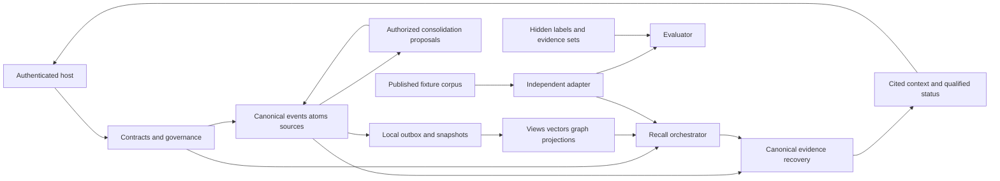

# Norn project map

Updated 20 October 2026 (Asia/Bangkok). Coverage: actual planning repository and proposed memory/research module boundaries. This map makes no claim that planned runtime exists.

## Actual repository

```text
docs/
  README.md
  vision/subcortical_memory_blueprint.md   # authoritative research intent, unchanged
  development/
    README.md                            # navigation and document roles
    MASTER_DEV_PLAN.md                   # technical design and atomic tasks
    GOAL.md, PROGRESS.md, READINESS_MATRIX.md
    PROJECT_MEMORY.md, PROJECT_MAP.md
    ADR_LOG.md, RISKS_AND_OPEN_QUESTIONS.md
    TESTING_GATES.md, REQUIREMENTS_TRACEABILITY.md
    RESEARCH_PROTOCOL.md, PROJECT_LEARNING.md, EVIDENCE_LOG.md
    check_docs.py                        # actual docs-only runnable tool
```

There is no runtime source tree, package/dependency manifest, SQL migration, model, dataset or application CLI. Directory/file names in the following map are proposals under ADR-0002, not discovered implementation.

## Proposed module map

| Module | Responsibility and owner boundary | Producer / consumer | Phase |
|---|---|---|---|
| contracts | identity, tagged values, clocks, evidence, budgets, snapshots | host/canonical → all owners | P01 |
| canonical | source bytes, registry, identity, schema, append-only controls, local outbox | authorized writes → source/recall/projection readers | P01/P03 |
| governance | current permissions, temporal basis, sufficiency, denial/purge | host/registry → every search/traversal/return | P01/P03/P11/P12 |
| extraction | source-anchored atoms, typed relation candidates, uncertainty | immutable source → registry/graph | P01/P06 |
| retrieval | exact/lexical/dense/ANN/fusion/rerank/source recovery | cue + eligible snapshot → cited memory candidates | P03 |
| features/embedding | multiple views, query/memory binding, objectives, checkpoint lineage | canonical episode → versioned derived code | P04/P05/P07/P10 |
| graph | grounded seeds, typed adjacency, bounded BFS/path/PPR/heat/optional recurrent | permitted canonical refs → candidate/path diagnostics | P06 |
| consolidation | source independence, aggregates, summary proposals, review/invalidation | eligible episodes → new supported derived assertions | P08 |
| integration | memory facade and bounded agent context | authenticated host → next-turn cited context | P01/P09 |
| projection | local readiness then external workers/manifests/rebuild/purge/restore | canonical log/outbox → coherent derived indexes | P03/P11 |
| telemetry | redacted stage/resource/failure traces | actual owners → operator/evaluator | P03 onward |
| benchmark (separate) | hidden world, publication, adapters, metrics, statistics, sealed runner/faults | published corpus + evaluator-only gold → reproducible reports | P02–P13 |

## Proposed dependencies and flows



No runtime edge points to hidden labels. Data flows preserve event→atom→source identity and per-projection version. The proposed mainline facade is in-process first; HTTP/MCP/UI is not an accepted interface or port assignment. See MDP [architecture](MASTER_DEV_PLAN.md#architecture), [schema](MASTER_DEV_PLAN.md#canonical-schema), [algorithms](MASTER_DEV_PLAN.md#graph-algorithms) and [operations](MASTER_DEV_PLAN.md#operations) for the owning design.

## Verification map

Actual documentation entry point: `python docs/development/check_docs.py`, plus its self-tests. Planned runtime tests are owned in exact atomic cards and bound to real executable commands after P01 approval. [TESTING_GATES](TESTING_GATES.md) distinguishes early phase-local checks from later multi-store and research proof. No code map or planned diagram establishes runtime readiness.
