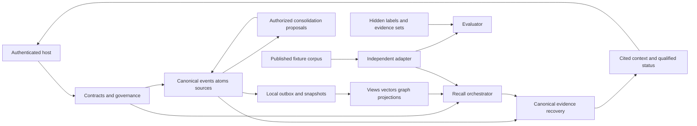

# Norn project map

Updated 22 October 2026 (Asia/Bangkok). Coverage: actual planning repository and proposed memory/research module boundaries. P01/P02/P03 are verified locally; P03 proof is E-P03-003 with scientific outcome INCONCLUSIVE. P04 implementation is active under accepted ADR-0020/0021; feature/binding/schema4/public consumers have focused E-P04-002 proof, not phase closure. P05+ remain proposals.

## Actual repository

```text
AGENTS.md                                # single project workflow; user-authorized
.gitignore                               # owner exclusion rules, committed unchanged
.env                                     # ignored owner credential file; never committed
.venv/                                   # ignored existing uv CPython3.14.7 environment
docs/
  README.md
  vision/subcortical_memory_blueprint.md   # authoritative research intent, unchanged
  development/
    README.md                            # navigation and document roles
    MASTER_DEV_PLAN.md                   # technical design and atomic tasks
    GOAL.md, PROGRESS.md, READINESS_MATRIX.md
    PROJECT_MEMORY.md, PROJECT_MAP.md
    ADR_LOG.md, RISKS_AND_OPEN_QUESTIONS.md
    TESTING_GATES.md, REQUIREMENTS_TRACEABILITY.md
    RESEARCH_PROTOCOL.md, PROJECT_LEARNING.md, EVIDENCE_LOG.md
    check_docs.py                        # actual documentation checker
```

Actual runtime includes pyproject.toml, uv.lock, src/norn/{contracts,canonical,governance,extraction,integration}, src/norn/cli.py and tests/test_*.py. canonical/schema.sql is schema1; 002_governance.sql is additive schema2 lineage. P03 adds 003_projection.sql, embedding/{assets,baseline}, retrieval/{contracts,exact,lexical,dense,fusion,rerank,resolve,assembly,service}, projection/local, canonical/snapshots and telemetry/query. These paths have source, reopened and installed-consumer proof in E-P03-003; cross-phase obligations remain open. Explicit local CPU model smoke passes; no foreign checkout import, provider or network service exists. P02 adds benchmark/{fixtures,adapters,metrics,statistics,runs}, with hidden world/gold, strict publication, control adapters, immutable ledger, scorer and CLI. Audit pack/judgments live in development/evidence; ignored models/run artifacts live in .norn/. See E-P01-003/E-P02-003/E-P03-003 for proof scope.

## Module ownership map (P01–P03 actual; later phases proposed)

| Module | Responsibility and owner boundary | Producer / consumer | Phase |
|---|---|---|---|
| contracts | identity, tagged values, clocks, evidence, budgets, snapshots | host/canonical → all owners | P01 |
| canonical | source bytes, registry, identity, schema, append-only controls, local outbox | authorized writes → source/recall/projection readers | P01/P03 |
| governance | current permissions, temporal basis, sufficiency, denial/purge | host/registry → every search/traversal/return | P01/P03/P11/P12 |
| extraction | source-anchored atoms, typed relation candidates, uncertainty | immutable source → registry/graph | P01/P06 |
| retrieval | exact/lexical/dense/ANN/fusion/rerank/source recovery | cue + eligible snapshot → cited memory candidates | P03 |
| embedding | pinned local encoder/reranker assets, explicit CPU worker lifecycle and inference | eligible sources/cues → normalized vectors/raw rerank scores | P03 actual |
| features and later embedding research | multiple views, query/memory binding, objectives, checkpoint lineage | canonical episode → versioned derived code | P04 implemented, study/review pending; P05/P07/P10 planned |
| graph | grounded seeds, typed adjacency, bounded BFS/path/PPR/heat/optional recurrent | permitted canonical refs → candidate/path diagnostics | P06 |
| consolidation | source independence, aggregates, summary proposals, review/invalidation | eligible episodes → new supported derived assertions | P08 |
| integration | memory facade and bounded agent context | authenticated host → next-turn cited context | P01/P09 |
| projection | local readiness then external workers/manifests/rebuild/purge/restore | canonical log/outbox → coherent derived indexes | P03/P11 |
| telemetry | redacted stage/resource/failure traces | actual owners → operator/evaluator | P03 onward |
| benchmark (separate) | P02 actual typed synthetic fixtures/publication/common control contracts/immutable ledger/scorers/statistics/CLI; later scientific and sealed runners planned | public capture boundary → trusted controls → immutable ledger → reopened evaluator; hidden gold only scorer/oracle diagnostic | P02/P03 actual; P04 full study running; P05–P13 planned |

## Dependencies and flows — implemented core and planned extensions



No runtime edge points to hidden labels. Data flows preserve event→atom→source identity and per-projection version. The actual local facade is in-process; graph/consolidation extensions in this diagram remain planned; P04 views/binding are implemented with final study/review pending. The mainline design is in-process first; HTTP/MCP/UI is not an accepted interface or port assignment. See MDP [architecture](MASTER_DEV_PLAN.md#architecture), [schema](MASTER_DEV_PLAN.md#canonical-schema), [algorithms](MASTER_DEV_PLAN.md#graph-algorithms) and [operations](MASTER_DEV_PLAN.md#operations) for the owning design.

P04 actual partial source: features context/semantic/action/S0/views, embedding numerical/fusion/training/checkpoint/attention/cue owners, schema4, projection/retrieval binding and opt-in Engine/CLI. Focused math and real E5 Engine B0/B1/B2/source/backup/revoke controls pass (E-P04-002); Full0024140-pair study completed; installed003 all7/source/correction/revoke/deny passes; sole source review resolved checkpoint-selector omission. Final003/artifact resolution pending (E-P04-005).

## Verification map

Documentation entry point: `.venv/Scripts/python.exe docs/development/check_docs.py`, plus its self-tests. P01/P02 tests and CLIs are real and bound in README Local foundation/Synthetic benchmark harness. P03 retrieval/model/projection paths are verified:131 tests, installed80-file parity and actual recall/native controls,540 paired development observations and444 ANN measurements (E-P03-003). Scientific outcome remains INCONCLUSIVE. P04 paths are implemented with158 passing tests,105 installed matching files and all7 installed CLI source/correction/revocation/denial consumers; full0024140-pair exploratory evidence is version-scoped, final003/artifact resolution remain pending. P05+ paths remain planned. [TESTING_GATES](TESTING_GATES.md) distinguishes early phase-local checks from later multi-store and research proof. No code map or planned diagram establishes runtime readiness.
