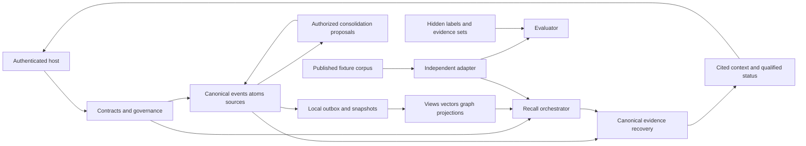

# Norn project map

Updated 21 October 2026 (Asia/Bangkok). Coverage: actual planning repository and proposed memory/research module boundaries. P01 and P02 paths below exist; P03+ research paths remain proposals.

## Actual repository

```text
AGENTS.md                                # single project workflow; user-authorized
.gitignore                               # owner exclusion rules, committed unchanged
.env                                     # ignored owner credential file; never committed
.venv/                                   # ignored existing uv CPython3.14.7 environment
docs/
  README.md
  vision/subcortical_memory_blueprint.md   # authoritative research intent, unchanged
  development/
    README.md                            # navigation and document roles
    MASTER_DEV_PLAN.md                   # technical design and atomic tasks
    GOAL.md, PROGRESS.md, READINESS_MATRIX.md
    PROJECT_MEMORY.md, PROJECT_MAP.md
    ADR_LOG.md, RISKS_AND_OPEN_QUESTIONS.md
    TESTING_GATES.md, REQUIREMENTS_TRACEABILITY.md
    RESEARCH_PROTOCOL.md, PROJECT_LEARNING.md, EVIDENCE_LOG.md
    check_docs.py                        # actual documentation checker
```

Actual runtime now also includes pyproject.toml, uv.lock, src/norn/{contracts,canonical,governance,extraction,integration}, src/norn/cli.py and tests/test_*.py. canonical/schema.sql is schema1; 002_governance.sql is additive schema2 lineage. Tests and installed CLI consume the same owners; no foreign checkout import, model or network service exists. P02 adds benchmark/{fixtures,adapters,metrics,statistics,runs}, with hidden world/gold, strict publication, control adapters, immutable ledger, scorer and CLI. Audit pack/judgments live in development/evidence; ignored run artifacts live in .norn/. See E-P01-003/E-P02-003 for proof scope.

## Module ownership map (P01/P02 actual; later phases proposed)

| Module | Responsibility and owner boundary | Producer / consumer | Phase |
|---|---|---|---|
| contracts | identity, tagged values, clocks, evidence, budgets, snapshots | host/canonical → all owners | P01 |
| canonical | source bytes, registry, identity, schema, append-only controls, local outbox | authorized writes → source/recall/projection readers | P01/P03 |
| governance | current permissions, temporal basis, sufficiency, denial/purge | host/registry → every search/traversal/return | P01/P03/P11/P12 |
| extraction | source-anchored atoms, typed relation candidates, uncertainty | immutable source → registry/graph | P01/P06 |
| retrieval | exact/lexical/dense/ANN/fusion/rerank/source recovery | cue + eligible snapshot → cited memory candidates | P03 |
| features/embedding | multiple views, query/memory binding, objectives, checkpoint lineage | canonical episode → versioned derived code | P04/P05/P07/P10 |
| graph | grounded seeds, typed adjacency, bounded BFS/path/PPR/heat/optional recurrent | permitted canonical refs → candidate/path diagnostics | P06 |
| consolidation | source independence, aggregates, summary proposals, review/invalidation | eligible episodes → new supported derived assertions | P08 |
| integration | memory facade and bounded agent context | authenticated host → next-turn cited context | P01/P09 |
| projection | local readiness then external workers/manifests/rebuild/purge/restore | canonical log/outbox → coherent derived indexes | P03/P11 |
| telemetry | redacted stage/resource/failure traces | actual owners → operator/evaluator | P03 onward |
| benchmark (separate) | P02 actual typed synthetic fixtures/publication/common control contracts/immutable ledger/scorers/statistics/CLI; later scientific and sealed runners planned | public capture boundary → trusted controls → immutable ledger → reopened evaluator; hidden gold only scorer/oracle diagnostic | P02 actual; P03–P13 studies planned |

## Proposed dependencies and flows



No runtime edge points to hidden labels. Data flows preserve event→atom→source identity and per-projection version. The proposed mainline facade is in-process first; HTTP/MCP/UI is not an accepted interface or port assignment. See MDP [architecture](MASTER_DEV_PLAN.md#architecture), [schema](MASTER_DEV_PLAN.md#canonical-schema), [algorithms](MASTER_DEV_PLAN.md#graph-algorithms) and [operations](MASTER_DEV_PLAN.md#operations) for the owning design.

## Verification map

Documentation entry point: `.venv/Scripts/python.exe docs/development/check_docs.py`, plus its self-tests. P01/P02 tests and CLIs are real and bound in README Local foundation/Synthetic benchmark harness; P03+ runtime paths remain planned. [TESTING_GATES](TESTING_GATES.md) distinguishes early phase-local checks from later multi-store and research proof. No code map or planned diagram establishes runtime readiness.
